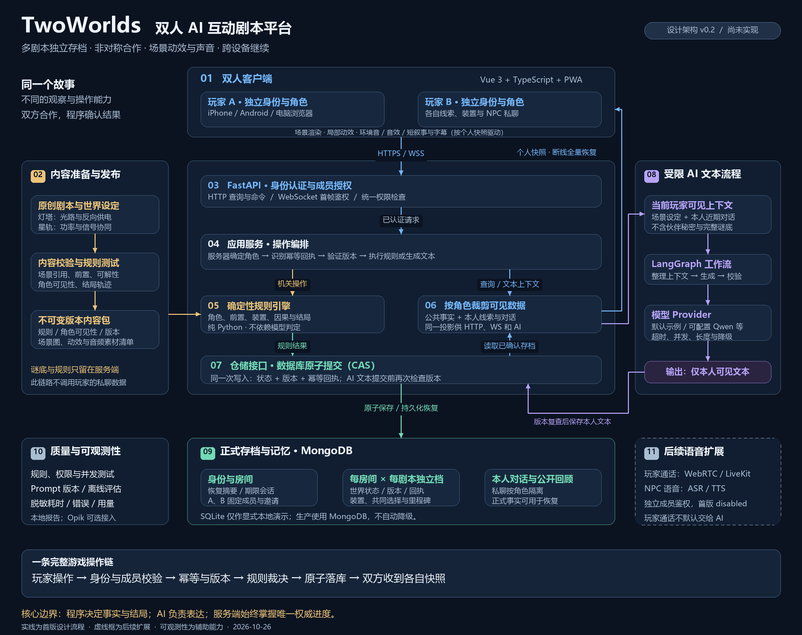
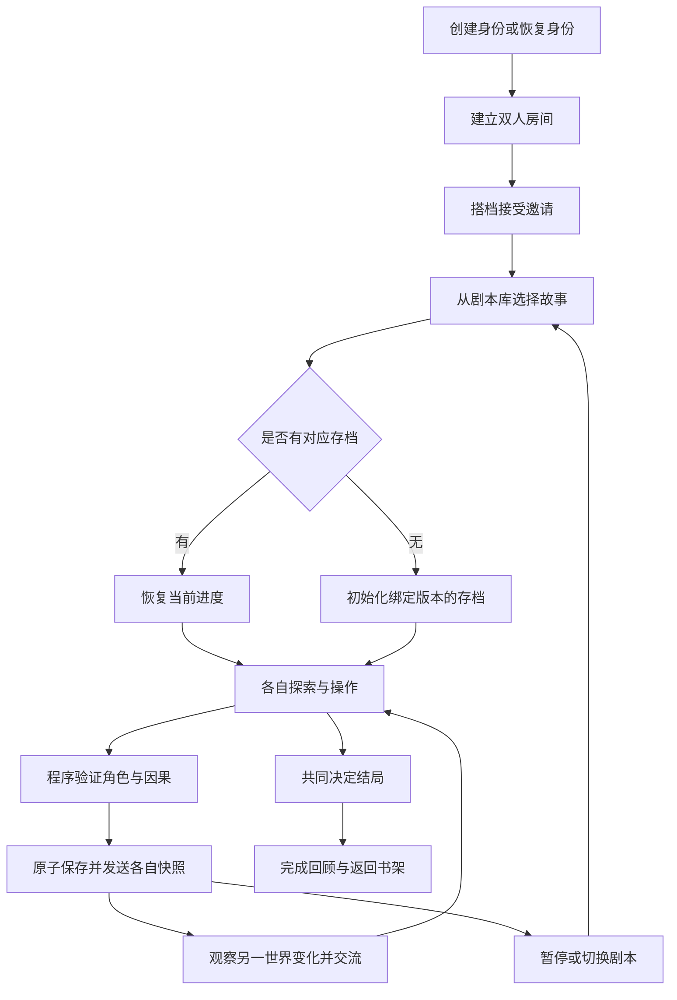

# TwoWorlds 项目文档入口

> 版本：v0.2 设计提案 · 2026-10-26  
> 项目目录：`F:\two-worlds-agent-game`  
> 2026-11-15 · PR #20已合并；本轮T09.1增加《末班星轨》正式内容与纯Python规则，等待独立PR审查。专项96、灯塔123、内容202通过；完整回归与边界见[星轨报告](docs/reports/starline-engine.md)。两剧本正式素材/许可未完成，T09.2跨档验证未开始。

TwoWorlds 是面向异地情侣、也允许双人朋友使用的 AI 互动剧本平台。两个人进入同一剧本，拥有不同的观察信息与操作能力，通过探索、试验和交流改变彼此的世界。平台提供多个剧本，每个剧本保存各自的进度和记忆，手机与电脑可以继续同一段旅程。

首版采用场景插画、可交互的局部动画、环境音/事件音效和必要短叙事音频。关键世界变化需要实际看得见，不能全程只靠文字推进；文字与字幕同时作为说明和无障碍替代。

**最终体验：今晚选一个世界，邀请搭档一起进入；两人真正配合完成一章，随时暂停，换设备后继续。**

## TwoWorlds 自有架构图

[PNG 高清图](docs/assets/twoworlds-architecture-v0.2.png) · [可编辑 SVG](docs/assets/twoworlds-architecture-v0.2.svg) · [架构说明](docs/03-技术架构与数据接口.md)

这张图对应当前设计提案，虚线框表示后续语音扩展，尚不代表系统已经实现。

## 一、先看哪些文档

| 阅读顺序 | 文档 | 解决什么问题 |
| --- | --- | --- |
| 1 | [产品需求与用户流程](docs/01-产品需求与用户流程.md) | 为谁做、每个环节做什么、页面展示什么、异常怎么处理 |
| 2 | [玩法系统与首批剧本](docs/02-玩法系统与首批剧本.md) | 两人为什么缺一不可、因果联动如何实现、首批两剧本怎么玩 |
| 3 | [技术架构与数据接口](docs/03-技术架构与数据接口.md) | 模块边界、身份、存档、AI、数据库、HTTP 与 WS 契约 |
| 4 | [开发阶段与任务清单](docs/04-开发阶段与任务清单.md) | 先做什么、每个任务交付什么、依赖什么、如何验收 |
| 5 | [测试验收与交付标准](docs/05-测试验收与交付标准.md) | 哪些测试必须过、如何演示、什么时候可以称为完成 |
| 6 | [版本路线与商业验证](docs/06-版本路线与商业验证.md) | 首版与后续功能、试用与盈利验证、关键取舍与需求来源 |
| 7 | [场景动效与音频设计](docs/07-场景动效与音频设计.md) | 场景画面、因果动画、基础音频、素材权限、播放与验收 |

建议先阅读本文和文档 01、02，理解产品；技术开发再依次阅读 03、04、05。所有文档的章节可通过 Markdown 预览中的大纲跳转。

已开始代码学习时，可从[后端README](backend/README.md)和[T00.2.2工程报告](docs/reports/backend-layout.md)进入，先理解包布局与开发环境，再进入后续行为测试。

T00.3的[测试阅读入口](backend/tests/README.md)解释新请求、回执、身份和两剧本轨迹；[基线修订报告](docs/reports/baseline-changes.md)记录旧稿迁移关系与尚未实现范围。

T01.1从[测试专用JSON](backend/tests/content/fixtures/minimal.json)和[Schema模型](backend/src/twoworlds/content/schema.py)开始，理解程序如何拒绝坏内容；阅读/运行步骤见[本轮报告](docs/reports/content-schema.md)。该小样不是正式剧本，也不提供实际图片/音频。

T01.2.1增加[版本加载器](backend/src/twoworlds/content/loader.py)与[加载测试](backend/tests/content/test_loader.py)：只读指定id+version，不猜测替代版本；路径、JSON、Schema或标识错误会明确拒绝。步骤与实际工作树位置见[加载器报告](docs/reports/content-loader.md)。

T01.2.2增加[正式灯塔1.0.0](backend/src/twoworlds/content/scripts/lighthouse/1.0.0.json)与[内容完整性测试](backend/tests/content/test_lighthouse_content.py)，包含四场景、双角色动作/线索、两个共同结局和视听声明；媒体仍待制作，规则仍待实现。阅读顺序与源码加载命令见[本轮报告](docs/reports/lighthouse-content.md)。

T01.2.3从[发布库](backend/src/twoworlds/content/publication.py)、[包内访问](backend/src/twoworlds/content/packaged.py)与[构建钩子](backend/hatch_build.py)开始：草稿不能自动成为已发布版本，目录仅返回已审核、哈希完整版本的Metadata。wheel/sdist、独立安装与临时媒体集成结果见[发布报告](docs/reports/content-publication.md)；没有新增HTTP接口。

T02从[规则入口](backend/src/twoworlds/domain/engine.py)与[实际通关测试](backend/tests/domain/test_lighthouse.py)开始：两角色按不同权限操作、共同决定结局，所有成功变化返回新状态，拒绝/重复无变化不增加版本。54个可达世界状态的恢复与两结局可达已检查；阅读顺序、纯Python演示与边界见[规则报告](docs/reports/lighthouse-engine.md)。完整状态仍只供服务端。

T03.1从[个人投影](backend/src/twoworlds/domain/projection.py)与[投影测试](backend/tests/domain/test_projection.py)开始：同一世界分别构造A/B冻结快照，线索/装置/观察/动作/媒体只返回本人或已合法公开的内容；命令与投影共用状态验证。90个新增测试通过，复现步骤见[本轮报告](docs/reports/player-projection.md)。没有线索分享命令、公共回顾、对话历史或HTTP/WS/AI集成，本轮完成后停止。

## 二、需求依据与本次变更

本次文档结合了以下材料：

1. [完整原始聊天记录](work/TwoWorlds-原始聊天记录.md)：已从公开分享页提取，包含多剧本、谜题太简单、三端同步及未来语音等后续讨论。该记录仅保留本机，按.gitignore排除，GitHub副本中此本地链接不可用；产品决定已整理在docs中。
2. [旧版项目设计与实施计划](outputs/TwoWorlds-项目设计与实施计划.md)。
3. [旧版开工说明](outputs/TwoWorlds-Codex开工说明.md)。
4. [旧版实施草稿](outputs/twoworlds/docs/IMPLEMENTATION.md)及现有测试草稿。
5. 本地参考仓库 `F:\ai-agent-game\philoagents-course` 的说明与核心代码。
6. 根据当前方案绘制的 [TwoWorlds 自有架构图](docs/assets/twoworlds-architecture-v0.2.png)，及[流程与质量流水线说明](docs/03-技术架构与数据接口.md#14-twoworlds-架构图与流程说明)。

用户后续明确要求的是“多剧本平台”，并指出单纯读数字、输入密码太简单。因此，本次保留现有技术边界与首版两个短剧本的范围，重新设计玩法与开发顺序。

| 项目 | v0.2 的处理 |
| --- | --- |
| 产品形态 | 剧本库 + 双人房间 + 各剧本独立存档 |
| 首批内容 | 保留《跨时灯塔》《末班星轨》名称，重新设计两种不同的合作机制 |
| 谜题 | 从交换固定答案升级为探索、操作、观察变化、反馈、共同决定 |
| 分享线索 | 默认作为沟通辅助；必需前置由具体剧本规则明确声明，不统一强制点“分享” |
| 连续七晚 | 可作为未来某一剧本的内容形式，不作为整个平台的固定规则 |
| 技术一致性 | 恢复密钥与短期会话分离；数据库 CAS；状态与回执原子提交；按角色投影 |
| 现有测试 | 保留权限、并发、恢复等测试意图，重写简单六步通关和旧身份契约 |

本文档集是用户要求编写的**新设计提案**。用户后续明确补充首版应有动态图片与音频，已写入文档07与相关任务/验收。具体素材数量、剧本细节、默认额度、会话期限和体验指标是设计建议，并非用户此前逐项确认的事实。旧文件保留溯源，其冲突描述不再用于指导新实现。

## 三、首版最终交付什么

| 交付能力 | 用户能实际做到什么 |
| --- | --- |
| 身份与恢复 | 创建个人身份，保存恢复密钥，在新设备恢复同一身份 |
| 双人房间 | 创建房间并邀请搭档，固定两个角色，第三人无法加入或读档 |
| 剧本库 | 查看两个剧本的题材、角色、预计时长和独立进度 |
| 真正合作 | 两人操作不同系统，观察彼此引起的变化，共同完成机关和选择 |
| 视听场景 | 各自场景插画、物件交互、光路/供电/轨道变化，以及受控播放的声音与字幕 |
| 独立存档 | 两个剧本可以交替玩；场景、物品、对话、进度互不混用 |
| 自动保存与恢复 | 每次被服务器接受的操作自动保存，刷新和服务重启后能继续 |
| 实时同步 | 接收各自可见的最新状态，断线后重新鉴权恢复 |
| AI NPC | 无密钥使用清楚标示的示例回复；可配置真实模型 Provider |
| 多端网页 | Vue PWA 适配 iPhone、Android 与电脑；真机验证结果单独记录 |
| 工程交付 | 源码、配置样例、容器、部署与运行说明、测试报告 |

首版每个房间、每个剧本一个存档；通关档可回看。目标体验时长每剧本约 10–20 分钟，实际时长必须由试玩测量。

实时语音通话、任意NPC回复在线配音、支付、订阅、公开投稿、原生 App、多存档槽、七章长篇和插画纪念册列入后续路线。场景图、因果动画、环境音、事件音效与预制短叙事音频属于首版必需，不以语音接口disabled为由省略。

## 四、整体工作流程

## 五、开发顺序与里程碑

| 阶段 | 重点 | 该阶段结束时可检查的成果 |
| --- | --- | --- |
| M0 文档与基线 | 对齐范围、文件、契约和剧本 | 本文档集、测试修订清单、工程目录方案 |
| M1 玩法核心 | 先证明两个世界真的联动 | 无界面条件下通关灯塔；纯规则与投影测试 |
| M2 持久化与身份 | 身份、配对、CAS、幂等、存档 | HTTP 能以两个身份通关并重启恢复 |
| M3 第二剧本与内容协议 | 证明不是两套硬编码应用 | 第二机制、切档隔离、通用规则组件 |
| M4 前端与同步 | 两个独立浏览器看见并听到合作变化 | 房间、书架、场景/装置动效、基础音频与字幕、回顾、重连和PWA |
| M5 AI 与能力接口 | NPC、叙事表达、模型隔离 | 示例模式、可配置 Provider、语音 disabled |
| M6 完整验收 | Mongo、双浏览器、真机记录、部署 | 可复现演示、测试报告、运行与部署手册 |
| M7 小范围试用 | 验证是否好玩、是否愿意回来 | 体验问题清单、继续/改版判断、商业验证数据 |

不把阶段直接换算成固定日历承诺。依赖版本、Docker/Mongo 可用性、内容制作和真机测试条件在开工时检查，依据实际结果安排工期。

## 六、当前实际状态

| 项目 | 状态 | 说明 |
| --- | --- | --- |
| 原始材料迁入当前目录 | 已完成 | 保留 `outputs`、`work`，迁移文件已校验 |
| 完整聊天读取与归档 | 已完成 | 有原始页面与提取记录 |
| 本地参考仓库核心代码阅读 | 已完成部分 | 已看说明、API、身份、AI 图与对话、前端会话等核心路径 |
| 本地参考仓库提交核实 | 已核实 | HEAD为`211033c6785c29cbe79e053ebc5f3219e5f0051f`；另有未跟踪test/目录 |
| v0.2 项目文档 | 本次交付 | 设计提案，尚未代表业务功能落地 |
| 后端/前端运行 | 内容能力与灯塔纯规则可运行 | [backend](backend/README.md)可执行两结局合作轨迹；尚无玩家投影、业务API或前端，灯塔未发布 |
| 测试、Mongo 真库、真机、部署 | 未通过完整产品验收 | 123领域+191内容通过；38个契约仍缺业务实现；Mongo真库、真机、部署未验证 |
| T00.1工作区与环境检查 | 已完成 | [环境报告](docs/reports/environment.md)；Python/Node和Edge探针可用；20:55复核Docker引擎可连接，Mongo仍未验证 |
| 本地Git与GitHub仓库 | 已创建并推送 | [仓库设置报告](docs/reports/repository-setup.md)；[私有远端](https://github.com/ajsjsjjbshshsj/two-worlds-agent-game)，默认分支codex/bootstrap |
| T00.2.2工程包布局 | 完成待观察 | [工程报告](docs/reports/backend-layout.md)；项目独立环境、uv.lock、9个包文件与wheel验证 |
| T00.3旧测试契约修订 | 完成待观察 | [基线修订报告](docs/reports/baseline-changes.md)；38个可收集契约条目因缺实现失败，不能计作产品测试通过 |
| T01.1内容结构与静态校验 | 已完成 | [Schema报告](docs/reports/content-schema.md)；字段、引用、有限原语与角色媒体声明，实际规则尚未开始 |
| T01.2.1版本加载器 | 已完成 | [加载器报告](docs/reports/content-loader.md)；按版本只读加载与明确失败，PR #4已合并 |
| T01.2.2正式灯塔四场景 | 已完成 | [正式内容报告](docs/reports/lighthouse-content.md)；36个新增检查，PR #5已合并；实际规则尚未实现 |
| T01.2.3发布/目录/资源打包 | 已完成 | [发布报告](docs/reports/content-publication.md)；PR #6已合并；灯塔尚未发布 |
| T02灯塔纯规则引擎 | 完成待审查 | [规则报告](docs/reports/lighthouse-engine.md)；双向因果、两结局、错误不变、有限状态恢复验证 |

## 七、开发交接规则

跨聊天与跨 Agent 的执行约定见 [AGENTS.md](AGENTS.md)，当前状态见 [开发进度与交接](docs/开发进度与交接.md)。新聊天先读取这两个文件，再核对当前代码与对应设计。

开始业务实现时，从文档 04 的 T00 开始，先检查环境和现有改动。**一次只执行一个任务或已拆分的子环节；完成、验证、讲解和记录后必须停止，等用户观察代码并明确要求继续，再推进下一环节。** 每完成一项，在任务清单更新实际状态，并在文档 05 的报告格式记录验证证据。

任何阶段不得把计划、模拟回复、静态页面、SQLite 通过结果或容器配置写成已完成的生产系统。遇到玩法范围变化先更新对应需求、剧本与验收项，再调整代码。
