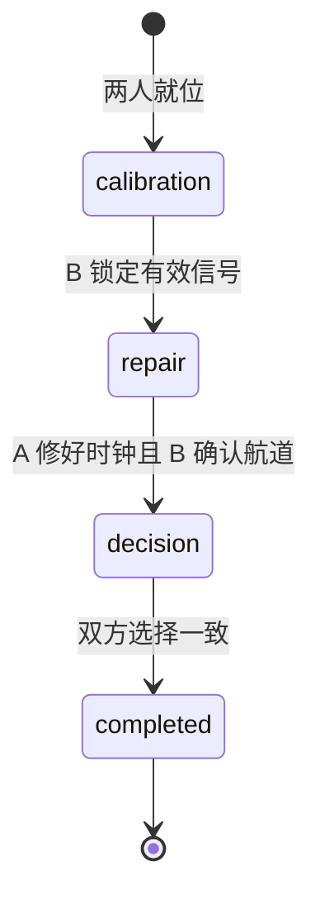

# 02 · 玩法系统与首批剧本

> v0.2玩法设计 · 2026-10-26。灯塔纯规则已实现；2026-11-15的T09.1增加星轨正式内容与纯规则，见[星轨报告](reports/starline-engine.md)。正式视听、星轨HTTP/跨档和实际游玩与目标时长仍未验证，T09.2未开始。本文保留既定玩法，不把领域测试当完整产品验收。
>
> 本文件含机关解法，属于开发与内容验收资料；不得整份作为前端资源、公开剧本 API 或 NPC 上下文发送。

## 1. 玩法需要解决的问题

场景、装置与世界变化同时采用插画、局部动画和基础音频呈现，不能全靠文字描述推进。两套剧本的逐节点画面/声音要求见[视听设计](07-场景动效与音频设计.md)，媒体只演绎已确认事实。

用户已经指出：“一人看到数字，另一人看到密码框”缺少探索与合作。本版的每个主机制必须包含以下闭环：

共享事实由规则决定，叙事文本只能描述这些事实。两人无需按毫秒同步，也不依赖现实世界反应速度。

## 2. 两套剧本为什么不同

| 项目 | 跨时灯塔 | 末班星轨 |
| --- | --- | --- |
| 主要机制 | 跨时空装置改变、观察反馈、反向供能 | 有限功率分配、切换系统、路线与信号协同 |
| A 能做什么 | 操作旧灯塔发射器、维修时钟 | 操作站台轨道、开启水闸、安装导轨 |
| B 能做什么 | 观察未来光路、调滤镜、路由能源 | 分配列车功率、声呐扫描、确认站台信号 |
| 核心推理 | 调节哪个变量会改变哪种观测 | 同时开不了所有系统，必须按阶段分配 |
| 双向联动 | A 的光改变 B；B 供电开放 A 的维修 | A 打开回声路径；B 扫描开放 A 的导轨；A 安装后 B 可发车 |
| 共同选择 | 立即引航 / 等待下一次潮汐 | 绕行救援 / 直接归站 |
| 避免的重复 | 不出现“731→北极星”固定六步模板 | 不复制灯塔换个密码和名称 |

当前每套 1.0.0 规则仍为 4 个主要状态场景；目标体验调整为约 1 小时。未来叙事可拆为约 6 章，但章节不等于状态机 Scene。需增加有意义的双人调查、验证、机关阶段和叙事反馈，不能靠堆 NPC 字数、重复点击或等待凑时长。新增状态事实/动作必须经规则引擎确定性验证；现有 1.0.0 的动作、权限、前置和结局保持不变。

## 3. 共用规则与内容协议

### 3.1 游戏内概念

| 概念 | 定义 | 归属 |
| --- | --- | --- |
| Script | 已发布、带不可变内容版本的剧本定义 | 内容 |
| Scene | 当前可探索场景及进入/完成条件 | 内容 |
| Fact | 已确定的结构化事实，如 `clock_repaired=true` | 存档 |
| Observation | 当前玩家可见的事实表达 | 角色投影 |
| Device | 有受限配置的装置，如角度与滤镜 | 存档 |
| Clue | 可发现、可选择公开的信息 | 内容 + 发现状态 |
| Action | 指定角色在条件满足时可执行的命令 | 规则 |
| Ending | 双方选择及规则共同确定的结局 ID | 存档 |
| Narrative | 基于已确认事实的可替换文本 | 展示/AI |

### 3.2 统一的动作形式

对外统一提交 `{request_id, expected_version, kind, args}`。`kind` 是枚举，`args` 按动作类型验证；前端不提交角色、物品所有者、完整状态或完成标志。

每个动作必须声明：允许角色、场景、参数、前置条件、产生的事实、两角色观察变化、是否允许重复、可能错误码。首次发现线索需写入；重新阅读已发现内容只是前端展示。

合法且有变化的操作更新版本并保存回执；不满足条件或与当前配置相同的操作返回业务错误，不消耗已接受命令额度。网络重复提交依据回执确认，不再次执行规则。

### 3.3 线索与提示

分享动作只把玩家已发现的线索加入公共栏，不能凭客户端文本创造事实。默认不要求先点分享才能操作，双方可以口头交流；特定剧情若需要正式交接，必须在该动作规则中单独声明。

提示由每场景三档模板定义，不能读取伙伴隐藏信息后泄露。提示只引导当前已开放的能力。例如“请让另一位玩家观察你调节装置后的变化”，而非提前告知对方未发现的完整装置表。

### 3.4 可恢复性

- 配置试验可反复调整；机关完成后锁定已完成阶段的关键配置，防止回滚因果。
- 错误答案或前置不足不改变状态、版本、对话和回执。
- 没有现实时间倒计时、永久失败、死亡重开和随机软锁。
- 共同选择不一致时允许修改自己的选择；两人一致后只结算一次，完成档不再改选。
- 关键事实保存在结构化里程碑里，不能只依赖会截断的最近事件列表。

## 4. 剧本一：《跨时灯塔》

### 4.1 故事与角色

旧时守灯人 A 在尚能工作的灯塔，未来观星者 B 在风暴后的观测站。两人要重建跨时空信标，让失去方向的船找到安全航道。

| 项目 | A | B |
| --- | --- | --- |
| 初始可见 | 旧灯塔、维护日志、发射器、断电的时钟箱 | 观测台、航道图、滤镜、备用供电台 |
| 初始不可见 | B 的航道目标、观测地名、滤镜实际结果 | A 的维护日志、时钟结构与维修提示 |
| 独有操作 | 设置发射角度/光型，安装齿轮并维修 | 设置滤镜、锁定信号、路由供电、确认航道 |
| 必需贡献 | 发射正确光束、完成维修、做出结局选择 | 校准观测、为过去供电、确认航道、做出结局选择 |

### 4.2 场景与状态

#### 场景 1：看不见的光路

验收初态：`calibration`场景，发射器为`angle=0, pattern=steady`，滤镜为`clear`；尚未发现线索、没有完成事实和结局投票。这使下面第一次`0°/pulse`设置是真实变化，而非无变化重复操作。T01将这些初值固化进版本化内容。

1. A 检查维护日志，得知发射器有四档角度；脉冲信号需要琥珀滤镜才能被稳定识别。
2. B 检查航道图，得知船需要的是“内湾航道”，并发现自己的滤镜控制。
3. A 试调角度与连续/脉冲光。每次合法变化立即改变 B 的观测描述。
4. B 调整滤镜，向 A 反馈“暗礁方向”“内湾方向”或“光太散”等观察。A 的响应不包含这些 B 私有观察。
5. B 判断组合正确后执行锁定信号。只有实际条件成立时进入维修场景。

**开发用真值表：**

| A 角度 | B 看到的方向 |
| --- | --- |
| 0° | 暗礁 |
| 90° | 内湾航道 |
| 180° | 观测山 |
| 270° | 外海港 |

有效锁定条件：A 已看日志，B 已看航道图，角度 90°，光型 `pulse`，B 滤镜 `amber`。连续光或其他滤镜只产生模糊观察，不满足锁定；错误锁定返回 `SIGNAL_UNSTABLE`。

调试器可以保存真值表，正式浏览器只得到当前方向描述与合法控制项。B 看到的是 A 调节的结果，不会看到 A 的整个私人日志。

#### 场景 2：未来为过去供电

1. 锁定信号后，B 开放供电台，A 看见时钟箱仍无电。
2. B 可选向 `tower`、`shore`、`observatory` 三处供电。
3. 只有 `tower` 会点亮 A 的时钟箱并开放齿轮检查；其他选项给两人各自合理的环境反馈。
4. A 检查齿轮，获得维修工具与“稳定模式可避免二次错齿”的本地说明。
5. A 在供电仍为 `tower` 时选择 `steady` 维修，写入 `clock_repaired=true`。`fast` 是失败尝试，不损坏物品。

这里 B 的行为真正改变了 A 的可操作对象，不能用 A 自行点击“我已有电”绕过。

#### 场景 3：互相验证

1. 时钟修好后，B 的航道扫描开放，看到内湾信号稳定。
2. B 执行 `confirm_route`，条件是时钟已修好、供电仍为 `tower`。
3. 系统进入结局决策，展示两人已共同确定的事实与两种合理选择。

维修完成后齿轮事实保留；若 B 在确认前改变供电，只影响当前扫描可用性，切回即可恢复，不会删除 A 的已完成贡献。

#### 场景 4：共同决定

可选 `guide_now`（立即引航）或 `wait_tide`（等待下一次潮汐）。两个选择都可完成，各自对应确定的结局与公开回顾。它们是叙事取舍，不是隐藏的单一正确答案。

双方选择不同时提示讨论；任一方可修改自己的选择。投票内容可公开，点击前明确告知。第二份一致选择原子触发结局，只写入一次完成里程碑。

### 4.3 具体动作规格

| kind / args | 角色 | 条件 | 结果 |
| --- | --- | --- | --- |
| `inspect {target:maintenance_log}` | A | calibration | 解锁发射器说明与 A 私线索 |
| `inspect {target:sea_chart}` | B | calibration | 解锁航道目标与滤镜 |
| `set_emitter {angle,pattern}` | A | 已看日志、calibration | 角度 ∈ 0/90/180/270；pattern 为 steady/pulse；更新 B 观察 |
| `set_filter {filter}` | B | 已看航道图、calibration | filter 为 clear/blue/amber；改变 B 的当前观察 |
| `lock_signal {}` | B | 有效锁定条件全部满足 | 进入 repair，锁住第一场配置 |
| `route_power {target}` | B | repair | target 为 tower/shore/observatory；更新 A 可操作状态 |
| `inspect {target:clock_gears}` | A | repair 且 tower 有电 | 获得维修工具和方式说明 |
| `repair_clock {mode}` | A | 有工具、tower 有电、mode=steady | 设置维修事实，开放 B 扫描 |
| `confirm_route {}` | B | clock_repaired 且 tower 有电 | 进入 decision |
| `vote_ending {choice}` | A/B | decision | 一致后完成，choice 为 guide_now/wait_tide |

`share_clue`、`request_hint`、`talk` 为通用命令。分享只能使用已发现的 clue ID。全部游戏写入需要房间满员；角色越界即拒绝。

### 4.4 一条验收通关轨迹

A 查日志 → B 查图 → A 设置 0°/pulse → B 设置 amber 并观察暗礁 → A 改为 90°/pulse → B 锁信号 → B 供电 tower → A 检查齿轮 → A steady 维修 → B 确认航道 → A 选 guide_now → B 选 guide_now → 完成。

这只是最短合理轨迹之一。测试还要覆盖错误滤镜、错误供电、提前维修、投票分歧与重新选择。

## 5. 剧本二：《末班星轨》

### 5.1 故事与角色

A 在失落的星轨站台，B 在即将失去能源的末班列车。站台缺导轨、列车能源不能同时支持所有设备，双方需要轮流创造对方可用的条件。

| 项目 | A：站台记录员 | B：列车驾驶员 |
| --- | --- | --- |
| 独有信息 | 站台管线、检修记录、回声路径 | 功率表、声呐界面、最终信号标识 |
| 独有能力 | 开回声闸、安装导轨、选接车轨道 | 分配能源、扫描、确认信号、启动列车 |
| 需要对方 | B 扫描后才知道缺轨段，B 信号确认后才可接车 | A 开闸才能扫描，A 安装后才可行车 |

### 5.2 功率模型

总预算 5 单位：引擎 `engine` 占 3，声呐 `sonar` 占 3，信号灯 `lamp` 占 1。开关为布尔值，超过预算的方案整个拒绝，不部分应用。

验收初态：`survey`场景，回声闸为`closed`，三个能源开关均关闭；尚未扫描、安装导轨、确认信号或投票。T01/T09随版本化内容固化，不依靠测试运行时修改世界事实。

| 场景 | 可用配置示例 | 为什么要切换 |
| --- | --- | --- |
| 声呐勘测 | engine=false, sonar=true, lamp=true，总计 4 | 引擎噪声不能干扰勘测，且不能同时开两个大设备 |
| 信号与发车 | engine=true, sonar=false, lamp=true，总计 4 | 必须先完成勘测再把功率转到引擎 |
| 错误配置 | engine=true, sonar=true，总计 6 | 超过预算，返回 POWER_BUDGET_EXCEEDED |

能源不随现实时间下降，避免离线期间造成不可恢复失败。预算和设备成本属于服务端规则，前端只拿到当前角色允许看到的面板。

### 5.3 四个场景

**场景 1：让回声抵达。** A 检查站台检修记录，发现需要先打开东侧回声闸，同时读到本站“蓝色双闪接二号轨、白色常亮接一号轨、黄色单闪接三号轨”的标识。B 检查功率板。A 切换回声闸，改变 B 的扫描可用性。其他闸位为可恢复试验，只有 `east` 开放真实回声通道。

**场景 2：轮流启用系统。** B 在 east 闸、声呐开、引擎关时扫描，获得缺轨段位置 `bridge_2`；此结果作为经过扫描的共享工程事实开放 A 的对应安装动作。A 安装导轨后写入 `rail_installed=true`，B 才获得可行车反馈。未扫描不得直接猜 bridge_2 安装，前置必须成立。

**场景 3：交换信号。** B 关闭声呐、开启引擎与信号灯；列车面板显示目标是“蓝色双闪”，B 确认后该信号成为公共事实。A 按自己的站台标识将接车轨道设为 `track_2`。只有 B 已确认、A 轨道正确、导轨完成且能源配置满足时，B 可启动接车。

**场景 4：共同决定。** 接车成功后双方选择 `rescue_detour`（绕行救援）或 `return_station`（直接归站）。两个结局合法；分歧时可以修改自己的选择，一致后结算。

### 5.4 状态与动作

状态序列为 `survey → boarding → decision → completed`；勘测和导轨安装都在 survey，安装成功后进入 boarding。

| kind / args | 角色 | 条件 | 结果 |
| --- | --- | --- | --- |
| `inspect {target:station_log}` | A | survey | 解锁回声闸说明 |
| `inspect {target:power_board}` | B | survey | 解锁预算与能源面板 |
| `set_echo_gate {position}` | A | survey、已看日志 | position 为 west/east/closed；改变 B 可扫描性 |
| `allocate_power {engine,sonar,lamp}` | B | 已看功率板、survey/boarding | 验证总功率≤5，原子改变全部开关 |
| `scan_track {}` | B | east 闸、sonar 开、engine 关 | 写入扫描事实，公开 bridge_2 缺轨位置 |
| `install_rail {segment}` | A | 扫描完成、segment=bridge_2 | 写入 rail_installed，进入 boarding，锁定闸位 |
| `confirm_signal {}` | B | boarding、lamp 开 | 公布蓝色双闪，解锁 A 的接车轨道设置 |
| `set_platform {track}` | A | boarding、信号已确认 | track 为 track_1/track_2/track_3 |
| `dispatch_train {}` | B | rail_installed、track_2、信号确认、engine 开、lamp 开、sonar 关 | 成功接车，进入 decision |
| `vote_ending {choice}` | A/B | decision | choice 为 rescue_detour/return_station；一致完成 |

### 5.5 一条验收通关轨迹

A 查记录 → B 查功率板 → A 打开 east → B 开 sonar/lamp、关 engine → B 扫描 → A 安装 bridge_2 → B 开 engine/lamp、关 sonar → B 确认信号 → A 选择 track_2 → B 接车 → 双方同选结局 → 完成。

与灯塔分别测试：同角色不能操作对方系统；提前安装失败；超预算不改变任何开关；少一人操作无法完成；切去灯塔回来能源设置原样保留。

## 6. 统一剧本定义结构

每个版本至少含以下字段，具体 JSON Schema 在 T01 固化：

| 区域 | 必填内容 | 验证规则 |
| --- | --- | --- |
| metadata | id、content_version、标题、简介、角色、难度、预计时长 | ID 唯一，版本发布后不可改 |
| initial_state | 初始场景、装置、发现状态、共同选择、完成标志 | 引用对象必须存在，无预先泄露的私线索 |
| scenes | 场景 ID、进入条件、观察模板、完成条件 | 无悬空跳转，所有结局可达 |
| clues | ID、所属角色、发现条件、可分享性、文本 | 未发现不得投影，分享后只公开指定文本 |
| devices | ID、允许角色、可选配置、观察映射 | 参数范围受限，不能执行任意代码 |
| actions | 角色、类型、前置、效果、错误、事件模板 | 只调用注册的规则原语 |
| endings | 结局 ID、共同选择映射、确定回顾模板 | 每个合法结局有验收轨迹 |
| npc | 公开角色设定、允许话题、提示模板 | 不含整份谜底与伙伴私有事实 |
| presentation / media | 角色场景、可视状态、演出标识、图像/音频引用、字幕及来源许可 | 随内容版本固定；投影后只暴露当前角色获准素材；关键状态有替代观察 |

引擎提供一小组白名单原语：发现线索、设置装置、检查条件、产生角色观察、写入事实、切场景、共同选择。复杂机制允许新增经过测试的 Python 处理器；不使用 `eval` 或把 JSON 当任意可执行脚本。

新增剧本主要增加配置和内容测试。若机制超出已有原语，应新增独立处理器及契约测试，而不是复制 API、身份、仓储和同步代码。

### 6.1 T01.1已实现的静态结构

Schema入口为`content.schema.ScriptVersion`；顶层新增明确的facts声明。设备各字段的choices/initial_value、事实的initial_value属于不可随存档修改的内容定义；initial_state记录起始场景与空的发现/分享/投票集合。T02再由这些定义构造实际GameState。

前置条件以kind区分fact/clue/device；效果以op区分discover_clue/set_device/set_fact/enter_scene/record_vote/observe。这些是允许声明的有限原语，不表示已有执行器。T02/T09需要复杂机制时扩展经过测试的Python规则，不放入字符串表达式。

字段、多余键、角色、重复ID、引用、设备参数、场景图以及媒体角色/场景/版本声明已校验。图连通不能证明真实条件可满足或谜题有趣；规则轨迹、实际媒体文件与许可仍须后续验证，正式内容加载进度见6.2。详见[T01.1报告与示例](reports/content-schema.md)；测试小样不作为正式玩法验收。

### 6.2 T01.2.2正式灯塔内容

正式[灯塔1.0.0 JSON](../backend/src/twoworlds/content/scripts/lighthouse/1.0.0.json)已按现有Schema编写并可由加载器读取，四个状态仍为`calibration/repair/decision/completed`。第4.2节叙事中的供电维修与互相验证都发生在`repair`；B确认后进入`decision`，双方一致才结算至`completed`。没有增加或绕过既定步骤。

供电初值取既定可选项中的`observatory`，使A时钟开局无电；其余初值遵守4.2节。Schema中的`repair_clock`参数只声明可成功接受的`steady`，`fast`尝试不能应用修复效果，后续T02须验证拒绝及完整状态不变。投票只声明`record_vote`，结局映射与`completed/ending_id`预留给T02一致票结算，未实现执行器。

正式内容含双角色场景、私有光束结果、双向因果演出和带字幕音频的制作声明，实际素材及许可尚缺。36个新增内容检查通过不等于QA-G01～G05的规则通关或QA-M01～M07的播放/鉴权通过，详见[本轮报告](reports/lighthouse-content.md)。

### 6.3 T02灯塔可执行规则

`domain.engine.apply_command`已执行既有ActionDefinition/Condition/Effect，并由灯塔机制生成实际观察与校验阶段不变量。有效信号锁定进入repair；供电/维修与B验证仍同属repair；一致投票才到completed。fast明确拒绝，已修复事实不会因切断供电消失，两个结局同等合法。

原始JSON与Schema未改；实际测试123项通过，包括12步验收轨迹、不同顺序/额外试验的16步通关，以及54个可达世界的恢复。此处只证明纯规则，不证明身份所有权、房间满员、持久化、玩家投影、正式发布、真实视听或趣味/时长；详见[规则报告](reports/lighthouse-engine.md)。

## 7. 内容制作的每个环节

| 环节 | 需要做什么 | 产出 | 出口条件 |
| --- | --- | --- | --- |
| 故事骨架 | 写角色、目标、冲突和两种结局 | 1 页内容提要 | 每个人有清楚的独有能力 |
| 机关表 | 列全部变量、动作、前置与反馈 | 规则真值表 | 不依赖 AI 判定，可手动推演 |
| 可解性 | 枚举关键状态和成功轨迹 | 通关与失败样例 | 所有可达未完成状态能回到成功路径 |
| 角色视图 | 写 A/B 各自可见内容 | 投影对照表 | 互相不泄露、没有观察空白 |
| 中文文本 | 开场、观察、错误、提示、回顾 | 文本资源 | 规则一致、没有虚假可交互对象 |
| 自动测试 | 跑规则、权限、恢复和分支 | 内容测试报告 | 两角色参与且无必败状态 |
| 真人试玩 | 观察交流、停顿、试验和卡点 | 体验记录 | 不靠开发者讲答案也能理解推进 |
| 发布 | 冻结内容版本并登记 | 不可变版本清单 | 旧档仍能加载原版 |

## 8. 玩法质量门槛

每套剧本至少具有 4 个主要场景、3 次有意义的跨角色状态反馈、一次 B→A 的反向能力开放、一次真实取舍的共同选择。两套剧本不能只换文案、道具名与密码。

验收必须证明：单一服务器身份无法完成全流程；即便知道答案，仍需另一身份完成独有动作。这里保障角色参与，不承诺阻止一个真人持有两个账号自行操作。

“有趣”不由测试数量证明。试玩单独记录：首次有效合作耗时、需要外部提示次数、双方是否都做了必要操作、是否理解另一世界的变化、是否愿意再玩另一剧本。
