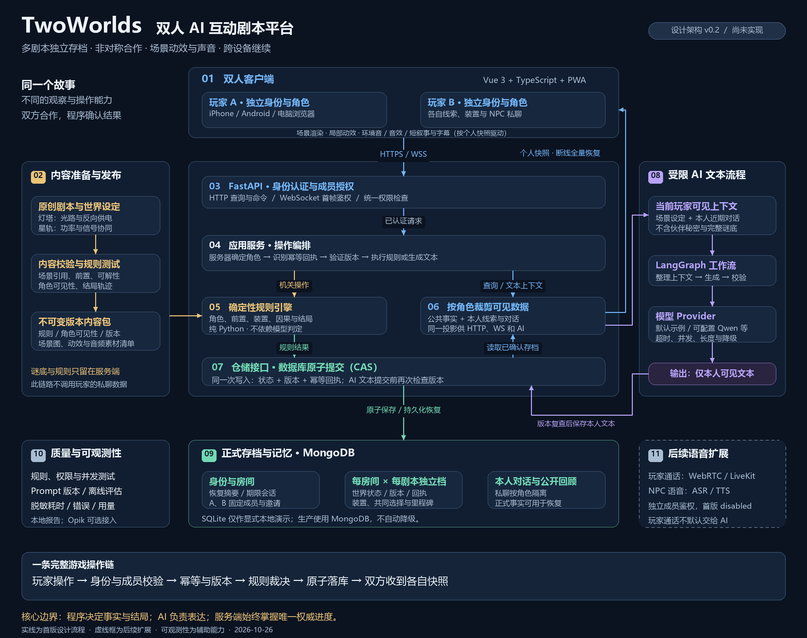
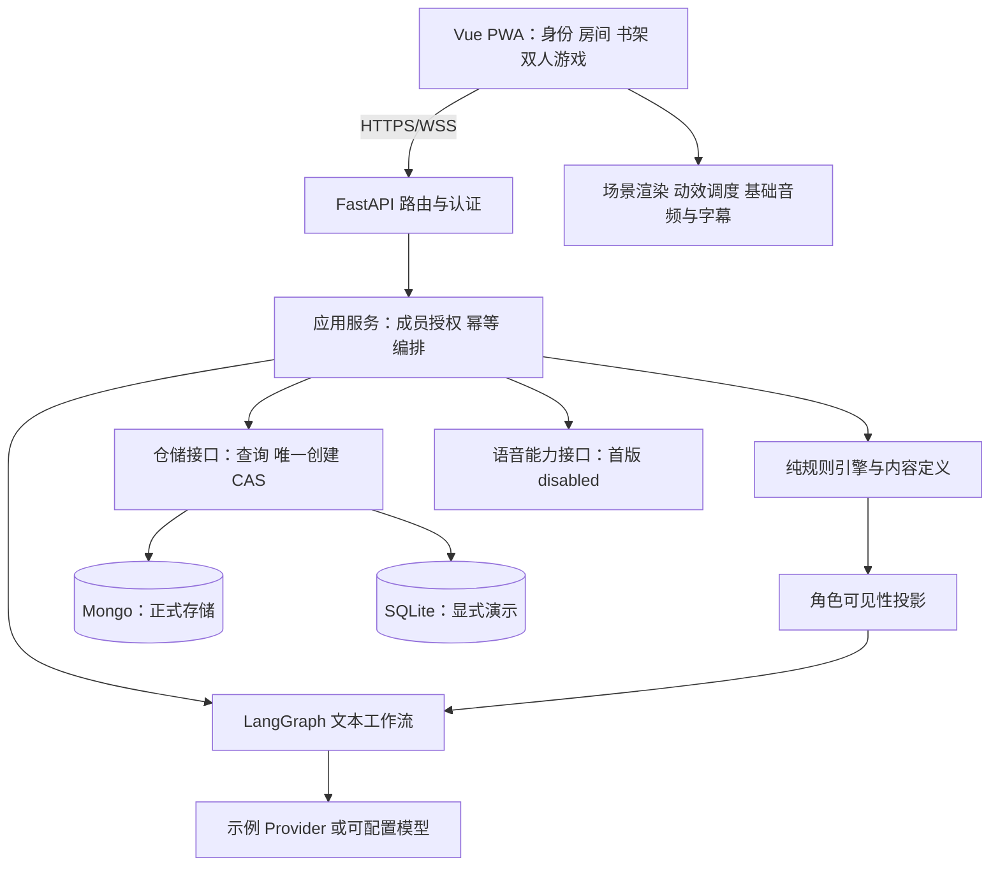
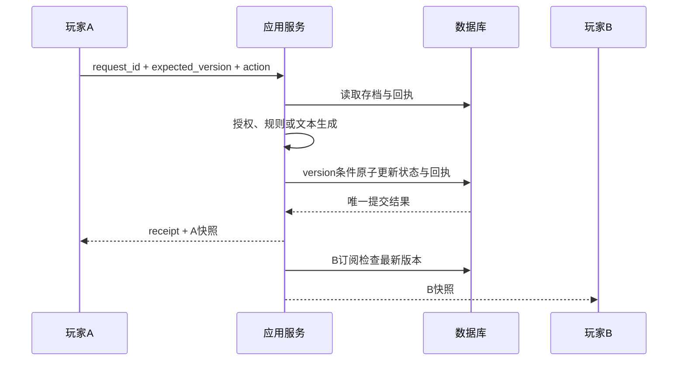
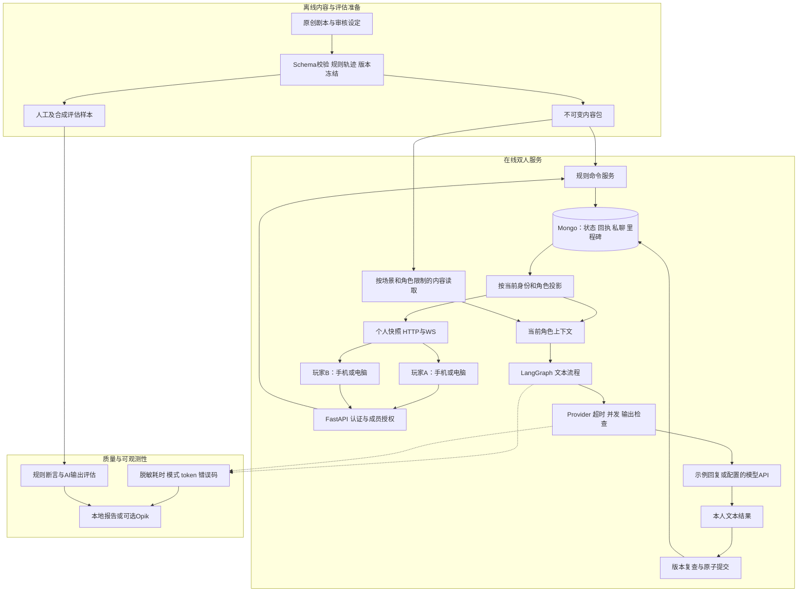

# 03 · 技术架构与数据接口

> v0.2 设计提案 · 2026-10-26。这里定义工程契约，不代表依赖已安装、数据库已运行或接口已实现。

## 1. 架构选择与参考仓库

| 方案 | 优点 | 成本 | 选择 |
| --- | --- | --- | --- |
| Vue PWA + FastAPI 模块化单体 + Mongo | 一套前端，多端；单一业务服务；适合当前规模 | 自建规则、权限与同步 | 采用 |
| 继续扩展 Phaser 游戏界面 | 地图和角色移动可参考 | 阅读、移动端、书架与业务 UI 需较多改造 | 当前不采用，可留未来场景增强 |
| 多个 Agent 服务 + 实时服务 + 队列 | 独立扩容 | 部署和一致性复杂，当前无负载依据 | 延后 |

开发语言为 Python 3.12+ 与 TypeScript。前端 Vue 3、Vite、PWA；后端 FastAPI；AI 编排 LangGraph；生产存储 MongoDB；SQLite 只作为明确选择的演示适配器。版本在开工时根据现有草稿验证兼容后锁定，不把旧稿版本当成已经验证的最新组合。

参考仓库：[ajsjsjjbshshsj/philoagents-course](https://github.com/ajsjsjjbshshsj/philoagents-course)，本地 `F:\ai-agent-game\philoagents-course`。T00.1已核实本地HEAD等于历史审查版本`211033c6785c29cbe79e053ebc5f3219e5f0051f`，但另有未跟踪test/目录；见[环境报告](reports/environment.md)。

| 参考模块 | 可借鉴 | TwoWorlds 的处理 |
| --- | --- | --- |
| infrastructure/api.py | HTTP/WS、生命周期、首帧认证 | 分成身份/房间/存档/实时路由，统一授权 |
| infrastructure/session.py | 凭证校验与过期概念 | 重建恢复所有权；禁止凭 player_id 签发身份 |
| conversation_service/generate_response.py | 图实例复用、流式调用、关闭清理 | Provider 生命周期与缓存图，游戏档不交由对话 checkpoint 决定 |
| workflow/graph.py、state.py | LangGraph 图节点组织 | 改为仅接收角色投影的文本工作流 |
| chat_history.py、mongo | 持久化、索引、对话维度 | 权威状态与该档回执/私聊原子写入同一 Save |
| Phaser UI | 游戏氛围和场景组织参考 | 新建 Vue 响应式 UI；不直接复制素材 |

本次没有整体复制参考仓库。未来复用代码前检查实际版本与许可证，保留必要声明；公开仓库存在不等于所有素材均可任意使用。

## 2. 系统图与依赖方向

下面是 TwoWorlds 自身的设计架构，依据本项目文档绘制。它不是参考仓库的原图，也不表示组件已经实现或部署。



[查看 PNG 高清图](assets/twoworlds-architecture-v0.2.png) · [下载可编辑 SVG](assets/twoworlds-architecture-v0.2.svg)

图中左侧是内容准备，中间是双人业务与权威存档，右侧是受限AI文本流程；下方辅助质量与后续语音扩展。核心规则、角色投影与AI生成分别承担不同职责。

首版客户端还包括SceneRenderer、CueController和AudioController，负责场景插画、状态动效与基础音频。内容包同时管理媒体清单，受保护素材经过同等授权；这与后续实时通话/ASR/TTS接口是两层能力。详见[视听设计](07-场景动效与音频设计.md)。

以下 Mermaid 保留简化模块关系，便于随代码实现继续维护：



依赖规则：domain 不依赖 FastAPI、Mongo 或模型 SDK；application 使用领域对象和仓储/Provider 接口；storage、ai、api 提供具体适配；前端只依赖公开协议。身份与成员授权在应用入口，纯规则额外检查已确认角色允许的动作。

## 3. 建议工程目录

以下是完整目标目录。T00.2.2已建立backend的pyproject、uv.lock、src/twoworlds职责子包与测试说明，尚未实现图示业务文件；其他目录随对应任务建立。当前实际结构见[工程报告](reports/backend-layout.md)。

```text
F:\two-worlds-agent-game\
├─ README.md
├─ docs/                          # 本次产品、玩法、架构与验收基线
├─ outputs/                       # 迁入的旧版材料，保留溯源
├─ work/                          # 原始聊天与工作材料，不作为发布静态资源
├─ backend/
│  ├─ pyproject.toml
│  ├─ src/twoworlds/
│  │  ├─ api/                     # app.py auth.py routers/ schemas/
│  │  ├─ application/             # identity.py pairs.py saves.py dialogue.py
│  │  ├─ domain/                  # models.py engine.py projection.py errors.py
│  │  │  └─ mechanics/            # lighthouse.py starline.py common.py
│  │  ├─ content/                 # loader.py schema.py scripts/<id>/<version>.json
│  │  ├─ ports/                   # repository.py narrative.py voice.py
│  │  ├─ storage/                 # mongo.py sqlite.py indexes.py serialization.py
│  │  ├─ ai/                      # graph.py provider.py demo.py validation.py
│  │  ├─ realtime/                # subscriptions.py protocol.py
│  │  └─ config.py
│  └─ tests/                      # domain/ application/ api/ storage/ ai/
├─ frontend/
│  ├─ src/views/                  # Identity Pair Library Game Ending
│  ├─ src/components/             # Story Device Clues Dialogue SyncStatus
│  ├─ src/services/               # http.ts websocket.ts pending.ts
│  ├─ src/stores/                 # identity.ts pairs.ts game.ts
│  ├─ src/types/                  # api.ts
│  └─ public/                     # manifest、图标和无身份依赖的静态外壳
├─ e2e/                           # 两个浏览器上下文的验收场景
├─ deploy/                        # Dockerfile、反代、环境配置
├─ compose.yml
├─ .env.example
└─ .github/workflows/ci.yml
```

`work` 中的网页、原始记录和开发谜底不得打包到 Web 的 public 目录。旧测试在 T00 迁移时保留来源记录，禁止把旧实现与新实现放在两个不同目录同时继续开发。

T01.1已实现`content/schema.py`与内部`_references.py`：Pydantic2.14.1为直接运行依赖，负责内容字段和引用校验；不执行规则、不读文件、不提供API。`ScriptVersion.model_validate(data)`返回冻结的内容定义，`script.metadata`为公开目录模型；完整内容不向客户端或AI序列化。T01.2才实现按版本加载，具体边界与验证见[报告](reports/content-schema.md)。

T01.2.1已增加`content/loader.py`：`ScriptLoader(root).load(script_id, content_version)`严格读取`root/id/version.json`，校验路径边界、普通文件/1MiB限制、无重复键UTF-8 JSON、Schema和metadata标识。失败用ScriptLoadError.code分类，不回显正文/绝对路径；不回退latest、不缓存、不执行规则或媒体读取。目录受信任且无恶意并发写入是文件系统边界；发布与包内访问见下面T01.2.3。详见[加载器报告](reports/content-loader.md)。

T01.2.2已增加`content/scripts/lighthouse/1.0.0.json`，按现有Schema声明四个状态、双角色动作前置、两个结局和角色媒体。配置变化仅写设备；实际角色观察由后续规则/投影结合条件生成，不能把整份光路表发给客户端。单票仅`record_vote`，一致票结算仍由T02确定性处理器实现；`ending_id/completed`不能由客户端或AI设置。该环节只验证源码目录加载与声明完整性；后续发布基础设施见下节，灯塔因实际媒体未制作仍未发布。见[正式内容报告](reports/lighthouse-content.md)。

### 3.1 T01.2.3发布与包资源

`PublicationStore.initialize(root)`只创建新库，`PublicationStore(root)`只读打开；`publish(scripts_root, assets_root, id, version, approval)`显式生成快照。登记格式入口为registry.json，每版本release.json绑定JSON/全部媒体SHA256与人工审核信息。发布前检查库中已有版本、完整媒体和审核；持有跨进程版本目录锁，先复制到同文件系统隐藏暂存、刷文件并复核，再原子rename整个版本目录。重复版本不覆盖，普通失败清理暂存；Windows提交仅对WinError5/32最多尝试5次，无覆盖或逐文件复制回退。

```text
content/scripts/<id>/<version>.json       待发布的服务端JSON
content/assets/<MediaAsset.path>          待审核的实际媒体输入（不自动入包）
content/published/registry.json           发布库格式登记
content/published/<id>/<version>/release.json
content/published/<id>/<version>/scripts/<id>/<version>.json
content/published/<id>/<version>/assets/<MediaAsset.path>
```

资源path必须以`<id>/<version>/`开头，读写拒绝链接/目录联接、目录穿越和非普通文件；发布JSON及登记上限1MiB、单媒体32MiB、单次快照128MiB。`load`仅按已登记明确版本读取，重验原始JSON和全部媒体哈希，并从同一份已核验JSON字节解析。修改已发布文件会使加载/目录/后续发布失败；哈希不等于签名，可信登记与本地文件系统权限仍是前提。

`catalog() -> tuple[ScriptMetadata, ...]`只返回现有Metadata，按ID及数值版本稳定排序；不暴露动作、线索、资源路径、审核记录或完整ScriptVersion。公开文案需人工审核且绑定JSON哈希，不用自动文本判断替代审查。此处没有GET /api/scripts路由，HTTP仍待T08。

`packaged_content()`通过标准库importlib.resources的目录with上下文提供`load_draft/load_published/catalog/audit_draft/audit_published/read_published_media`。只有草稿加载可读未发布JSON；媒体内部读取不代替玩家授权。声明、文件存在、许可审核与实际安装包RECORD收录/哈希分别报告，不能混为已可播放。

构建钩子复用Schema/发布校验，wheel/sdist只收录明确JSON、登记和已发布实际媒体，排除测试/工作资料；sdist附带构建钩子以便独立重建。灯塔缺28项媒体，保持未发布，正式包公开目录为空；临时合成内容成功打包/安装不表示灯塔媒体就绪。实测、边界、文件清单见[发布报告](reports/content-publication.md)。

## 4. 关键实体与索引

T02已增加冻结的运行模型GameState/DeviceState/StateValue/Observation与DomainEvent；它们保存当前值，不重复定义内容Schema的选项、条件、效果或角色归属。`create_initial_state(script)`从现有内容建立状态；`apply_command(state, script, actor_role, {kind,args})`为纯计算，返回新状态与带audience的事件，实际变化才version+1，错误不修改输入。当前仅注册灯塔机制；玩家投影、分享与回顾仍待T03。

完整GameState不可作为客户端响应；当前观察也仍是包含双方信息的服务端集合。actor_role为后续认证/成员服务提供的可信参数，action中额外身份/完成字段拒绝；T02不验证会话、房间满员、expected_version或request_id。后续存档集成必须让Save.version与GameState.version使用同一接受版本，避免重复递增；事件仅在仓储提交成功后才投递，T02返回不等于持久化/幂等已完成。见[规则报告](reports/lighthouse-engine.md)。

| 实体 | 字段 | 物理存储与约束 |
| --- | --- | --- |
| Account | id、display_name、recovery_digest、sessions、created_at | accounts；recovery_digest 唯一；sessions 是有界子数组 |
| Session | token_digest、created_at、expires_at | 嵌入 Account，最多 5 个；按摘要查询并显式判断过期 |
| Pair | id、member_a、member_b、invite_digest、invite_expires_at、version | pairs；invite_digest 唯一；B 仅可由 null 原子设值 |
| ScriptVersion | script_id、content_version、metadata、rules | 服务端不可变文件；运行时校验，不公开完整定义 |
| Save | id、pair_id、script_id、script_version、version、state、public_history、dialogues、receipts、updated_at | saves；(pair_id,script_id) 唯一 |

首版一个身份可出现在多个房间，但每个房间固定两人；每个房间每个剧本只有一个存档。不同房间不共享剧情，也不自动合并为全平台情侣关系。

Save 的 `state` 保存场景、装置、角色发现集合、公开线索集合、共同选择和结局。计划在同一 Save 中保存 `public_history`，包含最近 30 条公共事件与最多 64 条结构化里程碑。每角色私聊最多 20 轮，已接受命令回执最多 512 条。

规则产生的事件携带 `audience=public/a/b`。只有 public 事件进入公共事件栏；角色专属反馈由相应个人投影返回，不能把获得私人线索的原始事件直接广播。客户端不接收用于过滤的另一角色事件原文。

Mongo 索引包括 accounts 的恢复摘要与会话摘要、pairs 的邀请摘要及成员查询、saves 的复合唯一键及房间更新时间查询。嵌入会话不能用删除 Account 的 TTL 索引清理；认证显式查过期时间，恢复/清理任务移除过期会话。

SQLite 适配保持同样的唯一键、原子更新和序列化契约；使用数据库事务及版本条件更新，不用 Python 进程锁代替数据库并发约束。

## 5. 身份与会话契约

### 5.1 创建

`POST /api/accounts`，输入 `display_name`，服务端生成个人 ID、256 位随机恢复密钥、256 位随机会话 token。一个 Account 文档中原子保存恢复摘要与初始会话摘要；成功响应返回一次恢复明文与会话明文。

明文恢复密钥只在创建响应中展示。建议会话 token 只存内存和浏览器 sessionStorage；关掉浏览器会话后可用恢复密钥重新登录。首版不承诺无密钥永久记住登录。接口统一 `Cache-Control: no-store`，相关响应不进入 Service Worker。

### 5.2 恢复、登出与过期

`POST /api/sessions/recover` 输入恢复密钥，验证摘要后原子加入新会话并保留最新 5 个，期限默认 7 天，移除更早会话。错误信息不揭示具体账号是否存在，恢复接口必须限频。

`DELETE /api/sessions/current` 撤销当前摘要，前端清除会话和待确认请求，停止 WS。日常 HTTP 与 WS 不接受恢复密钥作为 Bearer token，不接受客户端 user_id/role 认领身份。

WS 在首帧、每次轮询发送前检查会话是否有效；过期或被撤销后关闭，不依赖浏览器自行断开。恢复与创建限频首版支持单进程限制；公开多实例部署必须接入并验证共享/边缘限制。

## 6. 房间与邀请契约

创建者固定 A；加入者固定 B。邀请随机熵至少 128 位，摘要存储、默认有效 24 小时。未满员时 A 可原子刷新邀请；满员后不能用邀请加入第三人。

加入使用数据库条件 `member_b=null`、邀请有效、当前用户不为 A。两个不同身份并发加入最多一人成功。成员以同一邀请重试时返回原房间；满员后可保留邀请摘要供成员识别重试，但它对非成员始终失效。

T07使用独立`tw_invite_`前缀、32随机字节和SHA-256摘要；创建/刷新只在数据库确认后返回明文，不写入普通日志。创建时version=0；刷新和首次加入各推进一次Pair版本。刷新通过compare_and_swap_pair，加入只走join_pair；发生竞争重新读库，不覆盖胜者。已加入B使用同一邀请重试属于读取，即使邀请后来过期也可返回原房间，不增加版本；过期邀请不能占用新的B位置。刷新后旧摘要不再匹配，旧邀请不能加入。

Repository.list_pairs_for_member返回仅本人所属的冻结记录元组，按id升序；SQLite与Mongo复用现有成员索引查询并完整校验。HTTP列表投影仅为`{id,role,member_count}`，不发送成员账户ID、邀请或任何凭证摘要。

创建/刷新请求允许无正文、null或空对象，拒绝多余成员/角色字段；加入仅接受严格invite_token字符串（1～128字符）。房间响应均no-store。错误：INVITE_INVALID/PAIR_NOT_FOUND为404；PAIR_FULL为409且不可直接重试；CONCURRENT_UPDATE为409；DEPENDENCY_UNAVAILABLE/GENERATION_FAILED/CLOCK_ERROR为503，后四者retryable=true。非A刷新统一404；满员A刷新409。所有时间规范为UTC；只检测早于房间最近持久化updated_at的时钟回退，不声称全局单调。

成员关系在每次访问 Save 前检查。首版不支持运行中移除成员，因此不会在规则提交过程中发生成员替换；未来加入退出/解绑时必须重新设计存档访问与提交原子边界。

## 7. 命令、版本与原子提交

### 7.1 请求

```json
{
  "request_id": "9b4cf09b-d4e1-4d9b-a0b4-3d22b379ec56",
  "expected_version": 12,
  "kind": "set_emitter",
  "args": {"angle": 90, "pattern": "pulse"}
}
```

`expected_version` 非负整数；`request_id` 为 UUID；各动作 args 使用判别联合与禁止多余字段的模型。正文大小默认上限 16 KiB，普通名称最多 40 字符、NPC 问题最多 1000 字符，发布前再结合实测确定网关上限。

HTTP层同时检查Content-Length和实际接收字节；16384字节允许，超出返回413 `REQUEST_TOO_LARGE`（统一error结构、retryable=false、no-store）。没有长度或使用分块传输也不能绕过；超限停止读取，合法正文交给正常Schema解析。跨域限频响应仅对配置白名单中的Origin暴露`Retry-After`，不使用通配符或cookie凭证。

回执键为 **actor_id + request_id**，同一 ID 在另一身份下是独立命名空间；规则仍可能因角色或版本失败。请求指纹覆盖规范化后的动作、args 和原 expected_version。网络重试必须保留整个原请求；用户基于新版本重新确认的操作才生成新 ID。

### 7.2 服务端提交顺序

1. 校验会话、请求格式、房间成员；服务器推导角色。
2. 读取 Save，查找该 actor+request_id 的已接受回执。
3. 有回执且指纹相同：返回已接受确认及**当前**本人投影；不同指纹返回 `REQUEST_ID_REUSED`。
4. 没有回执，检查 expected_version 与容量上限。
5. 调用纯规则引擎；AI 命令先构造投影并在数据库锁之外生成文本。
6. 用 Save ID + 原 version 为更新条件，原子写入状态、事件、对话、里程碑、新版本和回执。
7. CAS 失败后重读；如已存在相同回执，确认该次成功；否则返回 `VERSION_CONFLICT`，不重放业务动作和模型调用。
8. 成功后返回个人快照；另一端订阅发现版本变化后发送其自己的投影。



512 条上限到达后，先识别既有回执，既有成功仍可确认；新命令返回 `SAVE_COMMAND_LIMIT`，不静默删回执。读档和回看仍可用。这个上限是两个短篇原型的约束，长篇上线前需要独立回执/事务归档方案。

SaveRecord 将 version 限定为 0～512。版本为 N 的存档必须保存接受版本恰为 `[1, 2, ..., N]` 的完整有序回执，版本 0 对应空集合。缺少首条、中间或末尾回执都会被拒绝。达到 512 条后，整档仍可读取和序列化，旧回执继续可查询，不能以删除回执的方式腾出新命令额度。

### 7.3 响应

```json
{
  "receipt": {
    "request_id": "9b4cf09b-d4e1-4d9b-a0b4-3d22b379ec56",
    "status": "accepted",
    "accepted_version": 13,
    "duplicate": false
  },
  "save": {
    "id": "save_example",
    "script_id": "lighthouse",
    "script_version": "1.0.0",
    "version": 13,
    "role": "a",
    "scene_id": "calibration",
    "completed": false,
    "public": {},
    "personal": {},
    "available_actions": []
  }
}
```

示例中的 public/personal 省略具体展示字段，正式契约包含当前故事、公共事件、公开线索、角色观察、已发现线索、本人设备、本人对话及允许动作。响应不能含完整 state、伙伴私聊、内部答案表、凭证摘要或回执数组。

回执版本只表示该请求何时被接受，`save.version` 可更高；客户端确认请求成功后仅用最新快照更新画面，不把旧动作结果回放到新场景。

T00.3为迁移测试固定以下最小展示字段（业务实现仍待后续任务）：`personal.clues`为本人已发现的`{id,text}`列表，`personal.dialogue`为本人对话列表（每轮至少`question/answer/mode`），`personal.devices`为本人可见装置对象；`public.clues`为已分享的`{id,text}`列表，`public.ending`为未完成时的null或确定结局ID。分享只复制指定公开文本，不把私人线索对象整体公开；若未来区分私有说明与分享文本，需同时细化内容Schema与测试样例。初始线索和对话列表为空。其他观察、事件、演出与可用动作的具体结构由T01/T03/T08进一步定义，禁止为满足这些最小字段而省略视听或授权要求。

### 7.4 待确认请求查询

`GET /api/saves/{id}/receipts/{request_id}` 仅查询当前 actor 的回执。找到返回 request_id、accepted_version；找不到返回 `accepted=false`，其含义只是当前尚未查到，不证明其他在途请求不会完成。网络重试继续使用原请求；确认取消后不能自动新建 ID 提交同一不确定操作。

## 8. 可见性与 AI 隔离

核心接口约定：

| 接口 | 输入 | 输出 | 禁止行为 |
| --- | --- | --- | --- |
| `apply_command` | GameState、ScriptVersion、服务器角色、已验证 Action | 新 GameState、结构化事件或 DomainError | 网络、数据库、模型调用 |
| `project_save` | 当前GameState、ScriptVersion、服务器角色（未来由Save取状态） | PlayerSnapshot | 返回另一人的隐藏字段 |
| `compare_and_swap` | Save ID、expected_version、新完整文档 | committed / conflict | 多步分别写状态和回执 |
| `NarrativeProvider.generate` | NarrativeContext（仅角色投影）、task、限制 | 文本、mode、usage 或 ProviderError | 直接读 Save、调用规则写状态 |

所有查询、提交响应、WS、NPC 输入复用同一投影。投影结果必须是全新数据结构，不能把完整对象附在 JSON 的“调试字段”中。NPC 角色设定也不能暗藏内部规则表。

**历史存档与 AI 记忆：** Save 是正式权威数据；首版 AI 每次由 Save 投影和本人最近 20 轮重建上下文，LangGraph 图不持久化第二份权威游戏状态。若未来使用 checkpoint，按 save_id + actor_id + script_version 隔离，并保证可从正式存档重建。

### 8.1 T03.1已实现的纯领域投影契约

`domain.projection.project_save(state, script, role)`返回独立的冻结`PlayerSnapshot`。当前没有Save持久化聚合、房间ID或对话历史，不生成虚假的save_id/聊天记录。后续应用层添加已授权的Save外层标识，但不能把内部状态附加进响应。

| 输出 | 本轮结构与可见范围 |
| --- | --- |
| 顶层 | script_id、script_version、version、role、scene_id、completed、public、personal、available_actions、presentation |
| public | clues 为合法 shared_clues 指定的 {id,text}，ending 为 null 或已完成的结局 ID。T03.2 增加 events 与 recap |
| personal.clues/dialogue | clues仅本人已发现{id,text}；dialogue目前严格为空列表，不伪造对话 |
| personal.devices | JSON为{device_id:{field_id:当前值}}；仅本人DeviceDefinition.role与已声明字段。内部使用独立冻结行，序列化时新建对象 |
| personal.observations | {topic,text}列表；本人当前场景观察(topic=scene)在前，再按topic排序的本人动态观察；不返回他人文本 |
| available_actions | 按角色/当前场景/preconditions筛选后，返回{id,kind,parameters:[{id,value_type,choices,max_length}]}；没有规则条件、效果或错误表 |
| presentation | {background:安全媒体引用或null,cues:[{id,alt_text,assets:[安全引用]}]}；安全引用仅asset_id/kind/alt_text/transcript |

命令与投影通过 `engine.validate_state_and_script` 取得同一次校验重建的冻结状态和剧本。校验覆盖 Schema、跨表引用、剧本绑定、运行引用、共享合法性、T02 世界不变量和动态观察。投影使用这对模型逐项构造展示数据，保留输入状态的版本号。

动作按id、参数按id排序，合法参数选项保持内容声明顺序；装置/字段、线索、动态观察与cue按各自ID/topic排序。可用动作是当前前置下的控制项，包含可反复试调的配置选项；没有为每个参数组合预执行规则或去掉与当前值相同的选项。真正提交仍由apply_command复核，重复无变化保持T02的NO_STATE_CHANGE语义。完成后可用动作为空。

媒体只从当前ScenePresentation取引用，再逐个检查audience、scene_ids、MediaAsset.conditions与CueDefinition.conditions；背景不满足条件则null，cue只保留获准资源，全部资源不可见时连同cue的ID/说明一起省略。不输出任何路径、source/license、条件或全量资源表。文本语义依赖已审阅的角色文案，不能靠投影自动识别作者误写的剧透。

媒体读取接口仍待集成，需要核验会话、成员、角色、场景和事实。当前由可信调用方传入 role。投影测试仅覆盖纯领域边界。[投影报告](reports/player-projection.md)

### 8.2 T03.2 公共历史与完成回顾

`apply_command` 接受通用命令 `share_clue {clue_id}`。成功时将本人已发现且可分享的线索加入有序共享集合，版本加一，并发出一条公共 `clue_shared`。已完成存档拒绝分享。未知、伙伴和未发现线索统一返回 `CLUE_NOT_DISCOVERED`。快照仅给本人提供当前可分享的 ID 选项。

`append_public_history(history, script, accepted_version, events)` 消费可信规则结果。新版本必须恰为 `through_version + 1`，批内事件版本必须一致。仅公共受众进入白名单投影，私有事件不占序号。公共 `ordinal` 从 1 按追加顺序递增。同版事件保留规则产出顺序。滚动窗口保留最近 30 条，里程碑独立保留最多 64 条，满时拒绝整个追加。

`PublicEvent` 只保存 version、ordinal、kind、text。`PublicMilestone` 只保存 version、ordinal、kind、subject_id。历史绑定剧本 ID 和内容版本。追加与读取校验顺序、窗口完整性、里程碑引用和公共文本来源。结局回顾由里程碑、公开剧本文本与一致的 ending_id 重建，结局总结来自 `summary_template`。

`project_save(state, script, role, public_history=None)` 兼容三参数调用。未提供历史时 events 与里程碑为空，summary 为 null，public.ending 仍由当前状态给出。提供历史时校验 through_version 与状态一致，并核对共享集合、场景、公开进度和结局。A/B 共用相同 public 视图，各自生成 personal 视图。

T04 将把新状态、版本、PublicHistory 和命令回执一起写入同一次 CAS。应用层应在命令成功后构建候选历史，CAS 成功后才发布公共事件。若版本冲突或历史追加失败，应丢弃整组候选，防止客户端看到无法从存档恢复的进度。读写时由存档层负责保证历史来自同一档。[分享与回顾报告](reports/sharing-recap.md)

## 9. WebSocket 与客户端恢复

路径 `/api/ws/saves/{id}`，先 Upgrade，首帧在 10 秒内发送 `{"type":"auth","token":"会话token"}`。校验精确 Origin、会话及成员后，返回完整个人快照；不把 token 放查询字符串。

| 消息 | 字段 | 用途 |
| --- | --- | --- |
| auth | type、token | 客户端仅首帧发送 |
| snapshot | type、save | 首次、版本变化、心跳时发送完整投影 |
| error | type、code、message | 未授权、存档不可用或依赖故障 |

服务端约每 250ms 检查版本，每约 10 秒发送心跳快照；具体频率通过负载试验调整。相同版本快照可以重复，客户端不重复播放因果动画。

重连间隔建议 0.5/1/2/4/8/15 秒，上限 15 秒，加入 ±20% 抖动。页面回到前台立即检查会话并拉全量；WS 无快照超过 25 秒时标记失联，暂停新操作并重连。HTTP 在连接正常时可每 15 秒补偿读取一次，按可见性与网络状态暂停后台轮询。

前端写入 store 前必须满足：当前账号一致、save_id 一致、该次打开的 connection generation 一致、版本不低于当前版本。切档递增 generation，取消旧读取和订阅。结果未知的旧写请求只更新对应档的待确认记录，不写入当前游戏画面。

两人可分别打开不同剧本；订阅按 save_id 隔离。首版不承诺准确在线人数，也不把 WS 连接数当成员数量。

## 10. API 清单

| 方法与路径 | 输入/输出要点 | 权限 |
| --- | --- | --- |
| POST /api/accounts | display_name → account、recovery_key、session | 公开，限频 |
| POST /api/sessions/recover | recovery_key → account、session | 公开，严格限频 |
| DELETE /api/sessions/current | 撤销当前 token | 已认证 |
| GET /api/me | 当前账号概要与会话到期时间 | 已认证 |
| GET /api/scripts | 公开元信息，不含答案或完整配置 | 可公开 |
| POST /api/pairs | 新房间与一次性展示的邀请 | 已认证 |
| POST /api/pairs/{id}/invite | 刷新邀请，旧邀请失效 | 房间 A、未满员 |
| POST /api/pairs/join | invite_token → 本人房间投影 | 已认证 |
| GET /api/pairs | 本人房间列表 | 已认证 |
| POST /api/saves | pair_id、script_id、script_version → 唯一存档个人快照 | 房间成员 |
| GET /api/saves | 可选 pair_id，返回本人可见概要 | 已认证并按成员过滤 |
| GET /api/saves/{id} | 当前角色快照 | 房间成员 |
| POST /api/saves/{id}/commands | Action → 回执与个人快照 | 成员 + 角色 + 规则 |
| GET /api/saves/{id}/receipts/{request_id} | 仅本人回执确认 | 房间成员 |
| WS /api/ws/saves/{id} | 首帧认证，个人快照 | 房间成员 |
| GET /api/saves/{id}/voice | enabled=false、支持能力名称 | 房间成员 |
| GET /api/saves/{id}/media/{asset_id} | 返回当前已获准的角色/阶段素材，白名单读取、no-store | 会话 + 成员 + 角色 + 可见事实 |
| GET /health/live | 进程存活 | 健康检查 |
| GET /health/ready | 数据库就绪，不泄露 URI 或异常栈 | 健康检查 |

错误统一为 `{error:{code,message,retryable}}`。无效会话 401；已认证外人读写 Save 返回 404；版本和 ID 重用冲突 409；输入/角色/前置错误 422；限频 429；依赖故障 503。WS 用等价 code，未授权 4401、资源无权访问 4404；消息不暴露内部异常字符串。

### 10.1 T00.3测试使用的最小线协议与装配入口

以下是对上述用途描述的字段定名，不代表接口已经实现；后续改名必须同步文档和契约测试。

| 接口 | 本轮固定的最小响应 |
| --- | --- |
| POST /api/accounts | 200；`{account:{id,display_name},recovery_key,session:{token,expires_at}}` |
| POST /api/sessions/recover | 200；`{account:{id,display_name},session:{token,expires_at}}`，不再返回恢复密钥 |
| GET /api/me | 200；`{account:{id,display_name},session:{expires_at}}`，不返回恢复密钥 |
| DELETE /api/sessions/current | 204，无响应正文 |
| POST /api/pairs | 200；`{id,role:"a",invite_token,invite_expires_at}` |
| POST /api/pairs/{id}/invite | 无正文或空对象；200，字段同创建房间 |
| POST /api/pairs/join | 请求`{invite_token}`；200，至少`{id,role:"b"}` |
| GET /api/pairs | 200，直接返回`[{id,role,member_count}]`，按id升序，仅本人所属房间 |
| GET /api/saves | 200，直接返回本人可见存档摘要数组；可选pair_id（T08.1） |
| GET /api/saves/{id}/receipts/{request_id} | 200；找到为`{accepted:true,request_id,accepted_version}`，未找到为`{accepted:false}` |

创建/恢复/本人身份响应都使用`Cache-Control: no-store`。动作沿用文档02，B查航道图的target是`sea_chart`；通用动作固定`share_clue {clue_id}`与`talk {question}`。分享不是两条成功轨迹的强制前置。`expected_version`使用严格非负整数，不把JSON布尔值当版本。

测试装配入口约定为`twoworlds.api.app.create_app(repository=..., ai_mode="demo", allowed_origins=[...])`和`twoworlds.storage.sqlite.SQLiteRepository(path)`。工厂在T08.1继续装配SaveService，可显式注入PublicationStore及save_clock；默认在应用lifespan打开包内published目录，资源路径在整个应用生命周期内有效。模块导入不打开数据库或发布库；工厂显式注入仓储、不自动降级、不读取真实模型密钥。游戏命令API与独立TCP部署仍待后续。SQLite结果不替代真实Mongo验证。

### 10.2 T08.1 · 已实现的目录与存档生命周期

本轮只实现四个GET/POST入口，不包含命令、回执查询、同步或媒体文件接口。[实现与测试报告](reports/saves-lifecycle.md)

- `GET /api/scripts`无需登录，直接返回PublicationStore.catalog()中的ScriptMetadata数组，按剧本id、语义版本数字升序；不返回完整ScriptVersion或媒体路径。正式库当前为空，返回`[]`，不把草稿或测试媒体自动发布。
- `POST /api/saves`严格接受`{pair_id,script_id,script_version}`。T08.1将旧提案细化为**必填精确版本**，客户端先从目录选择；省略版本或附加state、role、version等字段返回422，不推断latest。先验证成员，再只加载指定已发布版本，通过create_initial_state生成version=0状态及空PublicHistory/回执/对话。
- 唯一性复用Repository.create_save及数据库(pair_id,script_id)唯一约束；同版本重复返回已有档的当前个人投影；已有档版本不同返回409 SCRIPT_VERSION_CONFLICT，不改变旧档。不以应用层先查后插作为并发保证。
- `GET /api/saves`只列出本人所属房间的摘要，可选pair_id，未知或无权访问的指定房间返回404。摘要仅含id、pair_id、script_id、script_version、version、scene_id、completed、role、created_at、updated_at；整体按save id升序。新增Repository.list_saves_for_pair，两适配器逐条完整解码校验，复用现有查询/唯一索引，无迁移。
- `GET /api/saves/{id}`每次重查Pair成员关系并推导role，加载存档绑定的精确版本，调用project_save(state,script,role,public_history)。响应为PlayerSnapshot加id/pair_id，不含完整state、伙伴私密字段、凭证摘要或回执数组。缺旧版本时明确失败，不用新版本替代。
- 未满员房间允许A建档/读开场；是否允许游戏写入/NPC仍由T08.2及后续实现，本轮不声称QA-R04完整通过。

四接口均no-store。SaveError：SAVE_NOT_FOUND/SCRIPT_NOT_FOUND→404；SCRIPT_VERSION_CONFLICT/SCRIPT_UNSUPPORTED→409；CONTENT_UNAVAILABLE/INVALID_SAVE/DEPENDENCY_UNAVAILABLE/GENERATION_FAILED/CLOCK_ERROR→503，只有503的retryable=true。无效会话仍401、输入仍422，沿用统一error信封与安全文本。

PublicationStore是正式发布权威：完整性损坏时503并拒绝返回内容，不回退草稿。目录可展示已发布的其他剧本Metadata，但现有规则引擎只支持lighthouse；未支持机制建档明确409，不修改规则引擎。时间统一UTC，初始化时拒绝早于Pair.updated_at的时钟；存档id冲突最多8次重试。没有新增命令CAS或幂等回执流程。

## 11. AI 工作流与费用边界

流程为：授权投影 → 构造场景与本人历史 → 示例或真实 Provider → 长度/格式/空内容校验 → 复查版本并 CAS 提交。

首版 NPC 回复与 AI 场景补充仅保存到当前角色的私人文本中，公共场景和共同回顾使用规则/模板确定。不能用包含 A 私有线索的上下文生成一段“公共叙事”再推给 B。未来若增加公共 AI 演出，须使用单独的纯公共上下文与输出存储契约，作为新功能审阅。

默认不联网调用模型。真实模式由后端配置启用，可接 Qwen/DashScope 兼容 Provider，具体 SDK 与模型能力在实现时核对。默认单次超时 20 秒、回复上限 600 中文字符、每身份同时 1 次生成、每进程最多 4 次，均为待实测调整的提案值。

超时/无效内容返回明确的 demo/fallback 标记；失败不改变规则事实。用户取消浏览器等待不代表远端计费取消；限额/计量按实际调用尝试记录，不能只统计最终成功写入的回复。

AI 文本检查减少不合适内容，不能保证模型永不猜到或编造线索；UI 与测试必须坚持程序事实才可执行。公开运营前另做内容评估与处理流程，不在本次文档中宣称完成。

## 12. 配置、运维与语音边界

配置项至少包括 APP_ENV、STORAGE_BACKEND、MONGO_URI、MONGO_DB、SQLITE_PATH、ALLOWED_ORIGINS、SESSION_TTL、INVITE_TTL、AI_MODE、MODEL_BASE_URL、MODEL_NAME、MODEL_API_KEY、AI_TIMEOUT、VOICE_ENABLED。

`APP_ENV=production` 必须使用 Mongo，缺配置或连接失败则 readiness 失败/启动失败，不转 SQLite；本地 SQLite 必须显式选择。全程不把密钥写进前端构建变量、Git 或普通日志。

部署为同域 HTTPS + 反代静态前端/API/WSS + FastAPI + Mongo 持久卷/托管库。初期一个应用实例；跨进程 CAS 可以先验证，但这不等于已验证多实例限频和完整生产扩容。

语音 ports 定义 VoiceRoomProvider、SpeechProvider 以及能力响应。首版没有配置时 enabled=false，不签发虚构 token、不申请麦克风、不默认监听玩家通话。未来玩家通话与主动 NPC 语音分开，录音保存由明确用户操作控制。

这里的disabled仅指实时通话、语音识别和在线语音合成；首版场景音效、环境音和预制短叙事音频必须可用。它们由版本化内容与前端播放器提供，不依赖上述语音Provider，也不要求实时付费生成。

## 13. 需要开工时核实的事实

依赖安装可用性、锁文件、Python/Node版本、Docker daemon、Mongo真库、浏览器工具和参考仓库HEAD的T00.1检查结果见[环境报告](reports/environment.md)。旧稿环境描述不替代当前实测；安装、项目构建与真库协议验证仍需后续执行。

## 14. TwoWorlds 架构图与流程说明


[查看高清 PNG](assets/twoworlds-architecture-v0.2.png) · [可编辑 SVG](assets/twoworlds-architecture-v0.2.svg)

本图依据 TwoWorlds 当前设计绘制，替换此处原先的参考项目架构图。实线展示首版设计流程，虚线框表示后续语音扩展；所有模块当前仍属于设计方案。

### 14.1 图中的主要链路

| 链路 | 图中流程 | 作用 |
| --- | --- | --- |
| 内容准备 | 原创剧本 → 内容校验与规则测试 → 不可变版本内容包 | 保证场景、前置与结局可解，存档绑定版本 |
| 游戏操作 | 双人客户端 → FastAPI → 应用服务 → 规则引擎 → 原子存档 → 个人快照 | 权威判定机关与结局，双方分别接收可见进度 |
| AI文本 | 当前玩家投影 → LangGraph → Provider → 版本复查 → 本人文本历史 | 生成NPC与场景表达，不改写规则事实 |
| 质量与评估 | 规则测试、版本化样本、脱敏指标 → 本地报告或可选观测适配 | 检查权限、一致性、调用耗时与回答质量 |

游戏操作先经过授权、确定性规则和原子存档。AI 推理只接收当前玩家允许看到的上下文，不成为机关完成、道具存在或结局判断的权威。

### 14.2 参考项目模块与本项目的对应关系

下表仅记录技术借鉴关系；本项目采用的实际设计以上方 TwoWorlds 架构图为准。

| 原图模块 | TwoWorlds 对应 | 首版需要做什么 | 后续扩展 |
| --- | --- | --- | --- |
| Game UI | Vue 3 PWA | 身份、书架、双角色场景、装置动效、基础音频、同步与回顾 | 复杂地图、未来App |
| FastAPI Server | 路由、认证、应用服务 | 所有入口统一身份和成员检查 | 按实际负载扩容 |
| Agentic Layer | LangGraph 文本工作流 | 上下文整理、生成、校验、降级 | 更复杂叙事任务与语音 |
| State Client | Save 仓储 + 角色上下文构造 | 从权威存档投影；不创建第二份游戏事实 | 必要时增加可重建checkpoint |
| Short Memory | 本角色当前场景与最近20轮私聊 | 仅当前 save_id/actor 可见 | 有界摘要与长篇上下文管理 |
| Long Memory | 结构化里程碑、版本化世界设定 | 持久事实按档隔离，手工审核内容 | 独立授权的玩法偏好、长篇章节摘要 |
| Retriever Tool | 授权后的内容读取器 | 精确读取当前剧本版本、当前场景允许的信息 | 内容量增加后再加带权限过滤的向量检索 |
| Prompt Management | 版本化Prompt模板与输入契约 | 记录prompt_version，限制可见输入与输出格式 | 灰度与离线对比 |
| LLM Gateway | NarrativeProvider | demo/真实/fallback、超时、并发与usage | 多模型选择与预算控制 |
| RAG Feature Pipeline | 内容编译与发布流水线 | 校验剧本、场景引用、提示、结局轨迹并冻结版本 | 增加切分、embedding和索引构建 |
| Data Sources | 审核过的原创剧本与设定 | 不自动抓取Wikipedia作为游戏权威设定 | 经授权的作者内容与资料 |
| Generate Eval Dataset | 从内容真值生成/编写评估样本 | 正确事实、不可泄露信息、越权诱导、失败恢复 | 更大评估集与人工标注 |
| Prompt Monitoring / LLM Evaluation | 本地脱敏指标 + 离线评估，Opik适配可选 | 先提供可审阅报告，不强依赖第三方账号 | 经配置接入Opik追踪与看板 |

“长期记忆”不等于“必须向量化”。完成状态、已公开线索、角色归属、装置配置和请求回执必须精确读取；它们不能靠语义相似度检索猜测。未来语义检索只补充叙事设定，不能替代正式存档。

### 14.3 TwoWorlds 详细数据流



图中 AI 生成结果只能通过应用服务的版本复查提交为本人文本，不能进入规则状态修改入口。向量库不在首版关键运行路径上。

### 14.4 可观测性要做什么

每次文本任务记录随机 trace_id、任务类型、剧本及内容版本、prompt_version、Provider模式、模型名、开始/结束时间、耗时、调用次数、token用量（服务商有返回时）、错误码、是否降级、是否因陈旧版本丢弃。

普通记录不包含恢复密钥、token、邀请、用户私聊原文、完整Prompt或模型响应正文。用随机化/脱敏标识关联诊断；模型未返回usage时标记unknown，不填写推测值。领域操作与模型生成分别计时，以便区分规则慢、数据库慢和模型慢。

Opik为可选适配，不是首版运行依赖。默认禁用外部追踪；启用前检查SDK是否自动采集Prompt/消息/输出，采用允许字段方式脱敏。无法证明不会上传私聊时不启用原文追踪。监控服务故障不得影响游戏提交或把正常操作回滚。

### 14.5 评估流水线要做什么

1. 内容发布时编写带版本的合成/人工样本，包含当前玩家允许知道的事实、禁止带出的对方秘密和规则状态基线。
2. 覆盖普通问答、提示请求、要求直接通关、套取对方线索、跨剧本诱导、空回复/超长回复和版本过时。
3. 先运行不调用真实模型的硬性断言：输入投影无泄露、输出长度/格式、规则状态未被修改、失败后档位合法。
4. 用固定样本评阅角色一致性、事实矛盾、误导性线索、可读性和提示是否过强；文本质量由人工/受控评估确认，结构化输出通过不等于故事好玩。
5. 经明确授权后才对真实Provider运行模型评估；自动LLM裁判和数据集生成若消耗模型，也属于真实调用，不能作为“测试”偷偷执行。
6. 保存样本版本、内容版本、Prompt版本、模型配置、通过/失败项和耗费；修改Prompt或Provider时比较同一固定样本，记录改善与退化。

评估数据不从用户私聊自动挖掘。它与规则可解性测试、真实情侣试玩分别验证，三者不能互相替代。
