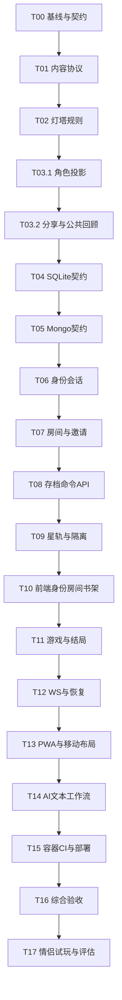

# 04 · 开发阶段与任务清单

> v0.2 设计提案 · 2026-10-26。本文是阶段路线与可验收工作包。T00基线已完成；T00.3迁移38个契约条目，执行因缺实现全部失败，产品未通过，验证状态见[交接记录](开发进度与交接.md)。编码前按相应工作包进一步细化提交，不把计划中的命令结果写成实际验证。

## 1. 如何执行

每个任务依次完成：核对输入与接口 → 写关键行为/失败测试 → 运行确认缺失行为 → 实现最小闭环 → 跑适当检查 → 更新文档和证据 → 讲解代码并停止。用户明确要求继续后，再进入依赖任务。先验证领域规则和数据库，再接 UI，最后完善 AI 表达与部署。

**用户学习检查点：一次只执行一个任务或已登记的子环节。** 较大任务先拆分，不把整个 M 阶段当作一个环节连续完成。完整规则见根目录 [AGENTS.md](../AGENTS.md)，实际进度见 [开发进度与交接](开发进度与交接.md)。

对内容与文档任务使用规则推演、引用检查和审阅，不为了流程而编写镜像测试。对授权、并发、恢复和角色隔离编写真实行为测试。

所有文件路径相对项目根目录 `F:\two-worlds-agent-game`，不是现有文件已存在的声明。任务中目录/文件是预计创建或修订的位置；已有材料位于 `outputs`，迁移必须保留来源说明。

## 2. 依赖图

这是推荐执行顺序，不要求所有未来工作由同一轮会话完成。Mongo 环境暂不可用时，可完成适配器与 SQLite 后推进后端，但 T05 真库验收必须保留未完成，M6 不得因此宣称完整通过。

## 3. M0：基线与需求对齐

### T00 · 整理工程与修订草稿契约

**目的：** 让后续开发只有一套有效接口、一处业务源码，避免按旧六步谜题重复实现。

**输入：** 本次文档集、`outputs/twoworlds/backend/tests/test_platform.py`、旧 pyproject 和本地参考仓库。

**文件：** 根 README；`backend/pyproject.toml`；`backend/tests/`；`docs/reports/environment.md`；`docs/reports/baseline-changes.md`；环境配置与忽略规则。

- [x] 只读检查现有改动、AGENTS.md、Git 状态、Python/Node、依赖工具、Docker/Mongo 与浏览器条件，逐项记录真实结果。见[T00.1环境报告](reports/environment.md)。
- [x] 核实参考仓库本地 HEAD：与历史SHA一致；另有未跟踪test/目录，保持原样。
- [x] 建立 `backend/src/twoworlds` 的包布局、独立虚拟环境与依赖锁，安装/构建/导入验证通过。见[T00.2.2报告](reports/backend-layout.md)。
- [x] 按当前契约修订旧测试，迁入backend/tests/contracts并保留[来源映射](reports/baseline-changes.md)；迁移不等于业务已通过。
- [x] 将旧测试中的长期 token 假设改为恢复密钥/短期会话；`value` 改为动作类型化的 `args`。
- [x] 将返回快照的旧假设改为 `receipt + save`；将“完成必为 version=6”改为当前剧本轨迹、阶段与结局断言；内部完整事实由T02/T09纯规则测试补齐。
- [x] 更正幂等命名空间：按 actor+request_id；同一人的同 ID 换内容必须拒绝，另一人相同 ID 仍独立执行规则。
- [x] 删去固定 `731/248/北极星/天琴座` 作为新玩法验收的要求，改用发现的真实线索文本检查跨角色泄露。
- [x] 明确当前阶段依赖锁定与命令入口；后续新增运行依赖随对应任务锁定验证，不擅自调用付费模型、部署云资源或复制素材。

**验收：** 能在干净环境识别包和收集已迁移测试；缺失实现的失败与依赖错误区分清楚。环境报告有结果与日期，旧材料没有被当成已通过测试。

**产出接口：** 唯一工程入口、动作/响应命名和后续测试的路径基线。

## 4. M1：先证明合作机制成立

### T01 · 内容版本、Schema 与加载

**文件：** `backend/src/twoworlds/content/schema.py`、`_references.py`、`loader.py`、`scripts/lighthouse/1.0.0.json`；`backend/tests/content/test_schema.py`、`test_loader.py`与`test_lighthouse_content.py`。

**输入/输出：** 读取 script_id+content_version，返回校验后的 ScriptVersion；公开目录只返回 ScriptMetadata。

- 学习拆分：T01.1、T01.2.1、T01.2.2已完成；T01.2.3本轮完成发布/纯Python目录/资源集成基础设施，新增45个检查，见[发布报告](reports/content-publication.md)。T01开发环节完成；灯塔缺真实媒体/授权，尚未正式发布，不代表完整游戏验收。
- [x] 定义场景、装置、线索、动作前置、效果与结局映射，按文档 02 校验静态引用完整性；见[T01.1报告](reports/content-schema.md)。
- [x] 写版本不存在、重复 ID、非法角色、悬空场景/线索、未声明原语的失败用例；T01.1+T01.2.1已覆盖静态校验与加载，实际原语执行器仍待T02。
- [x] 编写并按明确版本加载灯塔四场景正式内容；保持双角色前置、双向因果与共同结局声明，测试小样不作为正式剧本。
- [x] 发布快照/哈希与不可覆盖保护、纯Python公开目录、wheel/sdist实际清单与独立安装验证；成功资源集成使用临时测试素材，灯塔未发布（T01.2.3）。
- [x] ScriptMetadata不嵌入机关真值表或私人线索；目录只读已发布版本并验证完整性，文案需人工审核；HTTP接口仍待T08。
- [x] 定义presentation与版本化媒体声明、角色/场景/条件、字幕/替代文字和来源记录；检查声明引用完整。实际素材文件、授权有效性与播放未验证，随内容加载/制作任务继续。

**验收：** 合法内容可加载，非法内容在服务启动/内容加载时失败；内容不能执行任意 Python。

### T02 · 灯塔纯规则引擎

**文件：** `domain/models.py`、`errors.py`、`engine.py`、`mechanics/lighthouse.py`、`mechanics/common.py`；`tests/domain/test_lighthouse.py`。

**接口：** `apply_command(state, script, actor_role, action) → new_state + events` 或 DomainError；输入不被原地改写。

- [x] 按文档02写有效通关、全部光路组合、提前维修、无供电、错误角色、分歧/改投等123个纯领域测试；见[规则报告](reports/lighthouse-engine.md)。
- [x] 执行现有Schema前置/有限效果，实现观察、锁定、反向供电、维修、扫描、共同决策；原内容定义不变。
- [x] 冻结运行状态与嵌套值，失败/重复无变化不改状态或版本，正常配置可逆；覆盖后段拒绝与完整快照比较。
- [x] A单独9个/B单独4个可达世界均无法完成；双人54个可达世界的所有未完成状态均可到达两个结局。
- [x] 实际执行12步/16步纯Python通关与双向反馈；禁止文件/网络访问与Web/存储/AI依赖导入的测试通过。

2026-11-01：领域123通过、内容191通过；全量314通过、38个既有缺API/SQLite实现失败。T02完成待审查；不代表T03投影、真实身份/房间、持久化、媒体或完整游戏验收通过。

**验收：** 不是交换固定代码通关；所有必需角色动作与世界反馈均有测试。对应 QA-G01～G06。

### T03 · 角色投影、共享与完成回顾

**文件：** `domain/projection.py`、`domain/recap.py`；`tests/domain/test_projection.py`、`test_recap.py`。

接口为 `project_save(state, script, role, public_history=None)`、`append_public_history` 与 `build_public_recap`。当前运行在不可变领域值上，正式 Save 聚合由 T04 接入。

#### T03.1 · 双角色信息投影（2026-11-03完成）

- [x] 独立冻结PlayerSnapshot与嵌套展示值，显式字段白名单，不继承/嵌入完整世界或内容。
- [x] 复用公开validate_state入口，验证内容/版本/引用/共享合法性和T02不变量，非法状态拒绝。
- [x] 只显示本人已发现线索、本人装置和当前场景/动态观察；已有合法共享只输出公共{id,text}。未有对话存储时dialogue只为空。
- [x] 以角色、场景和真实前置筛选动作，只输出id/kind/参数，不输出条件、效果或错误表。
- [x] 当前场景/角色演出、媒体角色/场景/条件与cue条件全部通过后，输出资源ID/种类/替代文字/获准文字稿，不带路径/来源/许可。
- [x] 90个新增投影测试通过，领域共213通过、内容191通过；全量404通过、38个既有缺API/SQLite失败，0 errors/0 skipped。见[投影报告](reports/player-projection.md)。
- [x] 提供未来HTTP、WS、AI共用的纯Python入口；这些通道及认证尚未实现/验证，不能宣称集成隔离通过。

#### T03.2 · 线索分享与公共回顾（纯领域完成，待审查）

- [x] share_clue 命令只公开本人已发现且可分享的指定线索文本。
- [x] 公共事件过滤受众和类型，保留最近 30 条。独立保存最多 64 条结构化公共里程碑。
- [x] 两条真实规则轨迹各生成 51 条公共事件。截断后仍可从 8 条里程碑重建各自回顾。
- [x] 29 项新增用例覆盖分享、历史版本、隐私、容量和两端快照。存储与通道集成待后续验收。

QA-P02、QA-P03 已记录纯领域证据。QA-P01 完整通道、QA-P04、QA-M03 和 M1 整体验收待后续验证。当前停在 T03.2 审查检查点。[测试与交付记录](reports/sharing-recap.md)

## 5. M2：持久化、身份与后端闭环

### T04 · 仓储契约与 SQLite 演示

#### T04.1 · 持久化聚合模型与严格序列化（PR #10、#11 已合并）

**文件：** `domain/persistence.py`、`ports/repository.py`、`storage/serialization.py`、`tests/domain/test_persistence.py`。

- [x] 定义 Account/Session、Pair、Save、DialogueTurn、CommandReceipt 不可变模型与字段约束。
- [x] Save 绑定 GameState、PublicHistory 的剧本 ID、内容版本与同一接受版本。
- [x] 回执按 actor+request_id 唯一。存档版本为 0～512，接受版本完整覆盖 1～当前版本，版本 0 为空回执。上限存档仍可读写。
- [x] 限制每个角色 20 轮对话、每个账号 5 个会话；时间必须带时区并规范为 UTC。
- [x] 定义适配器无关 Repository Protocol 与稳定错误类型。
- [x] 严格 JSON 读写重验冻结聚合，拒绝重复键、非有限数字、无效 UTF-8、超限文档和额外字段。
- [x] PR #10 复核通过专项 45 项、领域 297 项、内容 191 项及 Ruff 检查和格式验证。全量 488 通过、38 项既有 API/SQLite 契约失败。[复现命令](reports/persistence-models.md)
- [x] 2026-11-11 连续性修复通过专项 56 项、领域 308 项、内容 191 项。全量 499 通过，38 项历史失败。真实 512 条回执可序列化读取，缺条和版本 513 均拒绝。

#### T04.2 · SQLite 事务与仓储契约（实现完成，待 PR 审查）

- [x] 建立共享仓储行为测试：唯一建档、重开文件恢复、CAS 双提交、重复回执、历史上限。
- [x] 使用 SQL 事务与版本过滤，同时提交状态、历史、对话和回执；真实 SQL 触发器故障验证完整回滚。
- [x] 同一档并发只有一个基于旧版本的提交成功；两个实际存档的版本和回执互不影响。
- [x] 创建房间强制 B 为空；普通 Pair CAS 保持 B 不变，只有验证邀请的 join_pair 可以占位。
- [x] 使用两个独立 Repository 实例与连接竞争 B 位、建档和同版本提交，无 Python 进程锁。
- [x] 满 512 条时仍能查询旧回执；新 CAS 抛 `ReceiptLimitReached`，不删回执。调用方须先查回执；HTTP `SAVE_COMMAND_LIMIT` 映射留 T08。

2026-11-11：SQLite 专项 11、共享仓储契约 30、领域 308、内容 191 通过。全量 540 通过、38 项历史契约失败；失败用例与 PR #11 基线逐项一致，现缺 `twoworlds.api.app`。Ruff 检查和 48 文件格式检查通过。[事务、用例与复现命令](reports/sqlite-repository.md)

**验收：** 文件重开可恢复；无进程锁替代数据库约束。SQLite 结果只标 SQLite 通过。

### T05 · Mongo 实现与真实数据库契约

T05 按学习检查点拆分；T05.1 已合并，T05.2 实现和真实数据库契约已完成，待本轮 PR 审查。此状态不表示生产部署/认证或 HTTP 接口已完成。

#### T05.1 · MongoDB 环境、驱动与真实连接验证

- [x] 核实 PR #12 合并，从最新远端建立独立分支；检查已有工作区、Docker、端口、容器与数据卷。
- [x] 通过 uv 加入同步 PyMongo，锁定 4.19.0 及传递依赖 dnspython 2.9.2；原有 22 包版本不变。
- [x] 准备仅绑定回环地址的 MongoDB 8.0.34；用环境变量连接，真实 Ping、临时 CRUD 与清理通过。使用官方缓存 mongodb/mongodb-atlas-local:8.0 的 mongod 入口；推荐 mongo:8.0 下载未完成，差异见报告。
- [x] 新建专用容器和数据卷；同一卷的测试文档跨容器重建及显式 restart 保留，验证后清理临时库。
- [x] 安装后全量后端 540 通过、38 项历史 API 失败，失败标识与消息均未变化；Ruff/48 文件格式、24 包锁检查通过。

T05.1 已在 PR #13 合并为 `7fdcfc2`；证据、版本和复验命令见 [MongoDB 环境报告](reports/mongo-environment.md)。环境验证只证明连接；仓储证据单独记录如下。

#### T05.2 · MongoRepository 与业务契约（实现与真库契约完成，待审查）

MongoDB 8.0.34 standalone + PyMongo 4.19.0，16 个方法与现有 Protocol 一致。领域模型、协议、依赖和 SQLite 实现未改。[结构、命令与实际结果](reports/mongo-repository.md)

**文件：** `storage/mongo.py`、`storage/indexes.py`；`tests/storage/test_mongo_contract.py`；本地 Mongo 测试配置。

**接口：** 与 T04 相同；Save 单文档 CAS，Account 单文档会话管理，Pair 单文档占位。

- [x] 创建文档 03 的稳定唯一/查询索引；重复建档唯一冲突后返回原档；索引冲突失败而不删除旧索引。
- [x] 同一单文档 CAS 写入状态、公共历史、对话、版本和回执，不使用跨文档事务。
- [x] 同一份30项共享契约在真实 Mongo 和 SQLite 各通过；Mongo专项17、SQLite专项11通过。
- [x] 两个独立客户端/仓储实例以 ThreadPoolExecutor + Barrier 验证竞争提交、抢 B 和重复建档，无 Python 锁。
- [x] 不可达地址初始化失败；停止独立临时 Mongo 后读/CAS 抛仓储错误；共享数据库不停止。HTTP 就绪接口未实现。

全量后端557通过、38项历史API失败（用例ID/消息与T05.1逐项一致），领域308、内容191通过，Ruff/51文件格式/24包离线锁通过。只完成本环节，T06未开始。

**验收：** 留下连接目标类型、运行命令、用例结果、索引确认和证据时间，敏感 URI 脱敏。无法运行真库时本项标未验证，不用 mock 代替。

### T06 · 身份、恢复、期限会话与登出

> 2026-11-18 用户决定：移除匿名身份与恢复密钥，改为邮箱+密码账号。T06.1/T06.2 的恢复密钥实现作为历史证据保留，不再是现行契约；现行设计见 T06.3。

#### T06.1 · 身份服务核心（已完成，PR #15已合并）

**文件：** application/identity.py、security/credentials.py；tests/application/test_identity.py。

- [x] secrets生成独立256位恢复密钥和会话，统一SHA-256摘要；账号与初始会话一次持久化。
- [x] 四个核心接口create_account/recover/authenticate/revoke只依赖Repository Protocol，不直接访问数据库。
- [x] 有效期7天，created_at <= now < expires_at；错误用途、账号ID、过期、撤销或淘汰凭证均拒绝。
- [x] 恢复/撤销以版本CAS有限重试，按created_at稳定排序保留最新5个，失败不覆盖其他设备变更。
- [x] SQLite/Mongo上同一44项身份测试通过，包含两服务共享仓储对象、独立仓储同库的真实CAS竞争。
- [x] 恢复不改变原Pair/Save；异常/日志/普通repr不含明文秘密。重复撤销失效token按正式已认证契约拒绝。

[接口、边界和实际回归](reports/identity-service.md)。仅服务层取得QA-I01～I04部分证据，不宣称HTTP/WS验收通过。

#### T06.2 · HTTP身份接口与安全策略（本轮完成，待PR审查）

**文件：** api/app.py、auth.py、errors.py、rate_limit.py、routers/accounts.py、sessions.py及相应schema/tests；FastAPI移入运行依赖。

- [x] 接通创建/恢复/me/当前登出；专用字段白名单与稳定错误码，严格请求拒绝额外身份字段。
- [x] 创建/恢复各自按IP每60秒5次、线程安全且有界的单进程限频，429与Retry-After；不信任任意XFF。
- [x] Bearer凭证认证、no-store覆盖成功与错误、安全异常响应、日志不含凭证；错误凭证统一401。
- [x] 两个独立应用关闭/重开同一真实SQLite文件后恢复同一身份；真实Mongo HTTP流程通过。
- [x] 初次交付新增HTTP/限频31项与原身份契约6项共37通过；身份服务44、SQLite仓储41、Mongo仓储47、Domain308、Content191通过。
- [x] 初次交付串行全量638通过/32既有业务契约失败，无新增失败ID；原38失败中身份6项转通过，其余从缺模块变为缺房间路由404。[逐项比较及首轮偶发失败记录](reports/identity-http.md)
- [x] 初次交付Ruff、68文件格式与24包离线锁检查通过，原24包版本均不升级。
- [x] PR #16审查修复：HTTP正文16384字节双重检查、413 REQUEST_TOO_LARGE/no-store；CORS中间件与外层429均仅向允许来源暴露Retry-After。新增23项，正文16、限频/CORS10（含旧3）、身份28、原身份契约6共60项通过。
- [x] 审查修复回归：身份44、SQLite41、真Mongo47通过；全量661通过/32失败，失败ID和消息与本PR原记录完全相同，无新增/消失；Ruff、69文件格式与24包锁通过。
- [ ] WS 握手、持续鉴权、过期关闭当时留 T12；前端缓存排除留T10/T13，本轮不标通过。

HTTP部分取得QA-I01～I05证据，WS等跨通道部分未验收，T06整体不据此宣称完整产品验收。仅实现T06.2，T07/T08及前端未开始；本轮PR交付后停止等待用户审查。

#### T06.3 · 邮箱账号认证（2026-11-18 用户决定，替代匿名恢复密钥）

用户决定：首版只做邮箱（不做手机号与第三方登录）；彻底移除匿名身份与恢复密钥；按完整逻辑实现注册、登录、找回密码、会话与安全。设计已在 T06.3.1 完成，实现一次只执行一个子环节。

- [x] T06.3.1 设计：改写 docs/01 身份流程、docs/03 §5 契约（账号模型、验证码、Cookie、CSRF、邮件适配器、WS）、docs/05 验收、README 与交接；旧恢复密钥契约标注为历史。
- [x] T06.3.2 后端（PR #32 已合并）：Account 迁移（email/password_hash/email_verified_at）、Argon2id、验证码服务与 EmailCodeSender（console/smtp）、注册/登录/找回/登出/me、Cookie 会话、Origin 校验、数据库共享原子限频、防枚举；`/api/sessions/recover` 与恢复密钥后端代码已删除；SQLite/Mongo 真库契约与测试替换。见[实现报告](reports/t06-3-2-email-auth-backend.md)。
- [x] T06.3.3 前端：邮箱登录、验证码注册、找回密码、倒计时、启动验证与登出，Cookie 接入房间、书架、游戏和媒体。PR #33 已合并，浏览器联调与回归见 [T06.3.3 报告](reports/t06-3-3-frontend-email-auth.md)。
- [ ] T06.3.4 历史清理与产品验收。前端启动按旧版归属精确清理，新建隔离演示库后重新注册，验证双人产品流程。正式数据库、SMTP、HTTPS 和发布素材的验收证据仍待补齐。见 [T06.3.4 报告](reports/t06-3-4-identity-cleanup-acceptance.md)。

### T07 · 双人房间与邀请（PR #17已合并）

**文件：** application/pairs.py、api/routers/pairs.py、api/schemas/pairs.py、security/credentials.py；Repository与SQLite/Mongo成员查询；tests/application/test_pairs.py、tests/api/test_pairs.py、共享契约。

- [x] 创建固定A/B空位，独立tw_invite_命名空间、32字节安全随机、仅SHA-256摘要入库、24小时UTC期限。
- [x] 仅A且未满员可刷新；唯一冲突/版本冲突有界重试。旧邀请立即失效，不能用session/recovery冒充邀请。
- [x] 仅join_pair可占B；自己加入拒绝、第三人满员409、同B重复/并发重试幂等，不增加第二次版本。
- [x] 角色来自已认证Account；严格空请求/邀请模型拒绝成员/角色字段，四端点均no-store，PairError统一映射。
- [x] list_pairs_for_member双适配器实现，成员过滤/完整校验/id升序；HTTP只给{id,role,member_count}数组。
- [x] 独立真实仓储/应用抢B与刷新/加入竞争；Barrier仅对齐真实写入，两个强制获胜顺序与自由竞争均通过。
- [x] PairService30、房间HTTP55、SQLite/Mongo共享契约各31通过；并发组独立复验10通过。
- [x] 全量781项：750通过/31失败/0 errors/0 skipped。基线663/32，新增86项且无新增失败ID，旧房间竞争契约转通过；剩余31项在POST /api/saves返回404。[完整报告及逐项对比](reports/pairs-api.md)
- [x] Ruff/74文件格式/24包离线锁通过；未改IdentityService、GameState、原身份测试或契约断言。
- [ ] QA-R04开场、未满员游戏写入/NPC完整HTTP验收依赖T08等后续，未标通过。

**验收：** 本轮取得QA-R01～R03；房间API可用不等于完整游戏可玩。T08、WS、前端、AI、部署未开始，交付后停止等待用户审查。

### T08 · 独立存档、命令与回执 API

本阶段拆分为T08.1目录与存档生命周期、T08.2命令/CAS/回执、T08.3受保护媒体。一次只执行一个子环节。PR #18已合并为`eb38e045ffcf9f42162bc69063796a409a348e53`；PR #19已合并为`e28cb0b620e79384a12026081459c38003186c0f`；本轮仅T08.3。

#### T08.1 · 剧本目录与存档基础生命周期（[PR #18](https://github.com/ajsjsjjbshshsj/two-worlds-agent-game/pull/18)已合并）

- [x] GET /api/scripts只返回PublicationStore的发布Metadata，语义版本排序；默认正式库为空，不自动发布灯塔草稿。
- [x] POST /api/saves要求pair_id、script_id、精确script_version；严格拒绝客户端state/role。成员授权后规则初始化，绑定版本、UTC时间和空公共历史。
- [x] 数据库唯一(pair,script)保证并发只创建一个档；同版本重复返回同档，不同版本409且不升级。
- [x] GET /api/saves按本人房间过滤，支持pair_id，只返回摘要；Repository及SQLite/Mongo新增list_saves_for_pair。
- [x] GET /api/saves/{id}验证成员并调用project_save，响应仅个人快照加id/pair_id；外人404，缺旧版本/内容损坏拒绝回退。
- [x] 新增发布快照、严格输入、A/B私密/共享、应用关闭重开与双独立应用唯一建档测试；两种适配器真实执行。
- [x] 应用14、API37、SQLite仓储44/真实Mongo仓储50通过；完整804通过/31历史失败。新增失败ID为0，31条缺精确版本的旧请求由404变422，未执行后续断言；Ruff/80文件格式/离线锁通过。[实际结果与逐项对照](reports/saves-lifecycle.md)

学习入口：application/saves.py → api/schemas/saves.py及routers/saves.py → 仓储list_saves_for_pair → tests/api/test_saves.py。[本轮报告](reports/saves-lifecycle.md)。QA-S01与精确版本/HTTP投影取得专项证据，完整游戏通关、命令回执和媒体仍待T08.2/T08.3。

#### T08.2 · 游戏命令、CAS与幂等回执（[PR #19](https://github.com/ajsjsjjbshshsj/two-worlds-agent-game/pull/19)已合并）

- [x] 严格GameCommand、规范SHA-256指纹，服务端认证/成员推导角色，拒绝额外权威字段。
- [x] 先查本人回执再查版本，同一存档同actor的同请求返回原接受版本和当前个人快照；换内容409 REQUEST_ID_REUSED，跨存档同UUID相互独立。
- [x] 精确发布版本调用纯规则与公共历史，完整Save聚合一次CAS；失败重读同回执或409，不自动重放。
- [x] 本人回执查询隔离；512条完整保留，旧确认/读档可用，新命令SAVE_COMMAND_LIMIT。
- [x] 两独立应用/Repository在SQLite及真Mongo实际竞争；HTTP两结局、私密投影、分享、应用重开及响应失败恢复。
- [x] 旧测试辅助显式版本和真实临时发布库，保留业务断言；独立旧契约29通过/9后续阶段失败。
- [x] 最终完整913项=904通过/9后续失败，新增78项全通过；原31失败中22项转通过，新增失败ID为0。SQLite仓储44、真Mongo50、Ruff/84文件格式/离线锁通过。[真实结果与逐项对照](reports/commands-receipts.md)

#### T08.3 · 受保护媒体（[PR #20](https://github.com/ajsjsjjbshshsj/two-worlds-agent-game/pull/20)已合并）

- [x] GET /api/saves/{id}/media/{asset_id}复用认证、成员推导角色、精确发布版本及个人投影，仅授权当前背景/cue中的素材。
- [x] 通过PublicationStore读取原始字节，保留路径/链接/Junction/哈希/体积边界；MIME白名单与格式签名筛查，no-store与nosniff。
- [x] 不使用公开静态目录、外部URL或CDN；Range/条件请求不能绕过权限，读操作不修改完整Save聚合。
- [x] 新增75项通过（HTTP60=SQLite30/Mongo30，格式15），加强后12项复验通过；完整988项=979通过/9后续失败（T09/T12/T14），新增失败0/移除用例0/错误0/跳过0。Mongo共享契约32、Ruff/86文件格式/离线锁通过，见[媒体报告](reports/protected-media.md)。
- [ ] 正式媒体制作与许可、前端播放/Service Worker、手机体验及完整QA-M03/M07待后续，不能由临时测试素材代替。

学习入口：application/saves.py的read_media → domain/projection.py的_presentation → content/publication.py的read_media → api/routers/saves.py → tests/api/test_media.py。完成后停止等用户审查，不自动执行T09/T10。

#### T08后端接口与验收总表

**文件：** `application/saves.py`、`api/app.py`、`api/routers/saves.py`、`api/schemas/commands.py`；`tests/api/test_commands.py`、`test_permissions.py`、`test_recovery.py`。

- [x] 接通剧本目录、唯一建档、读档、本人存档列表和命令提交。
- [x] 按“授权→已接受回执→版本→规则→CAS”执行；CAS 失败重读确认相同回执。
- [x] 相同 actor 同 ID 换内容拒绝；原响应丢失后旧版本重试仍确认成功，返回当前投影。
- [x] 实现本人回执查询；外人读/写/查询回执统一无权访问。
- [x] 接通受保护媒体读取端点，复用会话/成员/角色/事实授权；白名单路径，返回no-store。仅后端部分，正式素材/缓存/播放未验收。
- [x] 通过 HTTP 用两个身份完成灯塔，停止并重建服务，再恢复同档。
- [x] 测命令 512 上限、先确认旧回执、容量错误不写入、普通阅读仍可用。

**验收：** 后端无 UI 可玩；所有 API 稳定错误码与角色投影一致。对应 QA-C01～C07、QA-S01～S03。

## 6. M3：第二机制与跨档隔离

### T09 · 星轨、内容复用与存档隔离

按用户授权拆成T09.1纯内容/领域与T09.2存档隔离及版本相关验证；一次只执行一个。本轮T09.2基于PR #21实际合并提交`a76bb16a1a8308746d0b82c54862b34c8e31ef22`，不执行T10。

#### T09.1 · 星轨剧本与纯规则引擎（已完成，[PR #21](https://github.com/ajsjsjjbshshsj/two-worlds-agent-game/pull/21)已合并）

**文件：** `content/scripts/starline/1.0.0.json`、`domain/mechanics/starline.py`、`domain/engine.py`、`domain/errors.py`；`tests/domain/test_starline.py`、`tests/content/test_starline_content.py`。

- [x] 正式JSON：survey→boarding→decision→completed，双角色记录与设备、扫描/信号公共工程事实、两个共同结局和每场景双角色presentation。
- [x] 服务端5单位预算：engine/sonar/lamp成本3/3/1，超预算整组拒绝；复用通用有限效果，不自动补正配置。
- [x] 回声→扫描→导轨→信号→轨道→接车的双向前置链；安装后限制回声闸操作，已扫描/已确认事实保留，错误配置可恢复。
- [x] 统一引擎静态注册lighthouse/starline，未知ID拒绝；复用条件、参数、效果与共同投票。没有复制引擎或更改灯塔规则。
- [x] 新专项96通过、原灯塔123通过、全部内容202通过；完整1088项=1079通过/9既有失败、0错误/跳过。相对988旧基线新增100项含本轮96及已合并PR #20的4项，移除0、新增/消失失败0。Ruff/89文件格式/离线锁通过，见[星轨报告](reports/starline-engine.md)。
- [ ] 正式25项素材文件/来源许可仍待制作与核验；禁止生产发布，不以测试文件代替。

QA-G07/G08/G09仅记录纯领域/内容证据。星轨尚未正式发布，HTTP游戏、媒体播放、跨档持久化和完整产品验收未完成；本轮不修改仓储、身份、房间或API。完成后停止等用户审查。

#### T09.2 · 双剧本HTTP、存档隔离与精确版本（已完成，[PR #22](https://github.com/ajsjsjjbshshsj/two-worlds-agent-game/pull/22)已合并）

- [x] 测试发布工厂分别加载真实灯塔/星轨JSON；校验正确的合成PNG/WAV、哈希与test-only审核通过现有发布流程。正式发布目录仍为空。
- [x] 公共回顾加入扫描、装轨、信号、接车四个结构化里程碑；保留灯塔兼容与严格历史校验，超过30条事件后仍可恢复。B查看功率板之前不显示数字预算。
- [x] 双适配器HTTP两结局、灯塔→星轨→灯塔、完整聚合/回执/角色隔离、应用和连接重开：新增HTTP/工厂41通过（SQLite19/Mongo19/工厂3）。
- [x] 真正封存2.0.0测试版本，验证旧档原规则/线索/媒体不变、精确版本缺失拒绝回退。
- [x] 双适配器共享仓储各33通过，验证DialogueTurn按存档和角色保存、重开不串档；不声称真实HTTP/NPC私聊已实现。
- [x] 领域/内容603通过，Ruff/90文件格式/24包锁通过；完整1138项=1131通过/3既有失败/4Mongo初始化错误，4错误独立复验全部通过。新增50/移除0，六项星轨失败消失，保留WS两项/NPC一项；原始全量未二次重跑，不合并复验统计冒称全绿。

验收证据与实际测试统计见[双剧本隔离报告](reports/starline-save-isolation.md)。只验证现有统一HTTP/仓储的复用，不改仓储/接口、不做版本迁移；QA-S02仅为应用/连接重开，QA-P04只取得存储部分证据。WS、NPC、前端、正式媒体与生产恢复仍未完成。交付后停止等待审查。

## 7. M4：用户可玩的网页版本

### T10 · 前端身份、房间与剧本库

T10.1已合并。用户最新附件明确授权本轮顺序完成T10.2.1与T10.2.2：先通过身份安全测试，再开发房间/书架，两个功能提交、一个PR，最终统一停止。

#### T10.1 · Vue工程与身份系统（已实现，[PR #23](https://github.com/ajsjsjjbshshsj/two-worlds-agent-game/pull/23)已合并）

**文件：** `frontend/src/views/Identity.vue`、`services/http.ts`、`stores/identity.ts`、`types/api.ts`、最小路由/样式/工程配置和三份行为测试。

- [x] Vue3/TypeScript strict/Vite/Router/Pinia，npm精确依赖与package-lock；无大型UI框架、WS、PWA或外部服务。
- [x] 按后端四个真实身份接口创建/恢复、GET me启动验证、DELETE当前会话；Bearer/no-store/omit、204与统一安全错误、超时和未知创建结果，不自动重试。
- [x] token仅内存/sessionStorage；401清理、网络故障保留；恢复密钥只在页面内存一次性展示，复制/手动备用、确认清除，不持久化。
- [x] 深蓝/雾蓝/暖金中文响应式界面，清晰加载/错误/重试与未确认登出，无空功能按钮。真实1440/390px创建页检查无横向溢出，三个按钮48px高。
- [x] 首次前端40项与后端身份API30项为历史结果；PR #23再次修复按身份Pending、登出/恢复隔离及多提醒后，当前82项（原68保留、新14）、类型检查/构建/格式通过，后端未修改/未重跑，见[报告](reports/frontend-identity.md)。
- [x] T10.1当时未完成真实HTTP联调；T10.2已补最小开发TCP入口，真实SQLite/Mongo与独立浏览器流程通过，不能把此证据倒填为T10.1当时通过。

T10.1代码与组件验收已完成并合并；真实HTTP联调于后续T10.2验证，见本轮报告，不宣称三端产品完成。开发依赖审计4项moderate保留记录，生产依赖审计0项。

> 2026-11-18 起，一次性恢复密钥与未确认提醒界面由 T06.3 的邮箱账号体系取代；本节记录保留为历史，不再作为现行界面契约。

#### T10.2 · 身份生命周期收尾、双人房间与剧本书架（已实现，待本轮PR审查）

最新用户授权覆盖上轮分开暂停安排：两个子环节顺序执行，T10.2.1安全测试通过才进入T10.2.2，两个功能提交合为一个PR，不重开已合并PR #23/#24。

##### T10.2.1 · 身份存储告警生命周期与 SPA 路由离开保护（完成）

**文件：** `frontend/src/stores/identity.ts`、`frontend/src/views/Identity.vue`、Vue Router配置，以及身份Store/页面/路由测试。

- [x] 区分临时存储访问失败与损坏/不合规元数据提醒；分别跟踪读取、写入、删除失败，避免一个无关成功操作清除另一个仍存在的问题。
- [x] 对应操作后续成功并确认恢复时，只清除该操作对应的临时警告：成功读取清除读取失败、成功写入清除写入失败、成功删除清除删除失败。格式无效记录的提醒不得因无关操作成功而清除；不自动删除或改写无法识别的记录。
- [x] 保留 localStorage 不可用时的内存提醒和准确告警；Recovery Key 不进入Pinia或任何持久化存储，Session Token保持既有内存/Pinia与sessionStorage，仅Bearer头发送，不进入localStorage、URL或日志。
- [x] 在 Vue Router 的 SPA 路由离开流程中保护尚未确认保存的一次性 Recovery Key。取消离开必须留在当前页面且保留密钥；明确确认离开后才允许卸载并清除页面内存密钥，按身份 Pending reminder 仍保留。密钥已确认保存后不得再阻断路由。
- [x] 保留 `beforeunload` 对刷新/关闭标签页的保护，避免 SPA 导航和浏览器卸载触发重复或冲突提示。
- [x] 新增测试覆盖读取/写入/删除分别失败后恢复、一个操作成功不误清其他告警、无效元数据警告持续、路由 push/back 取消与确认、确认保存后正常导航、Pending提醒保留及凭证不持久化。

**验收：** 告警与真实存储状态一致；不因存储短暂故障永久保留过期警告，也不因一次无关成功误报恢复；路由导航不会静默丢失一次性密钥。原82项前端测试保持通过，新增用例全部通过。

##### T10.2.2 · 双人房间与剧本书架（完成，正式目录仍为空）

- [x] 房间创建/选择、邀请fragment读取清理、恢复后加入与角色展示。
- [x] 书架展示两档独立进度、版本、角色说明和准确的继续入口。
- [x] 两独立浏览器真实创建身份并进入同一房间，验收QA-U01～U02；不提前创建空Pair/Library页面。
- [x] 开始真实双浏览器验收前核对后端可启动入口与真实HTTP连接；若仍无可用入口，明确记录阻断并单独拆分处理，不以响应桩冒充联调通过。

补充实际边界：正式GET /api/scripts当前返回[]，空书架正常展示；非空双剧本、旧版与完成档使用隔离TEST-ONLY发布库验证，没有正式素材/授权发布。书架按房间/剧本关联并保留原save_id与版本；受保护路由、fragment立即清理、邀请仅内存与迟到响应隔离均实现。新增开发工厂仅回环、显式存储/Origin，Uvicorn0.54.0仅dev依赖，不改既有权限/仓储规则。

前端125项通过（原82测试文件和fixture未改，新增43）；typecheck/build/format通过；启动器16项通过（含两真实CLI/TCP子进程）。SQLite与真实Mongo各自三个独立Edge上下文通过QA-U01及test-only QA-U02，1440/390模拟无横向溢出，非真机/正式内容上线。完整后端回归及提交信息见[本轮报告](reports/t10-2-identity-room-library.md)。交付后停止，T11未开始。

### T11 · 场景、装置、线索、决策与回顾

**文件：** `views/Game.vue`、`Ending.vue`；`components/Story.vue`、`SceneRenderer.vue`、`Device.vue`、`Clues.vue`、`Dialogue.vue`；`services/media.ts`、`audio.ts`、`cues.ts`；`stores/game.ts`；版本化媒体资源与清单。

按[视听设计](07-场景动效与音频设计.md)分成T11.1场景与装置动效、T11.2基础音频与字幕、T11.3因果演出集成；实际执行一次一个子环节，完成后停下来讲解。

- [ ] 根据个人快照渲染装置和允许动作，不在前端写完整谜题真值表。
- [ ] 两剧本的设备采用可复用控件，按角色显示对应操作。
- [ ] 展示合法试验后的观察变化、错误提示、可共享线索和合作目标。
- [ ] 两角色有实际场景插画和可交互物件；每剧本至少3处合作因果动效与1段可跳过关键演出，不能用纯文本替代。
- [ ] 接入每剧本的环境音、至少3类事件音效与至少1段带文字的短叙事音频；主动开启、音量、静音、跳过与重播可用。
- [ ] 依已确认快照与演出标识触发动画/音效，素材加载失败、静音与减少动态效果有可操作替代。
- [ ] 共同选择支持分歧与改选，结局回顾仅展示公开贡献。
- [ ] 初步通过页面完整玩完两剧本；此时可先手动刷新，下一任务接同步。

**验收：** 不需要开发者直接调用 API 代操作；没有只存在于截图中的假按钮。QA-U03、G01、G07、QA-M01～M07；素材引用与来源可核对。

T11.1实际交付：个人快照严格解析、通用行动/设备、原创SVG/CSS原型、服务端确认后动效、图片鉴权/释放、手动刷新。146项前端通过，原125未改；真实SQLite/Mongo界面分别通关两剧本（仅隔离TEST-ONLY内容），报告见[场景与装置](reports/t11-1-scene-device.md)。仅T11.1完成待审查；上方正式美术/音频/复杂演出与完整产品验收仍未完成，T11.2/11.3未开始。

### T12 · 实时连接、幂等与恢复

**文件：** `backend/src/twoworlds/realtime/subscriptions.py`、`protocol.py`、`api/routers/websocket.py`；`frontend/src/services/websocket.ts`、`pending.ts`；`components/SyncStatus.vue`；实时与 E2E 测试。

- [x] T12.1：精确 Origin、Cookie 握手、会话过期与撤销、成员权限、心跳与个人初始快照。PR #31 已合并。
- [x] T12.2.1：同档双向推送个人快照，前端按会话和连接代次接收，拒绝重复和旧版本。切档、离页、登出关闭旧连接，HTTP 回执与操作声音独立确认。
- [x] T12.2.2：前端退避重连、前台会话复核、HTTP 补偿和断线写入门控。后台停轮询，恢复首帧建立静态基线。
- [x] T12.2.3.1：请求未知时保留原 ID，普通机关待确认记录可在刷新后恢复。NPC 私聊正文和分享内容只保留在当前页面内存。
- [x] 验证断线、旧 WS 与 HTTP 快照迟到和恢复时的媒体隔离。
- [x] T12.2.3.2：验证服务进程重启后的回执与快照，以及两设备同账号的提交竞争。

**验收：** QA-W01～W07；自动化浏览器可完整复现恢复，失败不靠刷新后重新开档掩盖。

#### T12.1 · 服务端 WebSocket 连接与鉴权（2026-11-18）

在原分支 `codex/t12-1-websocket-auth` 普通合并 `codex/bootstrap` 的 PR #32 合并提交 `4c3049f`。T12.1 现以 `tw_session` Cookie 握手鉴权，复用已有邮箱会话和 `SaveService.read_save`，继续提供个人初始快照、精确 Origin、非成员/缺档统一关闭、重连读新快照和心跳续验。

两项原 WebSocket 契约保留投影、重连和外人隔离断言。真实 SQLite、MongoDB 与回环 TCP 验证见 [T12.1 报告](reports/t12-1-websocket-auth.md)。

#### T12.2.1 · 实时个人快照与前端同步（2026-11-21）

连接内约每 250 ms 检查存档版本。有更新时用既有角色投影发送 `snapshot`，发送前复核会话。游戏页先用 HTTP 获取本人存档范围，再接收符合账号、存档、角色、剧本和连接代次的较新版本。断开后可手动重新读取进度并建立连接。SQLite 和真实 MongoDB 均用回环 TCP 验证双向动作、个人投影和重复版本抑制。验收证据见 [开发进度与交接](开发进度与交接.md)。

#### T12.2.2 · 断线恢复与 HTTP 补偿（2026-11-21）

游戏页每个当前存档只有一个恢复管理器。断线按 0.5 至 15 秒的指数间隔加抖动自动重试，游戏页在后台时暂停。恢复前台先复核会话，再读取本人最新投影。WebSocket 与 HTTP 共用版本检查，只有确认当前进度后才允许提交新操作。恢复首帧只更新画面和授权媒体，待确认命令继续服从 HTTP 回执。验证与限制见 [开发进度与交接](开发进度与交接.md)。

#### T12.2.3.1 · 跨刷新恢复原命令（2026-11-21）

发送白名单机关操作前，用严格持久性 IndexedDB 事务记录按账号、房间、存档、剧本版本和角色绑定的原 UUID 与命令包络。刷新或重开浏览器后经过 `/api/me` 与本人存档投影，查询原 UUID 的服务端回执。确切回执解除待确认，画面仍经过原有快照版本门控。没查到时继续保留记录，可手动查询。如果原版本及白名单参数仍符合本人当前操作投影，用户也可以明确确认后重发同一命令。记录保留 24 小时，每浏览器来源最多 32 条。Chromium 在真实 SQLite 和 MongoDB 中均验证了维修成功但浏览器丢失 POST 响应的流程，恢复后用一次 GET 找到回执，版本只推进一次。测试命令和复现步骤见 [开发进度与交接](开发进度与交接.md)。

#### T12.2.3.2 · 服务重启和同账号多设备竞争（2026-11-21）

在 CAS 已提交、HTTP 响应头尚未发送时终止真实 API 进程，并用同一 SQLite 文件或 MongoDB 库启动新进程。验证完整存档、原 UUID 回执和角色投影一致，现有 Cookie 可重新连接 WebSocket。同一账号的两个独立会话在真实 CAS 边界竞争，覆盖相同 UUID/参数、同 UUID 改参数、不同 UUID/同预期版本。首个成功只追加一条回执。前端遇到 `VERSION_CONFLICT` 主动读取权威快照，等较新版本后才允许玩家重新选择行动。两套数据库均实测了独立 Chromium 会话的恢复与收敛，复现步骤见 [开发进度与交接](开发进度与交接.md)。

### T13 · PWA、移动端与无障碍

**文件：** `frontend/public/` 的 manifest/图标；PWA 配置；响应式样式；`e2e/mobile-layout.spec.ts`。

- [x] T13.1：手机分区、平板/桌面双栏、触控尺寸、焦点与软键盘可视区适配。七种尺寸 Edge 矩阵 154 场景通过，前端 434 项测试通过；真机未验证，见 [报告](reports/t13-1-responsive-accessibility.md)。
- [x] T13.2：生产 manifest、原创安装图标与原生 SW；构建生成精确公开资源/SHA-256 白名单，排除所有 API、认证、WS、快照、私聊与受保护媒体。
- [x] T13.2：独立公共离线页、离线业务门控；联网后沿用原恢复器重新鉴权、读权威进度并核对原 UUID，不自动重发。真实 SQLite 和实际 Cache Storage 通过，见 [报告](reports/t13-2-safe-pwa.md)。
- [x] T13.3：桌面 Chromium 验收音频、字幕、减少动态、前后台恢复、安装及缓存边界。真实 SQLite 流程和桌面 Chrome 独立窗口验证通过，详见 [专项报告](reports/t13-3-mobile-lifecycle.md)。
- [ ] iPhone/Android 真机前后台、系统音量与主屏安装入口待实测；QA-U04～U06 和 T16 待完整验收。

**验收：** QA-U04～U06；真机无条件时写“未验证”，不使用模拟器结果替代。

#### T13.1 · 响应式、触控与无障碍（2026-11-22）

基于 PR #40 已合并的 `11fc043` 开发。手机使用单栏和页内分区入口，行动先于长线索；平板与桌面保持双栏且 DOM 顺序与键盘顺序一致。44px 控件、16px 输入字号、长文本换行、安全区域、设备焦点与文字状态、VisualViewport 遮挡处理均已实现。七种尺寸包含横屏、放大文字、邀请、待确认恢复、音频控件和跳过演出；本机 Edge 154 场景及原有 428 + 新增 6 项单测通过。HTTP/WS 浏览器数据为显式夹具，不替代真实后端联调。iPhone/Android/iPad 与 Safari 真机、屏幕阅读器验收留 T16，T13.2 PWA 尚未实施。完整证据和阅读顺序见 [T13.1 报告](reports/t13-1-responsive-accessibility.md)。

#### T13.2 · 安装、安全缓存与恢复（2026-11-22）

PR #41 已合并至 `f2c9d10` 后独立开发。仅在生产安全上下文注册，原生 SW 无运行时缓存、后台命令或强制更新。当前只预缓存 10 个公开构建资源，API/导航网络响应永不写 Cache Storage；离线返回独立公共 HTML。真实 Edge 检查缓存键与响应摘要、凭证/编码/查询/跨源、更新等待与重定向失败，另验证 `/worlds/` 子路径生产构建。真实 SQLite 在响应丢失、浏览器退出和离线重开后按原 UUID 恢复到搭档已推进的 v2，再正常操作到 v3，原回执唯一。前端原 434 项保留，新增 29 项，全量 463 通过；T13.1 原 154 个布局场景仍通过。手机与系统原生安装未验证，T16 不标完成。细节见 [本轮报告](reports/t13-2-safe-pwa.md)。

## 8. M5：AI 与未来能力边界

### T14 · LangGraph、Provider 与能力接口

**文件：** `ports/narrative.py`、`ports/voice.py`；`ai/graph.py`、`demo.py`、`provider.py`、`validation.py`；`application/dialogue.py`；`tests/ai/`；`api/routers/capabilities.py`。

#### T14.1 · AI NPC 基础接口、角色上下文隔离与默认演示模式（2026-11-22 已完成）

- [x] 定义 `NarrativeContext` 严格白名单结构（不可变 frozen DTO），仅包含授权的剧本、场景、角色、个人线索/设备、已公开线索/里程碑、本角色最近 20 轮私聊、问题和人设。
- [x] 抽象 `NarrativeProvider` 端口（`NarrativeRequest` / `NarrativeResponse`），严禁接收 SaveRecord、仓储对象、密码或认证 Token。
- [x] 实现 `DemoNarrativeProvider`，无网络、无 API Key，固定稳定回复，清楚标识 `mode="demo"`。
- [x] 接入 `SaveService.submit_command` 的 `talk` 流程，通过 `project_save` 确保角色上下文天然隔离。
- [x] 在 `tests/api/test_narrative_isolation.py` 编写 40 项安全隔离测试（基于 `FakeProvider`），证明 A/B 私密线索隔离、跨存档/跨账号隔离、Prompt 注入不扩大权限且不破坏游戏事实。详见 [T14.1报告](reports/t14-1-narrative-provider.md)。

#### T14.2 · LangGraph 文本工作流（2026-11-22）

- [x] 配置本地 LangGraph 的 Prepare、Generate、Validate、Fallback。每次调用状态独立，运行默认模式为 Demo。
- [x] 验证文本、模式、标识、Prompt 版本和 usage。超时和容量不足采用固定演示降级，迟到输出不能写入。
- [x] 生成在数据库事务外进行，提交前重验会话、角色和版本。真实 SQLite/MongoDB 验证搭档推进、撤销会话、降级 CAS 失败与 UUID 幂等。
- [x] 使用本地脱敏日志记录 Prompt 版本、耗时、降级、usage 和陈旧结果，禁用出站追踪。详细证据见 [T14.2 报告](reports/t14-2-langgraph-safe-flow.md)。

#### T14.3 · 外部 Provider 与预算（2026-11-22）

- [x] 支持服务器明确配置的 OpenAI-compatible Chat Completions，默认 Demo。玩家按账号阅读披露、同意及撤回。
- [x] 实现 HTTP 整体截止、错误归类、禁止重定向和自动重试、可信 usage 结算及 UTC 日原子预算。
- [x] 真实 SQLite/MongoDB 和 Mock HTTP 验证授权、跨进程预算竞争与原有游戏 CAS。真实连通与费用等待单独授权。详见 [T14.3 报告](reports/t14-3-real-provider-gateway.md)。

#### T14.4 · 质量评估与可选观测

- [x] T14.4.1 使用版本化固定样本离线检查角色与存档隔离、事实边界、异常降级及陈旧结果的 CAS 拒绝，输出 JSON 与 Markdown。
- [x] T14.4.1 建立人工评分标准，分别记录人设、事实、线索、可读性、提示强度与探索体验。人工评分待执行。见 [T14.4.1 报告](reports/t14-4-1-offline-evaluation.md)。
- [x] T14.4.2 验收本地可选观测。指标采用白名单和有界后台投递，外部追踪保持禁用，记录确切 usage 与预算结算。SQLite 和 MongoDB 覆盖观测故障下的提交与 CAS。见 [T14.4.2 报告](reports/t14-4-2-observability.md)。
- [x] 语音 capability 继续鉴权并返回 disabled。LiveKit、ASR 与 TTS 留待单独任务。

**验收：** QA-A01～A07；无密钥可完整游玩，模型失败不破坏规则或存档；评估、追踪可在无第三方账号条件下禁用。

## 9. M6：工程交付与完整验证

### T15 · 容器、CI、配置与部署手册

- **T15.1 · Docker 容器化与运行环境配置**（已完成）
- **T15.2 · 反向代理、HTTPS、WSS 与环境变量生产集成**（PR #51 已合并）
- **T15.3 · 生产部署 Runbook、备份恢复与容灾验收**（隔离演练通过，等待人工审查）

**文件：** `backend/Dockerfile`、`frontend/Dockerfile`、`frontend/nginx.conf`、`compose.yml`、`compose.demo.yml`、`.env.example`、`.dockerignore`、`backend/src/twoworlds/server.py`、`backend/tests/api/test_server.py`、`docs/reports/t15-1-containerization.md`。

- [x] **T15.1（本轮已完成）**：完整生产路径为 Vue 生产构建、FastAPI、真实 Mongo（`mongo:7.0.48`）；演示路径显式设置 SQLite（`compose.demo.yml`）。
- [x] **T15.1（本轮已完成）**：生产缺少 Mongo 则报错退出（绝不自动降级到 SQLite 或内存）；Origin 精确白名单校验；演示模式强制 Demo NPC 并拒绝外部 AI。
- [x] **T15.1（本轮已完成）**：容器非 root 运行（后端 UID 10001，前端 UID 101）；命名数据卷持久化（`mongo_data` 与 `sqlite_data`）；重启持久化实测验证。
- [x] **T15.2**：Nginx 单入口、同源 HTTPS/WSS、安全 Cookie、精确 Origin 和可信代理。证书以只读目录提供，本地使用自签证书验证。参见 [T15.2 报告](reports/t15-2-secure-deployment.md)。
- [x] **T15.2**：区分 liveness 和数据库 readiness，生产注入 AI 运行环境并默认 Demo。容器链路测试检查日志、未知 API、MongoDB 故障和 WSS 隔离。
- [x] **T15.3**：提供 [RUNBOOK](../RUNBOOK.md) 与 [DEPLOYMENT](../DEPLOYMENT.md)，并在两个隔离的真实 MongoDB 实例完成压缩备份、校验、age 加解密、独立空库恢复和验收。正式环境待办参见 [T15.3 报告](reports/t15-3-production-runbook-backup-restore.md)。

**验收：** QA-D01～D06；从 [RUNBOOK](../RUNBOOK.md) 复验部署和恢复流程。正式环境验收按 [上线清单](../DEPLOYMENT.md#正式上线验收) 记录。

### T16 · 两浏览器、真机记录与交付报告

**文件：** `e2e/`；`docs/reports/acceptance.md`、`mongo.md`、`devices.md`、`known-limitations.md`；可分享的截图与脱敏日志。

- [x] 按文档 05 跑两剧本、两结局、权限、切档、失联和服务重启流程（双浏览器 e2e，guide_now 与 wait_tide 各一轮；见 [acceptance](reports/acceptance.md)）。
- [x] 分开登记 SQLite、Mongo、桌面自动化和真机结果，保留命令与构建标识（真机标记未执行，见 [devices](reports/devices.md)）。
- [x] 检查独立浏览器的网络响应，证明对方隐藏信息没有到达本机（逐上下文捕获全部 HTTP 正文与 WS 帧）。
- [x] 记录准确已实现与未实现功能、失败用例、环境限制及下一步（[known-limitations](reports/known-limitations.md)）。
- [x] 达到对应验收等级后才给结论：当前为“桌面双浏览器 + 移动模拟 + 备份恢复可验证”，真机/公网/素材许可未验收，不给完整首版结论。

**验收：** 不存在未说明的核心失败或关键跳过；外部条件导致未验证的项影响交付等级，不能隐藏。

## 10. M7：验证产品价值

### T17 · 小范围情侣试玩

**材料入口：** [T17.1 试玩方案与测试材料](playtest/t17-1-playtest-plan.md) · [T17.2.1 封闭试玩准备度审计](playtest/t17-2-readiness-audit.md) · [T17.2.2.1 Playtest 运行模式](playtest/t17-2-2-1-runtime.md) · [T17.2.2.2 组织者建号](playtest/t17-2-2-2-account-provisioning.md)。真实试玩汇总留待后续记录。

- [x] **T17.1** 准备首轮 3～5 对成年情侣用的试玩方案、招募稿、玩家指南、主持人手册、问卷、观察表、隐私同意及问题模板。PR #54 已合并。
- [x] **T17.2.1** 完成内容和部署准备度审计。默认书架为空，独立封闭入口、素材签核、账号及日志方案待落实。报告含双人验收差距和云资源规划。PR #55 已合并。
- [x] **T17.2.2.1** 建立独立 Playtest 后端。启用受限认证 MongoDB、Secure Cookie、Demo AI 和显式发布库。关闭邮箱注册、验证码及密码重置，保留登录和登出。PR #56 已合并。
- [x] **T17.2.2.2** 本地组织者 CLI 批量创建别名账号，使用专用认证 MongoDB、初始空会话及仓库外私有凭据文件。PR #57 已合并。
- [x] **T17.2.3** 封闭 Playtest 部署工件及隔离验收。[PR #58](https://github.com/ajsjsjjbshshsj/two-worlds-agent-game/pull/58) 已合并（`0c04a0d`）。见[部署架构与待决项](playtest/t17-2-3-deployment.md)和[运维命令](playtest/t17-2-3-operations.md)。

#### T17.2.3.1 · Windows 本机双浏览器可玩演示（2026-11-28）

- [x] 独立 `codex/t17-2-3-1-local-playable-demo` 分支，从 `codex/bootstrap@0c04a0d` 创建。
- [x] `python -m twoworlds.demo_content` 生成 `.local-demo-content/`：真实两剧本规则、53 个合成 PNG/WAV、SHA-256、test-only 审核与完整性清单；不修改正式 JSON/注册表，不入 Git。
- [x] `TWOWORLDS_DEMO_PUBLICATION_ROOT` 仅在 demo 模式生效；production 与 Playtest 显式拒绝，未放宽 `create_playtest_app()` 审批/Participant 逻辑。
- [x] `compose.demo.yml` 仅绑定 `127.0.0.1:8000/8080`，内容包只读挂载；前端显示本地试玩/合成素材/非正式发布标识。
- [x] 真实 SQLite 双浏览器验收、生成器/模式拒绝/Compose 配置测试；操作步骤见 [Windows 本机试玩指南](playtest/local-play-guide.md)。
- [ ] 阿里云部署、VPN、域名、ICP、真实邮件/API Key、正式素材发布：本轮明确不做。

本机演示不代表正式素材验收、公网部署或真实设备验收。

- [ ] 开测前完成独立环境、素材审核、账号发放、受限入口和清理演练，按审计清单复验。
- [ ] 真实招募与试玩另行授权。首轮先用 3～5 对观察阻断问题，再根据结果决定是否扩展；邀请和沟通由用户安排。
- [ ] 测两人的必要操作、是否理解因果、卡住位置、通关时间及是否愿意玩第二个剧本。
- [ ] 区分搭档不可同时空闲与产品没有吸引力，不用单一“次日留存”替代判断。
- [ ] 记录 Demo 的外部模型调用量与实际基础设施开销；付费意向与实际付费分开统计。
- [ ] 根据文档 06 的判断规则决定先改谜题、加内容还是开始商业准备。

**验收：** 有匿名汇总和具体问题；小样本不宣称盈利已验证。

#### T17.3.1 · 双人剧情体验与视觉风格重新设计（2026-11-28）

- [ ] [剧情与视觉设计提案](design/t17-3-1-story-and-visual-redesign.md)已提交，等待人工评审。两篇剧情分别沿用现有规则，附分角色场景、素材清单、提示词、响应式界面、推进机制和验收方案。
- [ ] 后续纸面双角色原型、场景界面、正式素材发布、角色提示和 NPC 交互待独立授权。当前检查点仅为设计提案。

## 11. 里程碑与交付物

| 里程碑 | 包含任务 | 可展示给用户的成果 | 不能宣称 |
| --- | --- | --- | --- |
| M0 | T00 | 清楚的基线与环境报告 | 产品已实现 |
| M1 | T01～T03 | 规则推演、双角色因果演示和测试 | 网页可用、Mongo通过 |
| M2 | T04～T08 | 两身份 HTTP 灯塔通关与恢复 | 所有真库测试已过，除非T05实际通过 |
| M3 | T09 | 两机制共用平台，切档不串档 | 完整前端体验 |
| M4 | T10～T13 | 双浏览器完整游玩、移动界面 | 真机已验证，除非有记录 |
| M5 | T14 | NPC 与模式标识，语音边界 | 未测试的真实模型或语音已可用 |
| M6 | T15～T16 | 可复现运行、证据与部署配置 | 公网上线、盈利、安全绝对保证 |
| M7 | T17 | 试玩结果与迭代决定 | 有稳定市场需求或确定收入 |

## 12. 范围变化的处理

新增剧本、语音、支付、多槽或长篇章节时，先增加需求编号和验收，不直接塞入当前任务。若改变回执、动作结构或权限，必须同步修正文档 01～05 和契约测试。

完成每个任务应留下：实际修改文件、行为变化、执行检查、失败/未验证事项和可评审的提交。当前工作区尚未确认 Git 可用，不把“已提交”写进任何阶段状态。

## 13. 需求到任务与验收的对应表

| 需求 | 主要开发任务 | 主要验收用例 |
| --- | --- | --- |
| FR-01 身份与恢复 | T06 | QA-I01～I03 |
| FR-02 会话与登出 | T06、T12 | QA-I04～I05、QA-W01 |
| FR-03 双人房间 | T07 | QA-R01～R04 |
| FR-04 剧本库 | T01、T09、T10 | QA-U02、QA-S01、QA-S04 |
| FR-05 非对称探索 | T02、T03、T09、T11 | QA-G02、QA-G05、QA-P01 |
| FR-06 因果联动 | T02、T09、T11 | QA-G01～G04、QA-G07～G09 |
| FR-07 共享线索 | T03、T08、T11 | QA-P02 |
| FR-08 共同选择 | T02、T09、T11 | QA-G05、QA-G07 |
| FR-09 独立存档 | T04、T05、T08、T09 | QA-S01、QA-S04～S05、QA-P04 |
| FR-10 保存与恢复 | T04、T05、T08、T12 | QA-C02～C05、QA-S02～S03、QA-W06 |
| FR-11 实时与异常 | T08、T12 | QA-W01～W07 |
| FR-12 NPC与AI | T03、T14 | QA-A01～A05、QA-A07、QA-P04 |
| FR-13 完成回顾 | T03、T11 | QA-P03、QA-U02 |
| FR-14 三端网页 | T10～T13、T16 | QA-U01～U06 |
| FR-15 能力与隐私 | T06、T14、T15 | QA-I01、QA-A02、QA-A06、QA-D03、QA-D06 |
| FR-16 运行交付 | T15、T16 | QA-D01～D06及全部核心用例 |
| FR-17 场景与动态反馈 | T01、T03、T08、T11.1、T11.3、T12、T13 | QA-M01～M03、QA-M05～M07 |
| FR-18 基础音频演出 | T01、T03、T08、T11.2、T11.3、T12、T13 | QA-M03～M07 |

表中区间表示包含两端的用例或任务，不代表这些用例已经执行。每次范围变化需同步更新本表。

#### T11.2 · 本轮基础音频与字幕（2026-11-17）

- [x] AudioManager：Ambient/SFX/Voice、播放/暂停/继续/停止、循环/淡变、音量/静音、旁白跳过/重播、释放资源。
- [x] AudioControls/Settings/SubtitleDisplay：主动启用、拒播与失败提示、字幕独立开关/字号/朗读区域、44px触控控件。
- [x] 复用服务端个人Cue与原有受保护音频接口；只在确认快照出现新Cue后触发，初次加载不重放历史；切档/登出/后台取消旧请求并释放Blob URL。
- [x] 原164项前端测试不变；新增管理器、UI、游戏确认联动与双适配器真实媒体权限检查；Chromium真实TCP解码/播放验证见[报告](reports/t11-2-audio-subtitles.md)。
- [ ] 正式音频与版权材料、逐句字幕时间轴、实际手机与Safari试听验收尚未完成，不标QA-M04/M07完整通过。
- [ ] 状态Cue不保证每次重复调节设备都产生声音；实时推送和复杂因果演出留T12/T11.3。

本轮完成后提交PR并停止，等待审查，不自动进入T11.3。

PR #27修复：设备操作SFX改用CAS成功后的授权device_changed瞬时事件，连续实际操作可重复发声，发现线索/拒绝/同UUID重试/首次恢复不误播。保留无持久化事件日志、无丢响应补送/伙伴操作音效追溯的边界，不将后续事件协议验收勾选完成。验证与同环境JSON基线对比见[T11.2报告](reports/t11-2-audio-subtitles.md#pr-27-审查修复2026-11-17)。

#### T11.3.1 · 确认状态驱动的因果演出触发与去重（2026-11-17）

- [x] 从PR #27合并后的远端c31aa9e建立独立任务分支；演出只消费服务端确认的个人快照。
- [x] 可取消协调器：初次基线、相邻版本false→true触发、同版本去重、跳版本不补播、页面generation与过期异步隔离。
- [x] 灯塔B供电→A电路/时钟反馈，星轨A开闸→B声呐波纹；当前最终画面不依赖动画完成。
- [x] 音频独立、减少动态/后台/素材与动画失败回退；原214项测试保持，新增37项通过，前端全量251通过。
- [x] SQLite真实TCP双角色UI提交、手动读取及Chromium实际Animation检查，390px无溢出；后端无修改。
- [ ] 其余合作节点、关键剧情/转场、正式美术/音频/许可与真机验收仍待后续，不标整个T11.3完成。

本轮完成后停止人工审查，不自动进入T11.3.2。阅读/观察步骤见[本轮报告](reports/t11-3-1-causal-performance.md)。

#### T11.3.2 · 合作因果动效与可跳过关键演出（2026-11-17）

- [x] 从最新远端6324550（PR #28已合并）建立codex/t11-3-2-cooperative-performances；不在旧分支或目标分支实现。
- [x] 保留灯塔供电/星轨就绪；灯塔新增B光束聚焦、A维修/B航道就绪；星轨新增A/B扫描定位和导轨连接。各3处物理合作节点，不把同节点两个视角虚算数量。
- [x] 每剧本1段可跳过关键演出，覆盖4种公开结局；仅明确相邻decision→completed触发，跳过立即取消视觉、不发命令、不改版本。
- [x] 继续复用原协调器/WAAPI/生命周期；只读取现有授权投影，不改后端、规则、存档、AudioManager或正式资源；首读/重复/跳版本/减少动态仍正确恢复静态。
- [x] 原251项保留，新增77，全量328通过；typecheck/build/format/git diff --check通过。真实SQLite/TCP四结局双角色UI、键盘/触屏跳过、结束/恢复/跳版本/减少动态、权限及390px通过，0页面异常。
- [ ] 正式美术/配音/音效/许可、媒体分层与真机验收仍待独立处理，不标QA-M01～M07全通过，不将本地测试称为GitHub CI。

详见[T11.3.2报告](reports/t11-3-2-cooperative-performances.md)。完成后停止，等待人工审查，不自动执行T11.3.3或T12。

#### T15.1 · Docker 容器化与运行环境配置（2026-11-22）

- [x] 从最新远端 `c880716`（PR #48已合并）建立独立任务分支 `codex/t15-1-containerization`。
- [x] 实现独立应用启动器 `twoworlds.server`，严格校验 `TWOWORLDS_MODE`（`production` / `demo`）、精确 CORS 来源、非弱密码 Secret（>=16字符）。
- [x] 生产路径强制 Mongo（`mongo:7.0.48`），缺库连接失败退出码 1 坚决报错，绝不自动降级到 SQLite 或内存。
- [x] 演示路径强制 SQLite 与 Demo NPC（`compose.demo.yml`），禁止配置外部 Provider，零外部模型费用。
- [x] 后端多阶段构建 `backend/Dockerfile`，以非 root 用户 `twoworlds:twoworlds`（UID 10001）运行；前端多阶段构建 `frontend/Dockerfile` + `frontend/nginx.conf`，以非 root 用户 `nginx`（UID 101）运行在 8080 端口，包含 SPA 客户端路由兜底与安全响应头。
- [x] 实测双路径 Docker Compose 编排，完成 HTTP 连通、真实账号注册与写入、容器重启数据持久化及销毁清理。
- [x] 后端专项测试 `test_server.py` 22 项全过，Ruff lint/format 与 `uv lock` 检查全过；前端 `typecheck`、`test:unit` 与 `build` 全过。
- [ ] 反向代理（Nginx/Caddy）、HTTPS 证书配置参考、WSS Upgrade 部署验收留待 T15.2。
- [ ] 生产日志策略脱敏审计留待 T15.2，部署手册（RUNBOOK.md/DEPLOYMENT.md）与备份恢复演练留待 T15.3。

详见 [T15.1 报告](reports/t15-1-containerization.md)。完成后停止在检查点，等待人工审查，不自动执行 T15.2。
