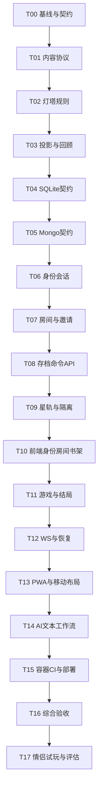

# 04 · 开发阶段与任务清单

> v0.2 设计提案 · 2026-10-26。本文是阶段路线与可验收工作包。T00基线已完成；T00.3迁移38个契约条目，执行因缺实现全部失败，产品未通过，验证状态见[交接记录](开发进度与交接.md)。编码前按相应工作包进一步细化提交，不把计划中的命令结果写成实际验证。

## 1. 如何执行

每个任务依次完成：核对输入与接口 → 写关键行为/失败测试 → 运行确认缺失行为 → 实现最小闭环 → 跑适当检查 → 更新文档和证据 → 讲解代码并停止。用户明确要求继续后，再进入依赖任务。先验证领域规则和数据库，再接 UI，最后完善 AI 表达与部署。

**用户学习检查点：一次只执行一个任务或已登记的子环节。** 较大任务先拆分，不把整个 M 阶段当作一个环节连续完成。完整规则见根目录 [AGENTS.md](../AGENTS.md)，实际进度见 [开发进度与交接](开发进度与交接.md)。

对内容与文档任务使用规则推演、引用检查和审阅，不为了流程而编写镜像测试。对授权、并发、恢复和角色隔离编写真实行为测试。

所有文件路径相对项目根目录 `F:\two-worlds-agent-game`，不是现有文件已存在的声明。任务中目录/文件是预计创建或修订的位置；已有材料位于 `outputs`，迁移必须保留来源说明。

## 2. 依赖图

这是推荐执行顺序，不要求所有未来工作由同一轮会话完成。Mongo 环境暂不可用时，可完成适配器与 SQLite 后推进后端，但 T05 真库验收必须保留未完成，M6 不得因此宣称完整通过。

## 3. M0：基线与需求对齐

### T00 · 整理工程与修订草稿契约

**目的：** 让后续开发只有一套有效接口、一处业务源码，避免按旧六步谜题重复实现。

**输入：** 本次文档集、`outputs/twoworlds/backend/tests/test_platform.py`、旧 pyproject 和本地参考仓库。

**文件：** 根 README；`backend/pyproject.toml`；`backend/tests/`；`docs/reports/environment.md`；`docs/reports/baseline-changes.md`；环境配置与忽略规则。

- [x] 只读检查现有改动、AGENTS.md、Git 状态、Python/Node、依赖工具、Docker/Mongo 与浏览器条件，逐项记录真实结果。见[T00.1环境报告](reports/environment.md)。
- [x] 核实参考仓库本地 HEAD：与历史SHA一致；另有未跟踪test/目录，保持原样。
- [x] 建立 `backend/src/twoworlds` 的包布局、独立虚拟环境与依赖锁，安装/构建/导入验证通过。见[T00.2.2报告](reports/backend-layout.md)。
- [x] 按当前契约修订旧测试，迁入backend/tests/contracts并保留[来源映射](reports/baseline-changes.md)；迁移不等于业务已通过。
- [x] 将旧测试中的长期 token 假设改为恢复密钥/短期会话；`value` 改为动作类型化的 `args`。
- [x] 将返回快照的旧假设改为 `receipt + save`；将“完成必为 version=6”改为当前剧本轨迹、阶段与结局断言；内部完整事实由T02/T09纯规则测试补齐。
- [x] 更正幂等命名空间：按 actor+request_id；同一人的同 ID 换内容必须拒绝，另一人相同 ID 仍独立执行规则。
- [x] 删去固定 `731/248/北极星/天琴座` 作为新玩法验收的要求，改用发现的真实线索文本检查跨角色泄露。
- [x] 明确当前阶段依赖锁定与命令入口；后续新增运行依赖随对应任务锁定验证，不擅自调用付费模型、部署云资源或复制素材。

**验收：** 能在干净环境识别包和收集已迁移测试；缺失实现的失败与依赖错误区分清楚。环境报告有结果与日期，旧材料没有被当成已通过测试。

**产出接口：** 唯一工程入口、动作/响应命名和后续测试的路径基线。

## 4. M1：先证明合作机制成立

### T01 · 内容版本、Schema 与加载

**文件：** `backend/src/twoworlds/content/schema.py`、`_references.py`、`loader.py`、`scripts/lighthouse/1.0.0.json`；`backend/tests/content/test_schema.py`、`test_loader.py`与`test_lighthouse_content.py`。

**输入/输出：** 读取 script_id+content_version，返回校验后的 ScriptVersion；公开目录只返回 ScriptMetadata。

- 学习拆分：T01.1、T01.2.1、T01.2.2已完成；T01.2.3本轮完成发布/纯Python目录/资源集成基础设施，新增45个检查，见[发布报告](reports/content-publication.md)。T01开发环节完成；灯塔缺真实媒体/授权，尚未正式发布，不代表完整游戏验收。
- [x] 定义场景、装置、线索、动作前置、效果与结局映射，按文档 02 校验静态引用完整性；见[T01.1报告](reports/content-schema.md)。
- [x] 写版本不存在、重复 ID、非法角色、悬空场景/线索、未声明原语的失败用例；T01.1+T01.2.1已覆盖静态校验与加载，实际原语执行器仍待T02。
- [x] 编写并按明确版本加载灯塔四场景正式内容；保持双角色前置、双向因果与共同结局声明，测试小样不作为正式剧本。
- [x] 发布快照/哈希与不可覆盖保护、纯Python公开目录、wheel/sdist实际清单与独立安装验证；成功资源集成使用临时测试素材，灯塔未发布（T01.2.3）。
- [x] ScriptMetadata不嵌入机关真值表或私人线索；目录只读已发布版本并验证完整性，文案需人工审核；HTTP接口仍待T08。
- [x] 定义presentation与版本化媒体声明、角色/场景/条件、字幕/替代文字和来源记录；检查声明引用完整。实际素材文件、授权有效性与播放未验证，随内容加载/制作任务继续。

**验收：** 合法内容可加载，非法内容在服务启动/内容加载时失败；内容不能执行任意 Python。

### T02 · 灯塔纯规则引擎

**文件：** `domain/models.py`、`errors.py`、`engine.py`、`mechanics/lighthouse.py`、`mechanics/common.py`；`tests/domain/test_lighthouse.py`。

**接口：** `apply_command(state, script, actor_role, action) → new_state + events` 或 DomainError；输入不被原地改写。

- [x] 按文档02写有效通关、全部光路组合、提前维修、无供电、错误角色、分歧/改投等123个纯领域测试；见[规则报告](reports/lighthouse-engine.md)。
- [x] 执行现有Schema前置/有限效果，实现观察、锁定、反向供电、维修、扫描、共同决策；原内容定义不变。
- [x] 冻结运行状态与嵌套值，失败/重复无变化不改状态或版本，正常配置可逆；覆盖后段拒绝与完整快照比较。
- [x] A单独9个/B单独4个可达世界均无法完成；双人54个可达世界的所有未完成状态均可到达两个结局。
- [x] 实际执行12步/16步纯Python通关与双向反馈；禁止文件/网络访问与Web/存储/AI依赖导入的测试通过。

2026-11-01：领域123通过、内容191通过；全量314通过、38个既有缺API/SQLite实现失败。T02完成待审查；不代表T03投影、真实身份/房间、持久化、媒体或完整游戏验收通过。

**验收：** 不是交换固定代码通关；所有必需角色动作与世界反馈均有测试。对应 QA-G01～G06。

### T03 · 角色投影、共享与完成回顾

**文件：** `domain/projection.py`、`domain/recap.py`；`tests/domain/test_projection.py`、`test_recap.py`。

**接口：** `project_save(save, script, role) → PlayerSnapshot`；回顾只从公共里程碑构造。

- [ ] 为同一完整状态分别生成 A/B 快照，验证未发现线索、对方私聊、谜底表与内部回执缺失。
- [ ] 分享只能公开本人已发现且可分享的 clue；分享后双方看到相同公开内容。
- [ ] 观察与可用动作由当前事实决定，避免前端自行判定前置。
- [ ] 公共事件截断后，结局回顾仍能从结构化里程碑恢复。
- [ ] HTTP、WS 和 AI 输入预留同一投影调用接口。
- [ ] 投影只返回当前角色/阶段可见的媒体引用，未公开线索不能通过图片、声音或完整资源清单泄露。

**验收：** 不需要前端隐藏字段来保护秘密；回顾没有私聊泄露。对应 QA-P01～P04。

## 5. M2：持久化、身份与后端闭环

### T04 · 仓储契约与 SQLite 演示

**文件：** `ports/repository.py`、`storage/sqlite.py`、`storage/serialization.py`；`tests/storage/test_repository_contract.py`。

**接口：** 按复合键唯一创建存档；读取完整 Save；`compare_and_swap` 原子保存完整文档；账户和邀请原子操作。

- [ ] 建立共享仓储行为测试：唯一建档、重开文件恢复、CAS 双提交、重复回执、历史上限。
- [ ] 使用 SQL 事务与版本过滤，同时提交状态和回执；失败必须回滚全部内容。
- [ ] 同一档并发只有一个基于旧版本的提交成功；不同档互不影响。
- [ ] 使用独立连接测试，避免只验证同一个内存对象。

**验收：** 文件重开可恢复；无进程锁替代数据库约束。SQLite 结果只标 SQLite 通过。

### T05 · Mongo 实现与真实数据库契约

**文件：** `storage/mongo.py`、`storage/indexes.py`；`tests/storage/test_mongo_contract.py`；本地 Mongo 测试配置。

**接口：** 与 T04 相同；Save 单文档 CAS，Account 单文档会话管理，Pair 单文档占位。

- [ ] 创建文档 03 的唯一/查询索引；重复建档捕获唯一冲突后返回原档。
- [ ] 同一 CAS 写入状态、版本和回执，不分成三次可部分成功的写入。
- [ ] 在真实 Mongo 上跑与 SQLite 共用的仓储契约。
- [ ] 用两个独立客户端/应用实例测试竞争提交与抢 B 位，证明不依赖单进程内存锁。
- [ ] 验证断开数据库时就绪失败、写入不伪造成功。

**验收：** 留下连接目标类型、运行命令、用例结果、索引确认和证据时间，敏感 URI 脱敏。无法运行真库时本项标未验证，不用 mock 代替。

### T06 · 身份、恢复、期限会话与登出

**文件：** `application/identity.py`、`api/auth.py`、`api/routers/accounts.py`、`api/routers/sessions.py`、`api/schemas/identity.py`；`tests/api/test_identity.py`。

- [ ] 先测仅凭 account_id/显示名不能登录；恢复密钥不等于日常 token；错误/过期/撤销 token 均拒绝。
- [ ] 创建身份与初始会话在 Account 文档中一次写入，明文密钥只出现于对应响应。
- [ ] 实现恢复、最新 5 个会话保留、显式过期校验和当前登出撤销。
- [ ] 添加创建/恢复限频、输入边界、no-store 与日志脱敏。
- [ ] 验证新设备恢复得到同一身份，而非新账户或新存档。

**验收：** QA-I01～I05；认证错误不输出凭证，不沿用参考仓库 player_id 认领逻辑。

### T07 · 双人房间与邀请

**文件：** `application/pairs.py`、`api/routers/pairs.py`、`api/schemas/pairs.py`；`tests/api/test_pairs.py`。

- [ ] 创建房间时固定 A，B 为空；高强度邀请仅保存摘要并设置有效期。
- [ ] 验证过期、刷新后旧凭证、自己占 B、第三人入满房、客户端强传角色等情况。
- [ ] 以数据库条件占用 B；相同成员重试返回房间。
- [ ] 用两个身份并发抢 B，最多一人成功；邀请刷新与加入竞争有唯一结果。
- [ ] 返回房间概要而不暴露邀请摘要/会话/恢复信息。

**验收：** QA-R01～R04；未满员只允许公开阅读，不允许改变游戏或调用 NPC。

### T08 · 独立存档、命令与回执 API

**文件：** `application/saves.py`、`api/app.py`、`api/routers/saves.py`、`api/schemas/commands.py`；`tests/api/test_commands.py`、`test_permissions.py`、`test_recovery.py`。

- [ ] 接通剧本目录、唯一建档、读档、本人存档列表和命令提交。
- [ ] 按“授权→已接受回执→版本→规则→CAS”执行；CAS 失败重读确认相同回执。
- [ ] 相同 actor 同 ID 换内容拒绝；原响应丢失后旧版本重试仍确认成功，返回当前投影。
- [ ] 实现本人回执查询；外人读/写/查询回执统一无权访问。
- [ ] 接通受保护媒体读取端点，复用会话/成员/角色/事实授权；白名单路径，返回no-store。
- [ ] 通过 HTTP 用两个身份完成灯塔，停止并重建服务，再恢复同档。
- [ ] 测命令 512 上限、先确认旧回执、容量错误不写入、普通阅读仍可用。

**验收：** 后端无 UI 可玩；所有 API 稳定错误码与角色投影一致。对应 QA-C01～C07、QA-S01～S03。

## 6. M3：第二机制与跨档隔离

### T09 · 星轨、内容复用与存档隔离

**文件：** `content/scripts/starline/1.0.0.json`、`domain/mechanics/starline.py`；`tests/domain/test_starline.py`、`tests/api/test_save_isolation.py`。

- [ ] 实现 5 单位预算、回声闸、声呐扫描、导轨安装、灯光信号和接车。
- [ ] 先测超预算整组不变、提前扫描/安装失败、错轨道、角色互换和两结局。
- [ ] 复用身份、仓储、投影、通用命令和共同选择，不复制一套 API。
- [ ] 灯塔推进后切星轨，回来确认世界状态、私聊和请求回执均独立。
- [ ] 更换公开最新内容版本时，旧档仍加载其原 script_version。

**验收：** QA-G07～G09、QA-S04～S05；两个不同机制都可以完整通关，不能以换密码模板交差。

## 7. M4：用户可玩的网页版本

### T10 · 前端身份、房间与剧本库

**文件：** `frontend/src/views/Identity.vue`、`Pair.vue`、`Library.vue`；`services/http.ts`；`stores/identity.ts`、`pairs.ts`；`types/api.ts`。

- [ ] 建立 Vue/TypeScript/Vite 项目与类型化 HTTP 客户端，采用文档 03 契约。
- [ ] 做创建、恢复、一次性密钥展示、会话到期、登出与房间选择。
- [ ] 邀请读取 fragment 后清理 URL；未登录时可在当前流程创建/恢复再加入。
- [ ] 书架展示两档独立进度、角色说明和可用入口。
- [ ] 加载、空状态、失败和重试都可见；不把 account_id 当认证凭证。

**验收：** 类型检查和生产构建通过；两独立浏览器可创建身份并进入同一房间。QA-U01～U02。

### T11 · 场景、装置、线索、决策与回顾

**文件：** `views/Game.vue`、`Ending.vue`；`components/Story.vue`、`SceneRenderer.vue`、`Device.vue`、`Clues.vue`、`Dialogue.vue`；`services/media.ts`、`audio.ts`、`cues.ts`；`stores/game.ts`；版本化媒体资源与清单。

按[视听设计](07-场景动效与音频设计.md)分成T11.1场景与装置动效、T11.2基础音频与字幕、T11.3因果演出集成；实际执行一次一个子环节，完成后停下来讲解。

- [ ] 根据个人快照渲染装置和允许动作，不在前端写完整谜题真值表。
- [ ] 两剧本的设备采用可复用控件，按角色显示对应操作。
- [ ] 展示合法试验后的观察变化、错误提示、可共享线索和合作目标。
- [ ] 两角色有实际场景插画和可交互物件；每剧本至少3处合作因果动效与1段可跳过关键演出，不能用纯文本替代。
- [ ] 接入每剧本的环境音、至少3类事件音效与至少1段带文字的短叙事音频；主动开启、音量、静音、跳过与重播可用。
- [ ] 依已确认快照与演出标识触发动画/音效，素材加载失败、静音与减少动态效果有可操作替代。
- [ ] 共同选择支持分歧与改选，结局回顾仅展示公开贡献。
- [ ] 初步通过页面完整玩完两剧本；此时可先手动刷新，下一任务接同步。

**验收：** 不需要开发者直接调用 API 代操作；没有只存在于截图中的假按钮。QA-U03、G01、G07、QA-M01～M07；素材引用与来源可核对。

### T12 · 实时连接、幂等与恢复

**文件：** `backend/src/twoworlds/realtime/subscriptions.py`、`protocol.py`、`api/routers/websocket.py`；`frontend/src/services/websocket.ts`、`pending.ts`；`components/SyncStatus.vue`；实时与 E2E 测试。

- [ ] WS 首帧认证、Origin、会话过期、成员权限、心跳与个人快照。
- [ ] 前端实现退避重连、前台恢复、HTTP 补偿、快照版本防回退。
- [ ] 请求未知时保留原 ID，普通机关待确认记录可在刷新后恢复；私聊正文不默认落本机磁盘。
- [ ] 切档递增连接 generation，迟到读响应和旧 WS 不覆盖新档。
- [ ] 制造响应丢失、断线、旧快照迟到、服务重启及两设备同账号竞争。
- [ ] 心跳/重复响应不重播一次性音效；首个恢复快照只恢复当前画面；切档和后台停止旧媒体，禁止串音。

**验收：** QA-W01～W07；自动化浏览器可完整复现恢复，失败不靠刷新后重新开档掩盖。

### T13 · PWA、移动端与无障碍

**文件：** `frontend/public/` 的 manifest/图标；PWA 配置；响应式样式；`e2e/mobile-layout.spec.ts`。

- [ ] 实现手机分区与桌面并列，按钮、软键盘、焦点与减少动态效果适配。
- [ ] 缓存公开静态外壳，明确排除 /api、认证、WS、用户快照与私聊。
- [ ] 离线仅显示可缓存外壳，禁用所有需要服务端确认的动作。
- [ ] 检查用户主动开启音频、浏览器拒播提示、字幕、静音、减少动态效果与后台恢复；受保护媒体不进入离线缓存。
- [ ] 先跑窄屏浏览器测试，再在可用 iPhone/Android 真机检查前后台和安装入口。

**验收：** QA-U04～U06；真机无条件时写“未验证”，不使用模拟器结果替代。

## 8. M5：AI 与未来能力边界

### T14 · LangGraph、Provider 与能力接口

**文件：** `ports/narrative.py`、`ports/voice.py`；`ai/graph.py`、`demo.py`、`provider.py`、`validation.py`；`application/dialogue.py`；`tests/ai/`；`api/routers/capabilities.py`。

- [ ] 先做默认示例模式与只接收 NarrativeContext 的 Provider 接口。
- [ ] 实现 LangGraph 的上下文整理、生成、输出验证节点，缓存无玩家状态的图实例。
- [ ] 用假 Provider 捕获输入，证明没有伙伴未公开线索、别档事实或全谜底。
- [ ] 实现超时、格式错误、并发上限、真实/示例/降级标记和调用计量。
- [ ] 模型生成期间不持数据库锁；版本过时只拒绝写入，不自动重新调用。
- [ ] 可配置真实 Provider；未明确授权真实付费调用时只用 mock/demo 验证。
- [ ] 语音 capability 为鉴权后的 disabled，接口命名为未来 LiveKit/ASR/TTS 留边界。
- [ ] 按架构文档14节版本化Prompt和离线样本，记录调用耗时、usage、降级与陈旧丢弃；不采私聊正文。
- [ ] 增加可选观测适配器，默认关闭外部追踪；验证不会自动上传Prompt原文，追踪故障不影响游戏。

**验收：** QA-A01～A07；无密钥可完整游玩，模型失败不破坏规则或存档；评估、追踪可在无第三方账号条件下禁用。

## 9. M6：工程交付与完整验证

### T15 · 容器、CI、配置与部署手册

**文件：** `deploy/`、`compose.yml`、`.env.example`、`.github/workflows/ci.yml`、`docs/RUNBOOK.md`、`docs/DEPLOYMENT.md`。

- [ ] 完整路径为 Vue 构建、FastAPI、真实 Mongo；演示路径显式设置 SQLite。
- [ ] 生产缺少 Mongo 则失败；Origin 精确配置，WSS Upgrade 和 HTTPS 设置可复现。
- [ ] CI 分别跑后端、前端、Mongo 契约与浏览器；缺关键环境的测试明确显示未执行。
- [ ] 区分 liveness/readiness；普通日志不含凭证、邀请或私聊正文。
- [ ] 写备份和恢复步骤，并用测试数据实际恢复验证；发布静态资源不含 work/谜底文件。

**验收：** QA-D01～D06；README 启动命令来源于实际验证后的 RUNBOOK，文档没有虚构公网地址。

### T16 · 两浏览器、真机记录与交付报告

**文件：** `e2e/`；`docs/reports/acceptance.md`、`mongo.md`、`devices.md`、`known-limitations.md`；可分享的截图与脱敏日志。

- [ ] 按文档 05 跑两剧本、两结局、权限、切档、失联和服务重启流程。
- [ ] 分开登记 SQLite、Mongo、桌面自动化和真机结果，保留命令与构建标识。
- [ ] 检查独立浏览器的网络响应，证明对方隐藏信息没有到达本机。
- [ ] 记录准确已实现与未实现功能、失败用例、环境限制及下一步。
- [ ] 达到对应验收等级后才给“可运行演示”或“完整首版验证”结论。

**验收：** 不存在未说明的核心失败或关键跳过；外部条件导致未验证的项影响交付等级，不能隐藏。

## 10. M7：验证产品价值

### T17 · 小范围情侣试玩

**文件：** `docs/reports/pilot-plan.md`、`pilot-results.md`；自愿参与的反馈表与汇总。

- [ ] 先邀请约 3 对试用排除阻断问题，再扩展到约 10 对；邀请和沟通由用户安排，系统不擅自发送消息。
- [ ] 测两人的必要操作、是否理解因果、卡住位置、通关时间及是否愿意玩第二个剧本。
- [ ] 区分搭档不可同时空闲与产品没有吸引力，不用单一“次日留存”替代判断。
- [ ] 记录真实推理调用量、基础设施和维护成本；付费意向与实际付费分开统计。
- [ ] 根据文档 06 的判断规则决定先改谜题、加内容还是开始商业准备。

**验收：** 有匿名汇总和具体问题；小样本不宣称盈利已验证。

## 11. 里程碑与交付物

| 里程碑 | 包含任务 | 可展示给用户的成果 | 不能宣称 |
| --- | --- | --- | --- |
| M0 | T00 | 清楚的基线与环境报告 | 产品已实现 |
| M1 | T01～T03 | 规则推演、双角色因果演示和测试 | 网页可用、Mongo通过 |
| M2 | T04～T08 | 两身份 HTTP 灯塔通关与恢复 | 所有真库测试已过，除非T05实际通过 |
| M3 | T09 | 两机制共用平台，切档不串档 | 完整前端体验 |
| M4 | T10～T13 | 双浏览器完整游玩、移动界面 | 真机已验证，除非有记录 |
| M5 | T14 | NPC 与模式标识，语音边界 | 未测试的真实模型或语音已可用 |
| M6 | T15～T16 | 可复现运行、证据与部署配置 | 公网上线、盈利、安全绝对保证 |
| M7 | T17 | 试玩结果与迭代决定 | 有稳定市场需求或确定收入 |

## 12. 范围变化的处理

新增剧本、语音、支付、多槽或长篇章节时，先增加需求编号和验收，不直接塞入当前任务。若改变回执、动作结构或权限，必须同步修正文档 01～05 和契约测试。

完成每个任务应留下：实际修改文件、行为变化、执行检查、失败/未验证事项和可评审的提交。当前工作区尚未确认 Git 可用，不把“已提交”写进任何阶段状态。

## 13. 需求到任务与验收的对应表

| 需求 | 主要开发任务 | 主要验收用例 |
| --- | --- | --- |
| FR-01 身份与恢复 | T06 | QA-I01～I03 |
| FR-02 会话与登出 | T06、T12 | QA-I04～I05、QA-W01 |
| FR-03 双人房间 | T07 | QA-R01～R04 |
| FR-04 剧本库 | T01、T09、T10 | QA-U02、QA-S01、QA-S04 |
| FR-05 非对称探索 | T02、T03、T09、T11 | QA-G02、QA-G05、QA-P01 |
| FR-06 因果联动 | T02、T09、T11 | QA-G01～G04、QA-G07～G09 |
| FR-07 共享线索 | T03、T08、T11 | QA-P02 |
| FR-08 共同选择 | T02、T09、T11 | QA-G05、QA-G07 |
| FR-09 独立存档 | T04、T05、T08、T09 | QA-S01、QA-S04～S05、QA-P04 |
| FR-10 保存与恢复 | T04、T05、T08、T12 | QA-C02～C05、QA-S02～S03、QA-W06 |
| FR-11 实时与异常 | T08、T12 | QA-W01～W07 |
| FR-12 NPC与AI | T03、T14 | QA-A01～A05、QA-A07、QA-P04 |
| FR-13 完成回顾 | T03、T11 | QA-P03、QA-U02 |
| FR-14 三端网页 | T10～T13、T16 | QA-U01～U06 |
| FR-15 能力与隐私 | T06、T14、T15 | QA-I01、QA-A02、QA-A06、QA-D03、QA-D06 |
| FR-16 运行交付 | T15、T16 | QA-D01～D06及全部核心用例 |
| FR-17 场景与动态反馈 | T01、T03、T08、T11.1、T11.3、T12、T13 | QA-M01～M03、QA-M05～M07 |
| FR-18 基础音频演出 | T01、T03、T08、T11.2、T11.3、T12、T13 | QA-M03～M07 |

表中区间表示包含两端的用例或任务，不代表这些用例已经执行。每次范围变化需同步更新本表。
