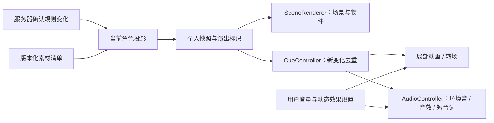

# 07 · 场景动效与音频设计

> 2026-10-26，v0.2视听需求增补。用户明确要求“不能完全是文字推动剧情进展，必要时要有动态的图片和音频”。本文规定待实现范围，本轮只更新设计，没有制作或接入实际素材。

## 1. 首版的体验标准

TwoWorlds 采用**可交互的场景插画 + 局部动画 + 环境音与事件音效 + 必要的短段叙事音频**。文字负责对白、说明和无障碍替代，关键世界变化必须也能在画面中观察。

画面需要参与操作与推理：旋转设备、改变光路、点亮电路、移动轨道等，不仅是在聊天框旁边摆一张循环GIF。所有动画与声音由服务器已确认的状态驱动，播放结束不决定机关是否成功。

### 方案取舍

| 方案 | 优点 | 成本 | 本次选择 |
| --- | --- | --- | --- |
| 场景插画分层 + CSS/SVG动画 + 网页音频 | 适合现有Vue、手机和短篇，状态容易映射 | 需要制作分层资源与动作反馈 | 首版采用 |
| Phaser等2D场景引擎 | 地图移动、复杂物件交互更强 | 增加引擎状态、加载和手机调试工作 | 有明确地图玩法时另评估 |
| 实时AI生成画面/视频与全对白语音 | 每次可能有不同表现 | 延迟、费用、一致性与审核难度增加 | 不放入首版关键路径 |

动态图片可以通过分层插画、图像状态切换、光效、粒子和物件运动实现，不要求每次调用图像/视频模型。本文不指定远程素材生成供应商；需要付费生成或上传文件时另遵守既有授权边界。

## 2. 首版素材与表现最低要求

每套剧本至少交付：

| 类型 | 最低可检查成果 |
| --- | --- |
| 角色场景 | A/B各一套主场景插画，场景内对象、明暗与状态随进展变化；不可全篇只有文字或灰色占位块 |
| 因果动效 | 至少3处与合作规则直接对应的可观察状态变化，包含A→B与B→A |
| 关键演出 | 至少1段场景转场或结局短演出，可跳过，并有静态最终状态 |
| 环境音 | 至少1套适合世界氛围的可循环环境音，进入有声模式后使用 |
| 事件音效 | 至少3类关键动作声音，例如装置、供电、接车；不能全部用同一提示音代替 |
| 叙事音频 | 至少1段开场、重要NPC台词或结局短音频，附完整文字，避免全程只靠阅读 |
| 操作与替代 | 静音、音量、字幕/文字提示、减少动态效果、素材加载失败后的可操作回退 |

数量是本次建议的验收下限，质量仍需试玩。开发中可用明确标记的占位素材验证流程；首版交付时关键演出需要实际可用素材，并有来源/许可记录。

叙事音频先使用审核过的预制片段，可以来自合法录制、可用授权资源或经批准的离线合成，不要求实时TTS。自由NPC文字问答仍按原有AI范围实现；玩家实时通话、语音提问ASR、任意回复TTS和实时语音主持仍属后续功能。

## 3. 《跨时灯塔》的画面与声音

| 合作节点 | A看到/操作 | B看到/操作 | 音频反馈 |
| --- | --- | --- | --- |
| 进入世界 | 旧灯塔、发射器与未通电时钟箱 | 风暴后的观测台、未来海面 | 可选开启风声/海浪；短开场叙事附文字 |
| 调节发射器 | 拖动或点按角度控件，齿轮与指针跟随已确认配置 | 光束落点随A角度改变；滤镜改变清晰度 | A本地机械声；B本地信号声，不广播私有提示 |
| 锁定信号 | 获得允许公开的联通提示 | 原先模糊光束变稳定，观测装置有明确反馈 | 锁定短音效，并有可读状态 |
| B向灯塔供电 | 时钟箱由暗到亮，维修热点开放 | 路由器与能量流变化 | 电路启动与机械恢复声 |
| A完成维修 | 齿轮恢复运转，装置显示修复完成 | 航道扫描从不可用变可用 | 齿轮运转/扫描确认，各自与可见事实一致 |
| 共同结局 | 按共同结局进入对应灯光与海面演出 | 展示本人视角的共同结果 | 引航音效与短结局音频，附字幕，可跳过 |

B的光束目标与私有观察不能作为共享动画配置下发给A。A看到自己的控制设置，B看到被授权的当前结果；两者可以有不同画面，也可以不同时间开始播放演出。

## 4. 《末班星轨》的画面与声音

| 合作节点 | 画面变化 | 音频反馈 |
| --- | --- | --- |
| 开回声闸 | A的闸门移动，B的声呐面板出现可扫描状态 | 闸门机械声，远处回声 |
| 分配功率 | B面板的能量条、电路、设备灯随已确认配置变化 | 引擎/声呐/灯光对应声音；关停时旧循环停止 |
| 扫描缺轨 | 扫描波与结果层出现，A获得对应安装热点 | 声呐短脉冲，同时提供文字或视觉读数 |
| 安装导轨 | A执行可点击安装，B看到线路从断开变接通 | 金属扣合与接通音效 |
| 接车 | 轨道指示与列车移动/门开启短演出 | 行车声、到站提示，配合可见字幕 |
| 共同结局 | 救援/归站各有确定的场景状态 | 环境音转场及短结局叙事音频 |

首版没有必须凭听力识别的隐藏答案；声呐和信号信息同时有授权后的视觉/文字表示。用户静音或使用减少动态效果时仍可完整通关。

## 5. 模块与数据如何连接

内容协议增加 `presentation` 与版本化素材清单；每项至少有asset_id、kind、content_version、所属角色/公开范围、可见场景/事实条件、文件路径、替代文字或音频文字、来源和许可记录。素材真实文件与声明必须匹配；发布前检查缺失引用。

个人快照只提供当前玩家可以接收的scene/visual_state、装置可视配置和可用media引用。单次演出以save_id + accepted_version + cue_id标识，并由当前打开的连接generation限定。音量、静音和减少动态效果是本机偏好，不写入共享存档。

### 私有素材访问

没有秘密的通用背景和环境音可放版本化静态目录。包含角色秘密、未公开线索或受阶段限制的画面/音频，不能放到所有人可下载的public包或完整预载清单里。

私有素材通过 `GET /api/saves/{id}/media/{asset_id}` 鉴权：服务器检查会话、成员、角色和当前事实，再读取白名单资源。客户端使用带Bearer的fetch获取Blob并创建本地object URL供图片/音频使用，响应no-store；登出、切档或失去访问时撤销URL并清理引用。不能把文件路径参数直接拼接成任意磁盘读取。

后续采用对象存储或短期签名URL时，要另验证授权范围、过期和缓存；首版不靠“文件名难猜”保护秘密。媒体路由与NPC、WS使用相同成员边界。

T08.3已接通上述后端接口：每次请求重新鉴权，从project_save的当前background/cues资源引用生成白名单，复用PublicationStore按绑定版本读字节；public素材也不豁免场景、素材条件或cue条件。响应no-store、nosniff，不提供公开静态路径/签名URL；本轮忽略Range与条件请求，鉴权后完整返回200。后端不能撤回已合法下载的字节，客户端Blob清理和Service Worker排除仍由后续前端实现。

目前正式发布库仍为空，28项灯塔资源/许可问题保持原状。[媒体接口报告](reports/protected-media.md)中的临时PNG/WAV只用于后端授权测试，不代表声音已可听、图片已制作、正式许可已审核或手机播放已通过。

## 6. 同步和重连规则

1. 玩家点击后可显示按下/等待反馈，但机关成功动画、真实场景变化和成功音效只在服务器确认后触发。
2. 相同快照、心跳或同请求重试不能重复播放一次性声音和结局演出。
3. 首次进入/重连根据最新状态恢复正确画面和当前环境音，不重放全部历史演出；允许用户主动重看已完成的公开演出。
4. 切档、登出和页面隐藏时停止旧场景音频与动画；回来后先拉最新状态，再恢复。静音/音量偏好保持，避免多个环境音叠加。
5. 两人的事实与因果保持一致，不要求两设备音频采样级同步；慢设备可以跳过转场直接呈现最终状态。
6. 动画完成、音频播放结束、素材下载成功都不能作为权威解锁或完成条件；缺少媒体时给替代提示，不伪造已保存。

## 7. 播放、无障碍与加载

首次进入由用户主动选择“开启声音”或“静音进入”；浏览器拒绝播放时显示点击播放入口。至少提供主音量、静音和环境音/效果音分组，短叙事片段可跳过和重播。

关键台词有字幕，重要提示有文字/图形替代；减少动态效果时用静态状态、简单显隐替代连续运动。首版避免强闪烁和必须精确拖动/同时点击的操作，热点支持键盘和触控。

只预载当前场景必需且已授权的资源，其余按需加载。加载中有状态，失败可重试；装饰媒体失败时规则操作仍可继续并提供替代描述。若某个视觉状态是当前推理必需信息，则先显示对应授权的替代观察，再允许操作，避免变成盲猜。

素材和用户数据的缓存策略分开：公开静态外壳/无秘密资源按版本缓存；认证API、快照、私聊与受保护媒体不进入Service Worker持久缓存。具体格式、体积和内存预算在真实素材和手机测试时测量，不虚构性能通过结论。

## 8. 内容制作与开发环节

| 环节 | 交付 | 对应任务 |
| --- | --- | --- |
| 分镜与状态表 | 两角色各自的场景、关键变化、声音与替代文本 | T01内容协议，剧本内容制作 |
| 素材清单与授权 | 版本、可见性、资源引用、来源/许可 | T01/T03 |
| 服务端投影与读取 | 当前可见媒体描述、受保护媒体接口 | T03/T08 |
| 场景组件 | 图片分层、热点、装置动画与转场 | T11.1 |
| 音频组件 | 开启声音、环境音、事件音效、短台词和字幕 | T11.2 |
| 因果演出集成 | 根据确认事件触发、重复去重、重连恢复 | T11.3/T12 |
| 手机与缓存检查 | 触控、软键盘、减少动态、后台、加载失败 | T13/T16 |

T11仍是前端游戏大任务，实际执行按AGENTS拆成这些子环节，完成一个就停下来讲解。此处只提前规定范围，不表示现在开始制作前端或素材。

## 9. 首版验收出口

FR-17（场景与动态反馈）和FR-18（基础音频演出）为首版必需。QA-M01～M07覆盖实际媒体、因果、权限、音频控制、重复去重、无障碍与来源清单。

没有实际场景画面、关键操作只改文本、音频全为假按钮，均不能算首版完整交付。实时通话和在线语音生成未实现不影响此基础视听层，但基础视听层必须真实可用。
