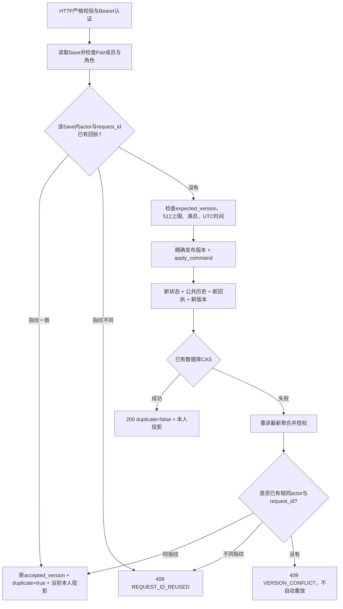

# T08.2 · 游戏命令、CAS与幂等回执

日期：2026-11-15。基线为PR #18合并提交`eb38e045ffcf9f42162bc69063796a409a348e53`，分支`codex/t08-2-command-receipts`。工作在`F:/two-worlds-agent-game/work/pr-t01-1-schema`独立工作树；主目录用户未提交修改保留。

## 本轮计划与边界

按附件只做T08.2：严格命令输入、确定性请求指纹、已授权命令/CAS编排、本人回执查询、HTTP双人通关及双适配器并发/恢复测试。采用test-driven-development与verification-before-completion；没有委派子代理。

复用IdentityService、Pair成员关系、SaveService、PublicationStore、apply_command、append_public_history、project_save及两仓储已有compare_and_swap_save。没有修改规则、GameState、存档Schema、数据库表/索引、Repository接口或既有CAS实现，没有新依赖。

不执行T08.3媒体、T09星轨、前端、动画、WS、PWA、NPC、语音或部署；无付费模型调用。正式灯塔仍未发布，真实媒体/许可未补齐；所有游戏集成测试使用临时封存的正式JSON副本和明确标识的测试PNG/WAV。

## PR #19审查：幂等域的契约依据

完整键是`save_id + actor_id + request_id`，每个Save内部以`actor_id + request_id`查询和校验唯一性；这是存档级幂等，不是账号级/全局UUID唯一。不同存档的同账号/UUID可分别接受不同合法命令。同一存档同actor同ID换kind、args或原expected_version仍409；不同actor在同档用同UUID也分别记录。

依据不是本轮新测试倒推：PR #19前的合并基线eb38e04已有[跨剧本/房间存档契约](../../backend/tests/contracts/test_platform.py)，明确写出actor+save+request_id并允许跨档重用；原SaveRecord只在各Save内检查actor/request唯一，原Repository.get_receipt也需要save_id。AGENTS存档隔离条款和单Save整档CAS与此一致。原actor+request_id简写省略了存档作用域，本轮在AGENTS、API契约、验收、README和报告中补齐，不改变产品语义或持久化行为。

现有单Save CAS保证完整命名空间内的状态/回执原子性。本轮不建立全局唯一键，不引入跨存档事务/全局登记，也不使用扫描其他存档再写当前存档的竞态方案。若未来产品要求账号全局唯一，必须先独立规定跨存档重放/冲突及两适配器的原子方案，不能通过改几处查询暗中迁移语义。

原78项测试保留。强化同账号跨存档同UUID为不同合法载荷，并用两独立应用/Repository并发重试；核对两个完整SaveRecord、版本、公共历史、连续回执、actor和指纹均一致。同档改参、不同actor同UUID、同档并发CAS和关闭重开后的网络重试也增加数据库断言；不仅检查HTTP返回。

## 两个接口

| 接口 | 输入/输出 | 权限 |
| --- | --- | --- |
| POST /api/saves/{id}/commands | {request_id,expected_version,kind,args} → {receipt,save} | 有效Bearer、所属Pair成员、服务器推导A/B |
| GET /api/saves/{id}/receipts/{request_id} | {accepted:false} 或 {accepted:true,request_id,accepted_version} | 有效Bearer、成员且仅查询当前actor的回执 |

GameCommand定义在application/commands.py，HTTP schemas/commands.py直接复用，避免HTTP与业务层两套校验。UUID正规化，expected_version为严格非负整数（bool/float/字符串拒绝），kind为Identifier，args必须是有限JSON对象；额外role/account_id/state/completed等字段拒绝。具体机关参数仍由内容Schema和原规则引擎检查，路由不重写玩法。

命令响应receipt仅request_id/status/accepted_version/duplicate；save仍为PlayerSnapshot加id/pair_id。回执查询不发送指纹、命令正文、演员身份或其他玩家信息。所有成功/失败响应no-store，401/404/422等沿用统一安全error结构。

CommandError：VERSION_CONFLICT、REQUEST_ID_REUSED、SAVE_COMMAND_LIMIT为409；PAIR_NOT_READY和玩家规则拒绝为422，均retryable=false，避免客户端盲目重放业务动作。版本冲突需先读新快照，由用户确认后生成新请求。存储故障仍503 DEPENDENCY_UNAVAILABLE；剧本/存档损坏保持原SaveError处理，时钟早于当前Save.updated_at或Pair.updated_at返回503 CLOCK_ERROR。

## 完整调用链



SaveService._receipt从同一次聚合读取中的receipts查找，避免“新回执配旧状态”的跨次查询问题。_duplicate只确认原接受版本，并投影当前读到的Save；例如A的v0请求在v1成功，B再推进至v2，A原样重试仍accepted_version=1，但返回save.version=2。

指纹为SHA-256(规范JSON)，包含原expected_version/kind/args，固定sort_keys、紧凑分隔符、UTF-8、禁止NaN/Infinity；不使用Python hash()。request_id是查找键，不放进内容指纹；actor与save为外部隔离域。对象字段顺序不同不改变指纹；同一Save同actor的同ID换原版本、kind或args都拒绝。业务边界重新验证GameCommand，防止model_copy/construct跳过字段约束。

新命令只执行一次纯规则，按规则已经生成的state.version构建完整SaveRecord，同时追加公共历史与唯一回执，保留旧回执和对话。提交前构造并校验个人投影；没有把原始私人事件或完整state返回客户端。一个compare_and_swap_save提交整个聚合，不先写状态再写回执，也不重复增加版本。

SQLite使用原事务和UPDATE版本条件；Mongo使用原单文档replace版本条件。两个独立实例基于同一旧版本写入，只能一个成功；CAS失败后只查询胜者结果，不自动把败者动作套用到新世界。

容量先识别旧回执，再检查版本和512上限。512条均保留，原请求可重复确认、读档和回执查询可用；新命令409 SAVE_COMMAND_LIMIT，不执行规则、不写数据库。完成后的旧成功也可确认，新动作仍由规则拒绝改结局。

## 真实测试方法与首轮证据

修改前全量835项=804 passed /31 failed /0 errors /0 skipped，所有旧失败因创建请求缺script_version。首个新测试一度缺sqlite fixture（测试装配错误），补齐后实际1 failed，原因是命令端点404；红灯证据确认后实现。首轮HTTP命令60 passed；补充指纹/512上限/同ID不同内容竞争/响应失败专项18 passed。最终913项=904 passed /9 failed /0 errors /0 skipped；新增78项全部通过，无新增失败ID，原31项失败中22项转通过。聚焦78项首次为74通过/4失败：加强后的因果测试在clear滤镜下错误期待落点可辨；检查原观察规则后，保持变化断言，先通过HTTP设置amber，再验证观测山→内湾航道，4项两适配器/两结局复验通过。没有修改领域规则或放宽断言。

API fixture对SQLite/Mongo参数化。CommitBarrier仅在两套独立Repository真正CAS前对齐，不替代数据库、不伪造成功：不同请求竞争为200+409，只有一条回执；相同请求为200+200且duplicate一真一假；同actor/ID不同合法args也只接受一份，另一方409 REQUEST_ID_REUSED。

完整两结局通过真实HTTP执行：双角色探索、A调光改变B观察、B供电改变A观察、分享、维修、确认、分歧与改票、共同结局和公共回顾。检查A/B响应字节、伙伴未公开线索、装置与观察的投影边界。关闭TestClient/Repository后新建实例，通过恢复密钥恢复身份，再查回执并原样重试，不重复执行。

512测试先使用真实灯塔规则产生512次合法状态变化，再构建完整连续回执聚合写入真实数据库，不用Mock伪造容量；通过HTTP验证旧确认、新拒绝、普通读档及actor隔离。它不是声称512步全部通过HTTP写入。

响应丢失注入代理先调用真实CAS成功，再抛RepositoryError：HTTP返回安全503而非假成功；新Repository/应用原样重试查到唯一已提交回执。代理只模拟提交后的响应失败，不作为数据库回滚的证明；原仓储事务/故障测试仍执行。

已有Mongo容器保持原配置和数据卷，不下载/替换容器；每例只用随机测试库。SQLite文件与发布快照位于C盘随机临时目录。没有修改生产数据库、没有真实模型调用。

## 旧契约适配与剩余功能

仅改contracts/support.py的save辅助方法，显式提交测试发布版本1.0.0；contracts/conftest.py注入模块内只读的真实测试PublicationStore，复用tests/save_support.py提取的make_publications，不发布到正式包。原test_commands.py与test_platform.py的业务断言不改，没有删除、skip或xfail。

旧契约独立运行38项=29 passed /9 failed，原31失败中22转通过。剩余6项在starline创建返回404 SCRIPT_NOT_FOUND（T09）；2项在WebSocket握手发生WebSocketDisconnect（T12）；1项NPC talk为422 UNKNOWN_ACTION（T14）。后续阶段保留失败，不补假实现。QA-R04的命令入口满员守卫也覆盖未满员talk拒绝，但不代表NPC对话已实现。

## 学习与复现

阅读application/commands.py的GameCommand/fingerprint → application/saves.py的submit_command/_duplicate/get_receipt → api/routers/saves.py → tests/api/test_commands.py的CommitBarrier、完整通关和恢复测试 → storage/sqlite.py或mongo.py原compare_and_swap_save。

从实际工作树运行，Mongo URI设置为自己的可用本地真库；每次basetemp使用新随机路径：

```powershell
$env:MONGO_URI='mongodb://127.0.0.1:27017/?directConnection=true'
$env:TWOWORLDS_TEST_BACKEND='sqlite'
$commandTemp=Join-Path 'C:/Users/30704/AppData/Local/Temp' ('twoworlds-t082-'+[guid]::NewGuid().ToString('N'))
.\backend\.venv\Scripts\python.exe -m pytest backend/tests/application/test_commands.py backend/tests/api/test_commands.py -q -p no:cacheprovider --basetemp=$commandTemp
# 观察一次真实双身份通关；去掉sqlite过滤可同时运行真Mongo
.\backend\.venv\Scripts\python.exe -m pytest backend/tests/api/test_commands.py -k 'full_lighthouse and sqlite' -q
.\backend\.venv\Scripts\python.exe -m pytest backend/tests/contracts -q
.\backend\.venv\Scripts\python.exe -m pytest backend/tests -q
.\backend\.venv\Scripts\ruff.exe check backend/src backend/tests backend/hatch_build.py
.\backend\.venv\Scripts\ruff.exe format --check backend/src backend/tests backend/hatch_build.py
uv lock --check --offline --project backend --cache-dir F:/two-worlds-agent-game/work/uv-cache
```

可在完整通关测试逐步观察：两个账号注册并入同Pair → 选择测试发布的精确版本创建Save → command(save,kind,args)生成UUID及当前版本 → POST命令 → 用响应save作为下一步版本。重试必须保留原request_id、原expected_version及原内容；查询receipt不能把accepted=false误解为其他在途提交绝不会完成。当前没有独立TCP/公开演示地址，不需要前端或付费模型即可通过TestClient学习真实HTTP流程。

应用重开验证不等于独立进程/Mongo服务重启或生产备份验收。正式内容仍缺媒体许可，不宣称完整产品上线可玩。交付后停止等待用户审查，不开始T08.3。


## T08.2原交付验证结果

| 检查 | 实际结果 |
| --- | --- |
| 新命令应用/指纹测试 | 12 passed |
| 新命令HTTP（SQLite/Mongo各33） | 66 passed，来自最终完整回归 |
| SQLite共享契约+专项 | 44 passed（32+12） |
| 真Mongo共享契约+专项 | 50 passed（32+18） |
| 原命令契约 | 13 passed |
| 全部原契约 | 29 passed /9 failed |
| PR #18合并基线 | 835项：804 passed /31 failed |
| 最终完整后端 | 913项：904 passed /9 failed /0 errors /0 skipped |
| Ruff check / format --check | 通过，84文件 |
| uv lock --check --offline | 通过，24包，无依赖变更 |

原交付完整回归429.40秒，退出码1，1条既有anyio弃用告警。API214、application100、content191、domain308、storage62、contracts38；专项互有覆盖，不相加作总量。最终全量含新增78项全部通过（不是把早前74/4聚焦结果误称全绿）。

JUnit证据保留在忽略目录work/t082-baseline.xml、t082-first.xml、t082-more.xml、t082-focused.xml、t082-endings.xml、t082-contracts.xml、t082-storage-sqlite.xml、t082-storage-mongo.xml、t082-all.xml。基线/新失败ID逐项比对：新增0、消失22，剩余9项位置见下表；没有删除旧断言、skip或xfail。未执行到的星轨/WS/NPC断言不能标通过。

### 31项原失败逐项比较

| 原失败ID | PR #18合并基线 | T08.2最终结果/实际阻塞 |
| --- | --- | --- |
| `tests.contracts.test_commands::test_invalid_command_does_not_change_save_or_create_receipt[bad-id]` | support.py:102，建档422 INVALID_INPUT | 通过；原业务断言已执行 |
| `tests.contracts.test_commands::test_invalid_command_does_not_change_save_or_create_receipt[boolean]` | support.py:102，建档422 INVALID_INPUT | 通过；原业务断言已执行 |
| `tests.contracts.test_commands::test_invalid_command_does_not_change_save_or_create_receipt[client-role]` | support.py:102，建档422 INVALID_INPUT | 通过；原业务断言已执行 |
| `tests.contracts.test_commands::test_invalid_command_does_not_change_save_or_create_receipt[extra-arg]` | support.py:102，建档422 INVALID_INPUT | 通过；原业务断言已执行 |
| `tests.contracts.test_commands::test_invalid_command_does_not_change_save_or_create_receipt[legacy-value]` | support.py:102，建档422 INVALID_INPUT | 通过；原业务断言已执行 |
| `tests.contracts.test_commands::test_invalid_command_does_not_change_save_or_create_receipt[negative]` | support.py:102，建档422 INVALID_INPUT | 通过；原业务断言已执行 |
| `tests.contracts.test_commands::test_old_version_retry_confirms_receipt_and_returns_current_snapshot` | support.py:102，建档422 INVALID_INPUT | 通过；原业务断言已执行 |
| `tests.contracts.test_commands::test_same_actor_cannot_reuse_id_with_changed_payload[args]` | support.py:102，建档422 INVALID_INPUT | 通过；原业务断言已执行 |
| `tests.contracts.test_commands::test_same_actor_cannot_reuse_id_with_changed_payload[kind]` | support.py:102，建档422 INVALID_INPUT | 通过；原业务断言已执行 |
| `tests.contracts.test_commands::test_same_actor_cannot_reuse_id_with_changed_payload[original-version]` | support.py:102，建档422 INVALID_INPUT | 通过；原业务断言已执行 |
| `tests.contracts.test_commands::test_same_request_id_is_independent_for_other_actor` | support.py:102，建档422 INVALID_INPUT | 通过；原业务断言已执行 |
| `tests.contracts.test_commands::test_two_application_instances_compete_on_one_database[different]` | support.py:102，建档422 INVALID_INPUT | 通过；原业务断言已执行 |
| `tests.contracts.test_commands::test_two_application_instances_compete_on_one_database[identical]` | support.py:102，建档422 INVALID_INPUT | 通过；原业务断言已执行 |
| `tests.contracts.test_platform::test_demo_npc_is_private_and_cannot_change_game_facts` | support.py:102，建档422 INVALID_INPUT | T14：test_platform.py:357，talk返回422 UNKNOWN_ACTION |
| `tests.contracts.test_platform::test_invalid_role_or_prerequisite_changes_neither_projection[early-dispatch]` | support.py:102，建档422 INVALID_INPUT | T09：support.py:102，starline创建404 SCRIPT_NOT_FOUND |
| `tests.contracts.test_platform::test_invalid_role_or_prerequisite_changes_neither_projection[unpowered-repair]` | support.py:102，建档422 INVALID_INPUT | 通过；原业务断言已执行 |
| `tests.contracts.test_platform::test_invalid_role_or_prerequisite_changes_neither_projection[unscanned-rail]` | support.py:102，建档422 INVALID_INPUT | T09：support.py:102，starline创建404 SCRIPT_NOT_FOUND |
| `tests.contracts.test_platform::test_invalid_role_or_prerequisite_changes_neither_projection[wrong-role]` | support.py:102，建档422 INVALID_INPUT | 通过；原业务断言已执行 |
| `tests.contracts.test_platform::test_lighthouse_requires_both_roles_and_agreed_ending[guide_now]` | support.py:102，建档422 INVALID_INPUT | 通过；原业务断言已执行 |
| `tests.contracts.test_platform::test_lighthouse_requires_both_roles_and_agreed_ending[wait_tide]` | support.py:102，建档422 INVALID_INPUT | 通过；原业务断言已执行 |
| `tests.contracts.test_platform::test_only_discovered_owner_can_share_the_designated_clue_text` | support.py:102，建档422 INVALID_INPUT | 通过；原业务断言已执行 |
| `tests.contracts.test_platform::test_outsider_websocket_never_receives_a_snapshot` | support.py:102，建档422 INVALID_INPUT | T12：test_platform.py:305或333，WS握手WebSocketDisconnect |
| `tests.contracts.test_platform::test_power_budget_rejects_the_entire_allocation` | support.py:102，建档422 INVALID_INPUT | T09：support.py:102，starline创建404 SCRIPT_NOT_FOUND |
| `tests.contracts.test_platform::test_private_projection_and_forbidden_access` | support.py:102，建档422 INVALID_INPUT | 通过；原业务断言已执行 |
| `tests.contracts.test_platform::test_restart_restores_identity_save_and_receipt` | support.py:102，建档422 INVALID_INPUT | 通过；原业务断言已执行 |
| `tests.contracts.test_platform::test_scripts_and_pairs_have_independent_saves_and_receipts` | support.py:102，建档422 INVALID_INPUT | T09：support.py:102，starline创建404 SCRIPT_NOT_FOUND |
| `tests.contracts.test_platform::test_starline_has_a_distinct_cooperative_solution[rescue_detour]` | support.py:102，建档422 INVALID_INPUT | T09：support.py:102，starline创建404 SCRIPT_NOT_FOUND |
| `tests.contracts.test_platform::test_starline_has_a_distinct_cooperative_solution[return_station]` | support.py:102，建档422 INVALID_INPUT | T09：support.py:102，starline创建404 SCRIPT_NOT_FOUND |
| `tests.contracts.test_platform::test_unfilled_room_allows_reading_but_no_game_or_npc_write[game-command]` | support.py:102，建档422 INVALID_INPUT | 通过；原业务断言已执行 |
| `tests.contracts.test_platform::test_unfilled_room_allows_reading_but_no_game_or_npc_write[npc]` | support.py:102，建档422 INVALID_INPUT | 通过；原业务断言已执行 |
| `tests.contracts.test_platform::test_websocket_uses_auth_frame_and_personal_projection_on_reconnect` | support.py:102，建档422 INVALID_INPUT | T12：test_platform.py:305或333，WS握手WebSocketDisconnect |


## 修改文件清单

- `backend/README.md`
- `backend/src/twoworlds/api/errors.py`
- `backend/src/twoworlds/api/routers/saves.py`
- `backend/src/twoworlds/api/schemas/commands.py`
- `backend/src/twoworlds/application/commands.py`
- `backend/src/twoworlds/application/saves.py`
- `backend/tests/api/test_commands.py`
- `backend/tests/application/test_commands.py`
- `backend/tests/contracts/conftest.py`
- `backend/tests/contracts/support.py`
- `backend/tests/save_support.py`
- `docs/03-技术架构与数据接口.md`
- `docs/04-开发阶段与任务清单.md`
- `docs/05-测试验收与交付标准.md`
- `docs/reports/commands-receipts.md`
- `docs/开发进度与交接.md`


## GitHub交付与检查点

实现提交`f8e33b16090d59b6c4cbd1bbf71d08d150c90c15`已推送`codex/t08-2-command-receipts`，创建[PR #19](https://github.com/ajsjsjjbshshsj/two-worlds-agent-game/pull/19)，目标`codex/bootstrap`。16个文件已检查，无新增凭证、数据库、临时资源或私人配置；原规则/仓储/原业务断言不变。收尾只更新交接与PR链接，业务代码测试结果不变。未合并或开启自动合并，当前停止，等待用户学习/审查，不开始T08.3。


## PR #19审查修复记录

修复前，检查点表头误带第三列，旧数据行仍显示PR #18待审查。本轮以固定两列表重新构造当前区块，明确PR #18已合并eb38e04、当前PR #19待审查未合并及分支。历史日志保留，并标注其为当时快照；学习总览中已核实的PR #9合并状态同步更新。

本轮仅统一存档级幂等表述、强化现有数据库测试并修复交接。生产方法只修改说明文字，无运行逻辑、Schema、表/索引、规则或后续功能变更。本轮实际复验结果如下；这些都是本地结果，不是GitHub Actions通过声明。


### 本次审查修复的实际复验

| 检查 | 结果 |
| --- | --- |
| 强化幂等/重试/CAS/重开专项 | 16 passed（独立筛选） |
| 原T08.2新增命令测试 | 78 passed（12应用、66 HTTP；用例数未变） |
| SQLite真实共享契约及专项 | 44 passed |
| MongoDB真实共享契约及专项 | 50 passed |
| 完整后端 | 913项：904 passed /9 failed /0 errors /0 skipped |
| Ruff check / format --check | 通过，84文件 |
| uv lock --check --offline | 通过，24包，无依赖变更 |
| 交接Markdown | 当前检查点严格2列；全文件3个表格列数一致，原34个历史章节保留 |

全量484.37秒，退出码1，1条原anyio弃用告警。与修复前原交付work/t082-all.xml逐项比较：913项用例ID完全一致、9项失败ID及failure.message完全一致，新增失败0，消失失败0。剩余6项T09星轨404 SCRIPT_NOT_FOUND、2项T12 WS握手WebSocketDisconnect、1项T14 NPC的422 UNKNOWN_ACTION；本轮不扩展到这些功能。原78项均在最终全量再次通过，未删除、skip、xfail或降低断言。

本轮JUnit：work/pr19-review-scope.xml、pr19-review-focused.xml、pr19-review-storage-sqlite.xml、pr19-review-storage-mongo.xml、pr19-review-all.xml，均为忽略的本地证据，不上传临时数据库/资源。真实Mongo使用原有本地服务，测试随机库由原fixture独立清理；没有Mock代替数据库。

复验使用Python3.12环境，实际命令目标如下；每次--basetemp设置为C盘新建随机twoworlds-pr19-*目录，MONGO_URI指向可用本地真库：

```powershell
.\backend\.venv\Scripts\python.exe -m pytest backend/tests/api/test_commands.py -k 'same_uuid or precedes_version or changed_payload or compete_at_real or closed_app' -q
.\backend\.venv\Scripts\python.exe -m pytest backend/tests/application/test_commands.py backend/tests/api/test_commands.py -q
$env:TWOWORLDS_TEST_BACKEND='sqlite'
.\backend\.venv\Scripts\python.exe -m pytest backend/tests/storage/test_repository_contract.py backend/tests/storage/test_sqlite.py -q
$env:TWOWORLDS_TEST_BACKEND='mongo'
.\backend\.venv\Scripts\python.exe -m pytest backend/tests/storage/test_repository_contract.py backend/tests/storage/test_mongo_contract.py -q
$env:TWOWORLDS_TEST_BACKEND='sqlite'
.\backend\.venv\Scripts\python.exe -m pytest backend/tests -q
```

生产方法只修改注释/模块说明。移除模块文档后的Python AST与修复前完全相同；类型约束由原命令模型/HTTP测试复验，未新增类型检查依赖。没有Schema、索引、事务、规则或后续阶段业务变更。本轮交付原PR #19供用户再次审查，提交SHA以PR最新HEAD为准；禁止合并与自动进入T08.3。


### 本轮审查修复文件清单（10个）

- `AGENTS.md`
- `backend/README.md`
- `backend/src/twoworlds/application/commands.py`
- `backend/src/twoworlds/application/saves.py`
- `backend/tests/api/test_commands.py`
- `docs/03-技术架构与数据接口.md`
- `docs/04-开发阶段与任务清单.md`
- `docs/05-测试验收与交付标准.md`
- `docs/reports/commands-receipts.md`
- `docs/开发进度与交接.md`
