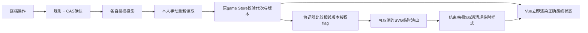

# T11.3.1 · 确认状态驱动的因果演出触发与去重

日期：2026-11-17。本轮只做可复用协调器和两个跨角色SVG原型，不完成整个T11.3，不进入T11.3.2/T12。

## 基线与范围

开始时工作区干净，先执行git fetch origin。远端codex/bootstrap的HEAD为`c31aa9e0043e72712de47d7cefc15541223731e9`，提交标题为Merge pull request #27，两个父提交为acca4ed与97a994b；验证该合并提交为目标分支祖先。从此最新基线创建`codex/t11-3-1-causal-performance`，没有使用过时T11.2分支继续开发，也没有创建worktree。分支开始前本地/远端均不存在同名任务分支。GitHub API读取PR状态被网络策略Forbidden拒绝，合并状态由实际Git合并提交、父提交及用户提供SHA共同核实，不能声称API查询成功。

阅读AGENTS、交接、04/05/07与T11.1/T11.2报告后确认：现有后端project_visuals已经给灯塔A提供clock_powered、给星轨B提供echo_available，且屏蔽伙伴原始设备。新增演出不需要新规则、事件日志或后端字段。本轮backend、AudioManager/audio-assets、game Store、GameSnapshot类型、依赖与锁文件均未修改；不引入后端存档迁移。

## 代码阅读顺序

1. `frontend/src/services/causal-performance.ts`：只读取确认的个人快照，保存范围标识、版本、场景和两个授权boolean作为上次基线；负责触发、取消、去重、生命周期与失败状态。
2. `frontend/src/services/performance-animation.ts`：原生Web Animations API播放器，只控制SVG临时样式，原地清理所有Animation，绝不提交样式或游戏状态。
3. `frontend/src/components/game/SceneRenderer.vue`：nextTick后取得当前SVG目标，传入AbortSignal；监听快照、凭证、减少动态偏好、隐藏/pagehide与卸载。媒体加载仍使用T11.1的独立generation和取消逻辑。
4. `LighthouseScene.vue`：电路路径加归一化pathLength和动画目标，时钟外圈提供通电反馈；确认后的金色电路仍由visual.clock_powered直接渲染。
5. `StarlineScene.vue`：声呐静态就绪灯和授权状态圆环，另外三条默认隐藏的扩散波。声呐置于右侧，避免原型列车挡住波纹；动画结束仍保持静态就绪画面。
6. `tests/causal-performance.spec.ts`、`performance-scene.spec.ts`、`performance-fixture.ts`：协调器契约、DOM/原生动画接口、异步请求与音频独立性测试。

没有给Game.vue继续堆音频/动画逻辑，没有重做AudioManager或改变身份/命令管线。

## 从确认事实到画面



两个示例使用同一份服务器存档版本，双方只收到各自个人投影：

- 灯塔：在repair阶段，B成功将能源路由至tower；A手动读取相邻新版本，clock_powered明确false→true，触发clock-power-on。电路描边约1000ms从暗到亮，时钟外圈约1100ms由暗至亮再回稳。没有读取或猜测B的power_router/power_target。B也不会借此获取A私有设备。
- 星轨：B已按既有规则配好声呐电源，A成功将回声闸打开；B手动读取相邻新版本，echo_available明确false→true，触发echo-ready。声呐就绪灯亮起，三条波纹约1200ms逐渐扩散（140ms错开）。是否具备扫描条件完全由后端flag决定，前端不复制回声闸/功率谜题真值表，不向B下发A的echo_gate/gate_position。

这些是授权结果的短演出，不要求两设备同一时刻播放，不表示实时同步；搭档必须手动读取。当前按角色/剧本/阶段限制两个案例，不按observations中文文本或未授权设备推断。

## 去重与生命周期

- 范围为save_id、pair_id、script_id、script_version、role，凭证变化也重置。单次键包含此范围、snapshot.version（该已确认存档的接受版本）、演出id及页面generation。Token只在私有内存中用于生命周期比较，不写入键、DOM或日志。
- 首次读取仅建立基线，哪怕当前flag已经true也不重播。只在相邻新版本、同一场景、受支持视角、明确boolean false→true时播放。undefined、truthy字符串、另一角色的装置和文案均不能触发。
- 相同版本（含重复回执/重读）直接忽略，不重启也不中断正在播放的当前演出；较旧版本忽略。跨越两个或更多版本时取消旧演出并建立最新基线，直接显示最终状态，不推测中间因果或补播历史。
- 每个较新快照取消旧临时演出；切档、角色、剧本/版本、凭证变化、离页/卸载、后台或减少动态偏好均取消。暂停动态时建立新生命周期，回来后的第一次快照仍是基线，不补播离开时发生的一次操作。
- 协调器捕获generation和独立AbortController；播放器在nextTick之后先检查signal，finished/reject迟到只可能影响原请求，不能修改新页面状态。HTTP旧请求的丢弃继续由既有game Store的generation/readNumber/版本校验承担，新集成测试证明旧响应不能回退画面或覆盖新演出。
- native Animation全部fill:none，不调用commitStyles。结束、取消、部分目标启动失败、API不可用均取消所有已经启动的轨道，清除反馈；Vue静态属性从一开始就是已确认状态。动画完成没有命令提交/规则解锁/存档写入能力。图片与动画失败分别提示，不阻断操作。

## 与T11.2音频协调

演出协调器不导入AudioManager，不调用声音播放，不生成或重放audio_events。设备操作声音仍由PR #27的CAS成功响应、接受版本和授权Cue驱动，普通clock_powered/echo_available变化不能制造操作SFX。两个控制器可独立失败：关闭声音仍有动画；减少动态时保留静态确认结果；已有字幕、按钮和文字观察保持可用。新增测试覆盖“已启用音频且存在授权power_switch，但只有echo_available变化时不fetch操作音效”。原214项前端（含T11.2操作音频/生命周期测试）完整保留。

## 实际验证

环境：Linux，Node24.22.1，系统Chromium156.0.8078.79；浏览器验证工具沿用本机Playwright1.58.2（不加入项目依赖）。

| 检查 | 结果 |
| --- | --- |
| 前端完整测试 | 251通过、0失败/跳过；原214项不改，新增37（协调器19+场景集成18） |
| typecheck | 通过 |
| build | 通过，88 modules |
| format:check | 通过 |
| git diff --check | 通过 |
| 真实SQLite/TCP双角色浏览器 | UI实际提交B供电与A开闸，本人手动读取后分别启动2/4条原生动画；检查结束后的静态状态、重复读取、首次恢复、版本跳跃和减少动态均通过 |
| 权限/声音/小屏 | A投影无power_router/power_target，B投影无echo_gate/gate_position；声音关闭且0音频响应时两演出正常；390px无横向溢出，0页面异常 |
| 后端/Mongo回归 | 本轮未修改后端，无新增后端专项或Mongo验证；不将T11.2旧结果算作本轮新证据 |
| Safari/iOS/Android真机 | 未执行 |

前端目录执行：

```bash
npm run typecheck
npm run test:unit
npm run build
npm run format:check
# 只学习本轮机制：
npm run test:unit -- tests/causal-performance.spec.ts tests/performance-scene.spec.ts
```

37项覆盖：初次true基线、两合法视角触发、同版本去重、跳版本直达、存档/角色/剧本/版本/凭证/场景切换、过期快照、旧完成/拒绝回调、generation隔离、减少动态/后台恢复、失败不改快照/不禁用行动、权限隔离、中文/伙伴设备不可推断、图片失败与音频关闭、音频启用但无授权操作事件时不补播、部分Animation失败清理、已取消生命周期不启动、HTTP旧读迟到丢弃。

浏览器的真实测试库通过已有tests.save_support创建在`work/t11-3-1-browser`隔离目录，初始粗糙不透明PNG占位会挡住SVG时钟，因此修正为原创程序合成透明PNG后重新验证截图与真实动画。没有修改正式素材或测试源码契约，正式发布库仍为空；本轮不声称正式媒体分层/版权/听感已验收。实际辅助命令为`backend/.venv/bin/python work/t11-3-1-browser/server.py sqlite`与`node work/t11-3-1-browser/check.cjs`，本地Vite5187连接临时API8017。临时脚本、测试库、截图不进入PR。截图`/tmp/t1131-lighthouse.png`与`/tmp/t1131-starline.png`仅为本实例检查资料，不承诺新任务保留。

## 如何自己观察原型

单元/DOM测试无需正式内容发布；按上面的两文件专项运行，先读fixture的假想授权flag，再看协调器与场景断言。

若希望使用本轮一样的真实页面，在当前Linux环境可显式启动一个**隔离TEST-ONLY SQLite演示服务**。下面脚本可临时存到backend/work下运行（不要提交测试资源），需先按后端README安装依赖。在backend目录运行等价脚本：

```python
from pathlib import Path
from tempfile import TemporaryDirectory
import binascii, struct, zlib
import uvicorn
from tests.save_support import make_publications
from twoworlds.api.app import create_app
from twoworlds.content import loader
from twoworlds.storage.sqlite import SQLiteRepository

def chunk(kind, data):
    return struct.pack('>I', len(data)) + kind + data + struct.pack('>I', binascii.crc32(kind + data))
transparent = (b'\x89PNG\r\n\x1a\n'
    + chunk(b'IHDR', struct.pack('>IIBBBBB', 1, 1, 8, 6, 0, 0, 0))
    + chunk(b'IDAT', zlib.compress(b'\x00\x00\x00\x00\x00')) + chunk(b'IEND', b''))
with TemporaryDirectory(prefix='twoworlds-t1131-') as directory:
    root = Path(directory)
    store, publish = make_publications(root)
    source = loader.ScriptLoader(Path(loader.__file__).parent / 'scripts')
    for story in ('lighthouse', 'starline'):
        script = source.load(story, '1.0.0')
        publish(identifier=story, media={m.id: transparent for m in script.media if m.kind == 'image'})
    app = create_app(repository=SQLiteRepository(root / 'demo.sqlite3'),
        publication_store=store, allowed_origins=('http://127.0.0.1:5187',), rate_limit=200)
    uvicorn.run(app, host='127.0.0.1', port=8017, access_log=False)
```

另在frontend目录使用`VITE_API_BASE_URL=http://127.0.0.1:8017 npm run dev -- --port 5187 --strictPort`，通过两个独立浏览器上下文正常创建身份、邀请加入同房。保持声音关闭即可观察：

每次换另一角色提交前，先重新读取当前快照避免版本冲突。观察者先读基线，再让搭档只提交一次，随后观察者再读。

- 灯塔先完成维护记录/海图、发射器90/pulse、amber滤镜、锁定信号进入repair。A先重新读取看到未供电；B选择tower提交供电；A再手动读取，只跨一个接受版本，观察电路与时钟箱反馈。重复读取不重播，刷新只显示已通电结果。
- 星轨双方先发现station_log/power_board，B开启sonar且关闭engine并读取基线，A重新读取当前版本后将闸门改east，B再手动读取。观察三道扩散波；减少动态时直接显示就绪。若两次读取之间还有其他操作使版本跳跃，按设计不播放，最终画面仍正确。

以上临时库用于原型观察，关闭后可丢弃，不能当作正式出版。正常开发入口仍应保持正式空目录，不自动发布测试内容。

## 限制与下一环节

仅两个短反馈案例；不是完整T11.3，不包含全部合作节点、复杂转场、可跳过关键剧情、正式美术/音频/许可、逐句字幕、WS或持久化事件补送。新演出依赖原生Web Animations；不支持或播放失败时用静态结果回退。正式不透明媒体/分层替换仍需独立视觉验收。Safari/iOS/Android实机、人工听感/观感质量未验收。当前不标完整QA-M01～M07通过。

建议下一环节为T11.3.2扩展其余合作节点与关键演出设计，范围需人工审查后明确授权。本轮结束后停止，不自动执行。

PR与提交状态将在交接表记录；GitHub API当前Forbidden，提交分支成功不等于PR已创建。
