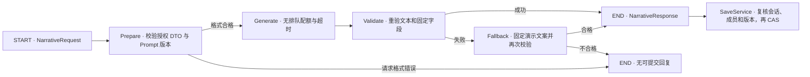

# T14.2 · LangGraph NPC 文本工作流

基线为已合并 PR #44 的 `codex/bootstrap@335ee44`。使用 Python 3.12、Pydantic 2.14.1 和正式版 LangGraph 1.2.24。运行入口保留 `ai_mode="demo"`。SQLite 与 MongoDB 使用同一应用流程。工作流调用本地 Demo，测试通过 Python 注入 FakeProvider。真实模型调用次数为零。

## 节点与输入输出

| 节点 | 输入 | 输出 |
| --- | --- | --- |
| Prepare | 已由应用构造的 `NarrativeRequest` | 重验后的授权 DTO 与 `prompt_version="1.0"`。格式错误终止。 |
| Generate | 本轮请求与进程内 Provider 配额 | 原始回复或固定失败类别，以及启动次数。 |
| Validate | 原始回复与请求版本 | 新建的 `NarrativeResponse` 或无效输出标记。 |
| Fallback | 原始请求的版本与失败类别 | 复用批准的 `DEMO_ANSWER`，标明 `mode="fallback"`，经过同一验证器。验证失败终止。 |

[StateGraph 官方 API](https://docs.langchain.com/oss/python/langgraph/graph-api)

Prepare 只沿用 T14.1 的白名单。内容包括本角色可见线索、设备、可见的公开信息、本角色最近 20 轮私聊和公开人设。应用服务把投影字段明确复制到 DTO。完整存档、原始剧本、内部规则、搭档未公开信息、会话凭证与仓储始终在图之外。编译图每个服务实例复用，每次调用创建独立状态，未配置缓存或 Checkpointer。私人历史仍只持久化在 `SaveRecord`。

输出经过严格 Pydantic 校验。去除首尾空白后文本须为 1–2000 字符且可编码为 UTF-8。模式和 Provider 标识须与服务端配置一致，版本须与请求一致。usage 可以留空。提供时只接受 `input_tokens`、`output_tokens`、`total_tokens` 对应的非负整数，拒绝布尔值和隐式转换。附加命令、规则更新、伪造授权字段以及自报错误或超时元数据会被拒绝。现成的响应对象也会从属性重验。结构校验只证明格式与权限边界，真实模型回复的语义和防泄露质量需另行评估。

## 超时、降级和日志

- 默认生成超时 2 秒，每个服务实例最多 4 个运行中的 Provider。可通过 `create_app(narrative_limits=NarrativeLimits(...))` 配置，范围为大于 0 且不超过 30 秒、1–16 个并发。配额耗尽会立即进入固定降级，无任务队列。
- 一个守护线程执行一次 Provider 调用。请求超时后直接进入降级，线程本身可能仍在执行，由它继续占用配额，直到退出才释放。迟到结果只会完成已经没人等待的本地 Future。异常、超时、容量不足和无效输出均只进入一次降级。降级自身失败返回 `503 NARRATIVE_UNAVAILABLE`。
- 日志使用项目的标准 Python logger `twoworlds.ai.graph` 的 INFO 级。记录随机 trace ID、Prompt 版本、配置模式、起止时间和耗时、调用次数、降级标记、固定错误类别、已提供的 usage 以及提交结果（含 `stale`）。缺失 usage 记录 `unknown`。日志不包含题目、回答、Prompt 原文、凭据或底层异常。出站追踪显式禁用，即使运行环境开启 LangSmith 追踪。LangSmith 是 LangGraph 传递依赖，此处仅使用其关闭追踪的开关。

## 真实数据库并发与命令边界

SQLite 的读事务在仓储方法返回时关闭，MongoDB 的该次读取在调用返回时结束。LangGraph 在这些读取之后运行，收到的只有授权 DTO。生成后 HTTP 层重新验证原 Cookie，应用层重新读取存档、成员、角色、版本与回执，最后沿用 SQLite 条件 UPDATE 或 MongoDB 条件替换。一次 CAS 提交会一起保存游戏状态、公共历史水位、本人对话和回执。对话不产生公共事件，已完成存档仍只读。

实际测试在两种真库各自打开两套应用和仓储连接。A 从第 0 版提交 `talk`，可控 Provider 开始后停在 Event。B 在 A 仍暂停时成功检查航道图，把存档推进到第 1 版。放行 A 后，正常文本和降级文本均收到 `409 VERSION_CONFLICT`。读取 A 的原 UUID 返回 `accepted:false`，完整数据库聚合等于 B 提交时的聚合。A 重新读取第 1 版时没有私聊、看不到 B 的私人航道图。B 仍能看到线索。Provider 调用次数始终为 1。另一个测试在 A 已通过版本复查且生成降级后，于实际 CAS 前让 B 先提交，确认 A 的真实仓储 CAS 返回 false。会话撤销用真实登出接口触发，A 返回 401，存档保持原样。

已成功 UUID 先查回执，直接返回已有成功，参数变化返回 `REQUEST_ID_REUSED`。同一服务实例对同存档、同账号、同 UUID 记录在途指纹，相同包络在尚无回执时快速返回 `503 NARRATIVE_IN_PROGRESS`，客户端可查询原回执。两个不同 UUID 在同版本竞争时只允许一条私聊落档。在途去重为进程内机制，跨进程共享的权威仍是数据库 CAS 和回执。分布式生成去重留待网关阶段。

## 实际验证

- `uv sync --locked --group dev`、`uv lock --check`、`uv lock --check --offline`、`uv run --locked ruff check .`、`uv run --locked ruff format --check .`、`git diff --check` 通过。
- `uv run --locked pytest tests/ai/ -v` 通过 48 项。32 项图级测试验证 Demo、输出、降级、超时、容量与日志。16 项真实 HTTP/数据库测试在 SQLite、MongoDB 7.0.48 各通过 8 项。
- `uv run --locked pytest tests/api/test_narrative_isolation.py -v` 通过 88 项，`uv run --locked pytest tests/api/test_dialogue.py -v` 通过 27 项。`uv run --locked pytest -ra --tb=short` 的实测统计见任务 PR。指定 MongoDB 测试使用隔离容器及随机数据库。

## 阅读顺序与限制

1. [授权 DTO 与接口](../../backend/src/twoworlds/ports/narrative.py) 与 [LangGraph 节点](../../backend/src/twoworlds/ai/graph.py)。
2. [输出校验](../../backend/src/twoworlds/ai/validation.py) 和 [固定降级](../../backend/src/twoworlds/ai/fallback.py)。
3. [SaveService 的复查和 CAS](../../backend/src/twoworlds/application/saves.py)。
4. [真库并发测试](../../backend/tests/ai/test_graph_persistence.py) 与 [T14.1 授权隔离测试](../../backend/tests/api/test_narrative_isolation.py)。

FakeProvider 验证工作流和边界。真实模型的内容质量、服务商调用与计费、生产峰值压力、跨进程生成去重和语音均尚未验收。T14.3 建议从有明确授权的单一网关开始，单独验证传输超时与请求取消、实际 usage、费用上限及提示泄露评估。对话生成与提交仍遵守现有角色与 CAS 边界。
