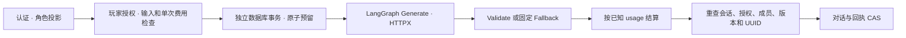

# T14.3 · 真实模型网关、外部授权与预算

从已合并 PR #45 的 `codex/bootstrap@f26bbe7` 开始。默认 `demo`，无需 API Key。本轮全部模型响应来自本地 HTTPX MockTransport，真实服务商调用为零。

## 启用与授权

后端从进程环境读取配置，使用根目录 [环境变量模板](../../.env.example)。管理员以 `TWOWORLDS_AI_MODE=provider` 明确启用唯一支持的 `openai_compatible` 适配器。生产地址必须为 HTTPS。缺少地址、模型、密钥、单价或限额，以及配置不合法时，启动失败。默认 Demo 模式忽略供应商设置。API Key 只由后端读取，前端只看见目标站点、模型和当前授权状态。

在“我的账号”打开“外部 AI 隐私设置”，阅读目标站点、模型及会发送的提问、场景、可见线索、设备和本角色近期对话后，再点击同意。通过 Cookie 认证的 `GET/POST /api/narrative_consent` 使用既有来源检查和账户 CAS。授权与账号绑定，覆盖该账号的存档，双方独立授权。应用将告知版本、服务端点、模型与 Prompt 版本绑定为披露摘要，变更后重新请求同意。撤回后后续请求使用本地 Demo。已经发送的第三方请求无法召回，且若撤回发生在结果保存前，该外部回复会被拒绝落档。

| 环境变量后缀（前缀 `TWOWORLDS_AI_`） | 内容 |
| --- | --- |
| `MODE`、`PROVIDER` | 默认 `demo`，启用时用 `provider` 与 `openai_compatible` |
| `BASE_URL`、`MODEL`、`API_KEY` | 服务端 HTTPS API 前缀、模型标识、服务端密钥。适配器追加 `/chat/completions` |
| `TIMEOUT_SECONDS` | 默认 2 秒，最多 10 秒，作为 HTTP 整体截止时间 |
| `MAX_INPUT_TOKENS`、`MAX_OUTPUT_TOKENS` | 输入上限和输出上限。超过输入界限拒绝整次调用，不截断授权线索 |
| `MAX_REQUEST_COST_USD`、`DAILY_BUDGET_USD`、`MAX_DAILY_CALLS` | 单次上限、同一数据库 UTC 日全局 USD 上限、调用次数上限（默认 200） |
| `PRICE_VERSION`、`INPUT_USD_PER_MILLION`、`OUTPUT_USD_PER_MILLION` | 价格版本和分别以 USD/百万 token 配置的输入、输出单价 |

配置模板不载入应用，部署时把值注入后端进程环境。真实连通前应核对服务商数据保留政策、模型名和上下文限额、计量口径、单价和服务商账户预算，再单独取得凭证和费用授权。

## 请求、验证与降级

Chat Completions 使用 JSON `model`、`max_tokens` 与两条消息。版本 `1.0` 的系统 Prompt 独立维护。用户消息只序列化 T14.1 的可见上下文，问题和历史都视为不可信文本。请求没有工具或函数。角色投影决定对方未公开线索、设备和私聊不能进入请求。存档、内部命令回执和会话凭据也留在应用层。测试检查 Prompt 注入不能添加授权字段或改变游戏事实。

HTTPX 设置 connect、read、write、pool 各自的限额，异步整体截止时间也约束缓慢分块响应。LangGraph 等待比 HTTP 截止时间多 250 ms。异步流限 64 KiB。禁用环境代理、重定向和自动重试。401、403、408、429、5xx 和网络失败映射到固定类别。非法 JSON、空文本、超长响应、错误结构或非法 usage 走已有 Validate/Fallback 或明确拒绝路径；服务商原始错误不进对外响应和应用日志。默认使用 LangGraph 的 4 个外部并发槽。超时后若底层协作取消尚未完成，外层仍按 T14.2 保留槽位直至其退出。

## 预算与实际 usage

输入预检采用请求的 UTF-8 字节长度加 256 的保守聊天封装余量，再与配置阈值比较。这是一项拒绝策略，具体服务商的 tokenizer 和额外计费规则尚待验证。这项上限估计从不作为真实 token 用量。

费用单位是整数微美元。用 Decimal 将输入、输出分别乘配置的百万 token 单价，合计向上取整。每次调用预留配置的输入和输出上限对应的最坏金额，必须满足单次和 UTC 日限额及调用次数。SQLite 使用条件 UPDATE、MongoDB 使用按版本条件替换，各自以唯一日主键原子建档。对同一存档、操作者和 UUID，日内共享预留键拦截不同进程的重复派发。所有游戏存档 CAS 与预算事务独立。

只按服务商响应中经校验的 `prompt_tokens`、`completion_tokens`、`total_tokens` 结算，拒绝负数、布尔值、未知字段和总量不一致。缺失、超时或失败后的未知 usage 保留原预留。若已拿到可信 usage 又因输出不能保存，费用仍结算。可证明未派发的容量不足等情形释放预留。服务商若报告超配置用量，记录实际成本并拒绝存档；应用无法约束服务商的违规记账。结算存储失效返回受控错误，保守预留保持，游戏成功回执不会生成。日志记录随机 trace ID、Provider、模型、Prompt、价格版本、真实提供的 usage、金额、耗时和失败分类，无题目、回复、线索、密钥及原始错误响应。未知金额或 usage 明确保持未知。应用有效预算以同一数据库和一致的 UTC 日为范围。

## 实际验证示例

A 在账号设置同意后提交问题，服务校验 Cookie、房间成员、A/B 投影及当前披露。使用测试定价 USD 0.5/百万输入、USD 2/百万输出，输入、输出上限 4096/128，先在真库预留 2,304 微美元，随后只进行一次 Mock HTTP 调用。收到输入 17、输出 3、总量 20，按配置结算 15 微美元；输出经校验，复查存档版本后用原 CAS 保存 A 私聊及回执。B 无法看到该私聊、未授权的 B 提问也继续使用本地 Demo。两种数据库均测试并发抢最后一个预算名额，以及未提供 usage 保留整笔预留。同 UUID 已成功时复用回执。同一 UTC 日内在途请求跨应用只派发一次。B 若在外部生成期间推进存档，A 的调用仍结算，但不会落档。结算错误和生成期间撤回授权同样无成功回执。

## 复验与阅读

- `uv sync --locked --group dev`，`uv run --locked pytest tests/ai/ -v`，随后运行授权隔离、对话及全量 pytest。MongoDB 需提供 CI 同类真实实例和 `MONGO_URI`。本地 Mock HTTP 不需要模型服务配置或真实密钥。
- 阅读顺序为 [配置](../../backend/src/twoworlds/ai/providers/config.py) → [传输适配器](../../backend/src/twoworlds/ai/providers/openai_compatible.py) → [授权与预算](../../backend/src/twoworlds/application/narrative_gateway.py) → [保存复查](../../backend/src/twoworlds/application/saves.py) → [真实数据库与 Mock HTTP 验证](../../backend/tests/ai/test_narrative_gateway.py)。本地与 GitHub 的最终测试统计记录于任务 PR。

**真实服务商连通性和真实费用尚未验证。** 真实 token 口径、系统解析器长延迟、服务商容量、语义质量和长期生产账务对账也待后续验收。T14.4 首先适合建立版本化的离线隐私、事实一致性与提示注入评估样本，并使用零外部费用的固定数据运行。
